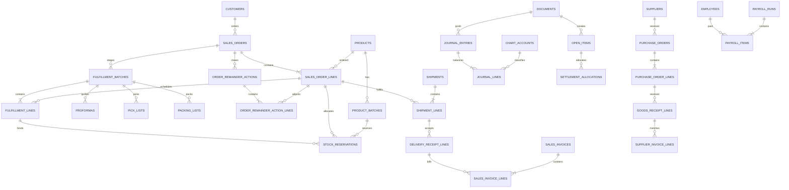

# Database — model relasional

## Detail SO dan uang muka — Bagian 2, 26 Oktober 2026

SalesOrderAdvance menyimpan companyId, salesOrderId, amount numeric(24,8), currency, receivedAt, bankAccountId, bankReference, evidenceId, state PENDING_VERIFICATION/VERIFIED/REJECTED, pencatat/waktu, verifier/waktu, rejectionReason, customerReceiptId unik, version dan idempotencyKey unik per perusahaan. CustomerReceipt.salesOrderId nullable mempertahankan asal uang muka; fulfillmentBatchId diisi saat dana PREPAY diikat. Tidak mengubah nominal posted receipt. Dua migration mencatat pemberian izin baru kepada pemegang kemampuan sumber.

## Model kepala SO — 25 Oktober 2026

Migration 20261025100000_sales_order_header_fields menambah sales_orders.order_date (date), payment_term_code, salesperson_id, warehouse_id serta sales_order_lines.warehouse_id. Tanggal lama diisi dari created_at pada zona perusahaan dan salesperson dari created_by_id; gudang/termin lama tetap NULL. FK gudang memakai company_id + warehouse_id; pilihan salesperson memerlukan membership aktif pada command. Indeks company_id/order_date mendukung daftar. Command selalu menentukan tanggal perusahaan; default SQL CURRENT_DATE hanya kompatibilitas insert lama.

Migration 20261025110000_sales_order_policy_defaults menyediakan OPS-FLX-10..13 secara idempoten dengan audit sistem tanpa mengganti policy yang ada. Status tampilan tidak disimpan: SQL per baris dan helper Decimal menghitung fakta POD/pengiriman/penutupan. Tidak ada saldo atau posted ledger yang dimigrasikan; pemulihan memakai forward-fix.

## Dampak keputusan 24 Oktober 2026 — rancangan

Mengikuti [desain arah fleksibel](../superpowers/specs/2026-10-24-erp-fleksibel-design.md). Bentuk final tabel ditetapkan pada rencana implementasi dan mengikuti pola policy bertanggal efektif, audit dan outbox:

- **Struktur organisasi:** departemen, jabatan dan karyawan dengan `manager_employee_id`; `user_id` pada karyawan opsional dan unik. Siklus atasan ditolak constraint/validasi.
- **Mesin persetujuan umum:** registri jenis dokumen, aturan berversi per jenis (kondisi, tahap berurutan, sumber pemberi persetujuan: atasan langsung/atasan N tingkat/kepala departemen/orang/peran, cukup satu/semua), instance pengajuan yang menautkan dokumen sumber dan versinya, serta keputusan per tahap dengan pelaksana sebenarnya. Data unlock/exception SO lama dimigrasikan ke struktur ini.
- **Penjualan:** daftar termin; termin snapshot pada SO dan invoice; mode kredit perusahaan; pilihan ongkir pada SO/proforma/invoice (ditanggung perusahaan atau dibebankan ke pelanggan, posisi sebelum/sesudah PPN) beserta akun konfigurasi. TOP/limit pada kebijakan pelanggan menjadi nullable.
- **Nilai bawaan:** baris konfigurasi bawaan (penomoran per jenis, termin, mode kredit, ongkir, format angka) dibuat idempotent saat perusahaan disiapkan. Implementasi tahap 2 memakai `system_policies`/`policy_versions` (`OPS-FLX-01..08`) dan `document_number_rules`; data sumber di `packages/database/src/data/`.
- **Riwayat migration:** `verify_win_lost` dipindah ke `20260930115000` agar berjalan setelah tabel yang diubahnya; `20261024100000_restore_line_relation_columns` menambah kolom `uomId`/`prospectNeedId` yang sudah ada di schema. Database baru kini dapat dibangun dari migration.

## Submenu Akun dan migrasi master — 16 Oktober 2026

Migrasi 20261017030000_account_workspace menambah finance_accounts.category_label, description, parent_id (FK), account_type (HEADER/DETAIL), normal_balance (DEBIT/CREDIT), psak118_category dan version. Kelompok tetap ASSET/LIABILITY/EQUITY/REVENUE/EXPENSE; kategori sumber disimpan terpisah. Nama tidak unik, kode unik per perusahaan. Induk opsional (akun akar); parent harus Header sekelompok dan bebas siklus. Tidak ada kolom nominal saldo. Migrasi data lokal membuat versi posting profile/revisi pajak dan audit; jurnal/snapshot lama utuh.

### Penyempurnaan master pajak — 16 Oktober 2026

Migrasi `20261017020000_operational_tax_usage` menambah `operational_taxes.usage` dengan nilai SALES/PURCHASE/BOTH, default BOTH untuk kompatibilitas master dan klien lama. Snapshot revisi/transaksi baru membawa usage. Revisi lama tanpa usage ditafsirkan BOTH; histori posted tidak ditulis ulang.

## Pembaruan pajak operasional — 16 Oktober 2026

Migrasi `20261017010000_operational_tax_master`: `operational_taxes`, `operational_tax_revisions`, `operational_tax_invoices`, serta `supplier_invoices.tax_snapshot`. Master menyimpan percentage numeric(12,8), account_id, kind/effect, precision/rounding, active, version/effective_from. Unik nama/perusahaan; revisi unik tax/version; dokumen unik perusahaan/arah/sumber serta perusahaan/arah/pihak/nomor. Invoice metadata menyimpan evidence_id, document_date dan versi. Identitas sumber polimorfik divalidasi server dalam transaksi dan lock perusahaan. Referensi lama dipertahankan; tidak ada konversi otomatis rule lama menjadi master baru karena akun harus dipilih secara eksplisit.

## Implementasi proforma manual — 7 Oktober 2026

Menggunakan `fulfillment_documents` yang sudah tersedia: original kind PROFORMA,
revisi PROFORMA_REVISION dengan identitas unik turunan sumber dan dokumen sebelumnya.
Snapshot baru menyimpan `source_version`, `supersedes_id`, referensi allocation/baris SO,
harga/pajak/qty/satuan, termin, header dan total. Versi sumber mengikat isi transaksi;
perubahan nama master tidak menulis ulang atau membatalkan snapshot dokumen terbit.
Status validitas merupakan read projection dari tahap, sumber dan dokumen terakhir.
Lock customer → tahap → stok menjaga penerbitan dan perubahan alokasi; nomor dan audit
berada dalam transaksi command. Tidak ada perubahan schema/tabel transaksi untuk
fitur ini. Migration hanya mendaftarkan capability `proforma.issue` tanpa grant otomatis.

Rancangan logis untuk PostgreSQL. Ini belum migration SQL yang dapat dijalankan. Nama tabel/kolom adalah kontrak awal; schema final mengikuti keputusan bisnis dan implementasi. Semua FK menggunakan UUID; tidak memakai nama pelanggan/kode produk sebagai FK.

Nama tabel dan kolom di dokumen ini adalah nama teknis untuk implementasi. Bila sebuah field muncul di layar, laporan, ekspor, atau pesan error, pasangan **label pengguna**, **arti bisnis**, dan **satuan/format** wajib dicatat mengikuti [Kamus Label Manusia dan Bahasa Layar](07-design.md). Jangan menyalin nama kolom seperti `value_type`, `over_receipt_tolerance`, `effective_from`, atau `posted_at` sebagai label pengguna.

ORM yang dipilih adalah Prisma pada backend NestJS/worker. Gunakan mapping `Decimal` ke `@db.Decimal(precision, scale)` dan `Prisma.Decimal` untuk perhitungan; API tetap mengirim string desimal. PostgreSQL menjadi satu sumber data untuk web Next.js dan aplikasi mobile Nuxt/Vue. Redis/BullMQ hanya menangani antrean; kedua frontend tidak mengakses Prisma atau database langsung. Constraint, trigger dan lock yang memerlukan SQL khusus tetap dikelola dalam migration teruji.

## 1. Standar data

| Data | Tipe / aturan |
|---|---|
| PK | UUID; dibuat server |
| Nilai uang baris/jurnal | numeric(20,2); currency_code char(3); API mengirim string desimal |
| Harga unit, biaya unit | numeric(24,8); pembulatan ke total baris/jurnal menggunakan aturan bertanggal efektif |
| Qty | numeric(20,6); > 0 pada baris bisnis; arah ledger berupa qty_delta |
| Faktor UOM / kurs | numeric(24,10), > 0; simpan snapshot pada transaksi |
| Persentase | numeric(12,8), simpan fraksi 0.25 untuk 25%; validasi rentang per jenis |
| Tanggal bisnis | date; timestamp audit timestamptz UTC; timezone perusahaan untuk tampilan/cut-off |
| Metadata | jsonb hanya untuk snapshot aturan/hasil validasi; saldo/FK utama tidak disembunyikan di JSON |
| Versi | bigint untuk optimistic concurrency; dinaikkan setiap mutasi draft |

Common fields tabel bisnis: id, company_id, created_at, created_by, updated_at, updated_by, version. Master memiliki active, bukan hard delete jika sudah dirujuk. Ledger append-only memiliki posted_at/posted_by; tidak menggunakan soft delete untuk menyembunyikan entri. Transaksi antar perusahaan ditolak lewat FK komposit `(company_id, id)` dan pengecekan service. Walaupun saat ini satu perusahaan, company_id wajib; tidak ada kompleksitas SaaS lintas tenant pada P1.

## 2. Identitas, dokumen dan kontrol

| Tabel | Kolom penting / relasi |
|---|---|
| companies | name, legal_name nullable, address/contact/logo references, tax_identity, base_currency default IDR, timezone default Asia/Makassar, fiscal_year_start default 01-01. Nama/profil dapat diperbarui langsung oleh pengguna berizin tanpa effective date, reason atau approval; `updated_at/by` mengikuti field standar |
| users | email unique, password_hash, employee_id nullable, active, mfa_reference |
| auth_sessions | user_id, session_family_id, created_at, last_seen_at, expires_at, revoked_at, revoked_reason, permission_version, device_label; state sesi bersama web/PWA |
| refresh_tokens | session_id, token_hash unique, expires_at, consumed_at, replaced_by_token_id, revoked_at; rotasi atomik, hash saja, jejak token lama untuk deteksi replay |
| company_memberships | company_id, user_id, active, deleted_at nullable; unique(company_id,user_id). `deleted_at` membedakan arsip dari akun nonaktif biasa; query aktif mengecualikan arsip |
| roles / permissions | code unique; permissions memakai resource/action |
| role_permissions / user_roles | FK role/permission/user + scope_type/scope_id tervalidasi |
| approval_policies | document_kind, version_no, state draft/active/inactive, effective_from/to, conditions, priority, amount_basis, currency, lower/upper bounds, separation_of_duties, allow_self_approval default false, reapproval_fields, reminder_after_work_minutes default 240, escalate_after_work_minutes default 480; Active memerlukan assignee/scope/limit/fallback lengkap |
| approval_steps / approval_step_assignees | policy_id, sequence, name, completion_mode any/all, threshold, deadline; selector kind user/role/supervisor, selector_id/scope; daftar aktor efektif diresolusikan saat pengajuan, diperiksa ulang saat keputusan |
| approval_delegations | delegator_id, delegate_id, valid_from/to, document_kind/scope/limits, reason, state, created_by; pengganti tetap memerlukan hak sesuai tugas, tidak memperluas limit |
| approval_instances / approval_actions | document_id, business_revision, policy_snapshot, active_step, state, assignment_snapshot; step, actor, delegated_for nullable, delegation_id nullable, decision, reason, decided_at, source_version; unique decision per actor/step/revision untuk mencegah suara ganda multi-peran |
| documents | company_id, kind, official_number nullable, business_date, state, version, issued_at, company_identity_snapshot saat diterbitkan; unique resmi per company/kind/number. Perubahan Profil Perusahaan tidak mengubah snapshot dokumen issued/posted |
| document_sequences | company_id, kind, period_key, prefix_snapshot, next_value; row lock saat penomoran |
| print_templates / print_template_versions | document_kind, scope, default_version_id, active; template_id, version_no, layout/schema, supported_fields, status draft/published/retired, effective_from/to, file/preview attachment, published_by/at; dokumen issued menyimpan version snapshot |
| reference_lists / reference_values | list_code, owner_domain, versioning_policy; code, label, sort_order, metadata, effective_from/to, active; alasan/status yang sudah dipakai tidak dihapus |
| system_policies / policy_versions | policy_code, owner_domain, policy_group, scope, value_type/unit, validation_schema, default_value; policy_id, version_no, value_snapshot, saved_at/by, effective_from nullable, state active/retired, approval_reference nullable. Simpan langsung membuat versi aktif baru secara default; reason/effective date/approval hanya wajib bila definition mengaktifkannya. Dipakai untuk freeze, bukti, toleransi, retensi dan katalog [dokumen 40](15-setting.md) |
| document_links | source_document_id, target_document_id, relation_kind; bukan pengganti FK baris transaksi |
| attachments | document_id atau employee_private_doc_id, object_key, original_name, hash, mime, size, scan_state, visibility |
| audit_events | actor, action, resource_type/id, before/after terbatas, request_id, timestamp, reason; redaksi data sensitif |
| idempotency_records | company_id, actor_id, route_key, idempotency_key, request_hash, state, response, expires_at; unique scoped key |
| outbox_events | event_id, aggregate_id, event_type, payload, occurred_at, published_at, retry_count; sumber durable untuk relay dan event realtime |
| realtime_event_cursors | stream_key, company_id, subject_id/scope_hash, last_event_id, acknowledged_at, expires_at; cursor replay per sesi/stream, tanpa DTO privat dan tidak menggantikan outbox |
| job_runs | event_id, handler_key, source_version, state, attempts, result_reference, last_error_code, completed_at; unique(event_id,handler_key), deduplikasi durable untuk retry BullMQ |
| import_jobs / import_rows | kind, file_hash, template_version, state; row_number, raw_payload, validated_payload, errors, source_key |

Setiap header operasional di bawah memakai `document_id UNIQUE REFERENCES documents(id)`. Registri documents menyediakan lampiran/approval tanpa FK polimorfik bebas. Total dokumen tersimpan sebagai snapshot hasil perhitungan server, diverifikasi kembali saat posting.

`user_roles` mendukung relasi banyak-ke-banyak pengguna/peran. Matriks hak akses merupakan tampilan pengelolaan `role_permissions` beserta scope. Izin efektif menggabungkan pasangan tindakan-cakupan dari setiap peran; jangan menggabungkan tindakan satu peran dengan cakupan lebih luas dari peran lain. Hak yang tidak diberikan ditolak. Tidak perlu akun berbeda untuk setiap peran; audit selalu menyimpan pengguna sebenarnya. Hak memiliki beberapa peran tidak otomatis melewati limit approval atau aturan persetujuan dokumen sendiri.

Pembuatan peran biasa mengisi `role_permissions` dari snapshot seluruh katalog `permissions` yang tersedia saat itu, dengan `scope_type=company`, dalam transaksi yang sama dengan baris `roles`. Peran lama tidak menerima backfill otomatis. `ADMIN_SYSTEM` tetap dapat memiliki nol grant tersimpan karena kewenangannya berasal dari kode peran aktif pada membership. Penambahan capability katalog kemudian tidak mengubah grant peran biasa yang telah dibuat.

## 3. Master dan CRM

Kepemilikan master mengikuti [Master Data](14-master-data.md); CRM mengikuti dokumen 09; transaksi pesanan mengikuti [Sales Order-to-Cash](10-sales-marketing.md).

| Tabel | Kolom penting / relasi |
|---|---|
| product_categories | name, code; empat kategori awal, active |
| products | sku unique per company, name, category_id, base_uom_id, batch_required, expiry_required, serial_required, storage_profile_id, valuation_policy_id, active |
| product_registrations | product_id, permit_type AKL/AKD, permit_number, holder, issued_on, expires_on nullable, status, evidence_id, disposition_by/at/reason; invalid/expired memblok transaction-ready kecuali disposition PJT |
| uoms / product_uoms | code; product_id, uom_id, factor_to_base, effective_from/to; satuan dasar berfaktor 1 |
| product_batches | product_id, manufacturer_lot, expiry_date nullable, manufacture_date nullable, quality_state, recall_state; identitas lot disambiguasi bila kode berulang |
| product_serials | product_id, batch_id nullable, serial_number; future optional, unique produk+serial |
| storage_profiles | min_temp, max_temp, humidity_limits nullable, handling_notes, shelf_life_policy, source_document, verified_by/at; nilai hilang menghasilkan quality hold |
| rayons | code, name, parent_id nullable, region/coverage notes, active; unique code per company |
| customer_channels | code/name, active, parent_id optional; dapat ditambah |
| customers | code, name, legal_name nullable, channel_id, rayon_id, assigned_sales_id, relationship_stage prospect/registered/transacted, onboarding_state, customer_type/potential nullable, transaction_ready_at nullable, first_posted_invoice_id nullable, payment_term_id, tax_profile_id nullable, collection_schedule_id nullable, invoice_exchange_schedule nullable, payment_method_preference nullable, payment_tolerance_days nullable, active; institusi prospek dan pelanggan memakai identitas yang sama |
| customer_addresses | customer_id, type primary/shipping/billing/tax, label, address_lines, village/district/city/province/postal_code/country_code, latitude/longitude nullable, delivery_notes, active |
| crm_contacts | code unique per company, full_name, preferred_name nullable, phone_whatsapp nullable, email nullable, birth_date nullable, active, notes; identitas orang terpisah dari akun ERP |
| customer_contacts / contact_functions / customer_contact_functions | customer_contacts: customer_id, contact_id, job_title, department, active, unique(customer_id, contact_id); contact_functions: code, name, active; customer_contact_functions: customer_contact_id, function_id unique pair; memungkinkan beberapa PIC dan beberapa fungsi tanpa menyalin identitas kontak |
| customer_legal_documents / customer_responsible_persons / customer_responsible_licenses | customer_id, document_type, number, issuer, issued_on/expires_on, attachment_id, verification_state; customer_id, person/contact reference, responsibility_type pharmacist/technical/other, effective dates; responsible_person_id, license_type/number/issuer/effective dates, attachment/verification |
| customer_onboarding_verifications | customer_id, revision, channel_requirement_snapshot, legal/tax/contact/NOO verification states, missing_items, reviewer, reviewed_at, decision/reason; upload saja tidak berarti verified |
| customer_credit_policies | customer_id, limit_amount nullable, payment_mode cod/prepay/credit, payment_term_id, grace_days, effective_from/to, version, set_by, reason, approval_reference nullable; pelanggan baru default COD 3 bulan, credit memerlukan TOP/limit yang ditetapkan pengguna berwenang |
| suppliers | code, legal_name, primary_address, primary_phone, technical_responsible_name, tax_profile_id/npwp, bank_detail_reference, active; tanpa TOP tetap, ketentuan pembayaran ditetapkan pada PO |
| supplier_categories / supplier_category_assignments | code/name, active; supplier_id, category_id; mendukung kategori lebih dari satu |
| supplier_contacts / supplier_contact_roles | supplier_id, name, position, phone, email; contact_id, role sales/finance/shipping; satu kontak dapat memiliki beberapa fungsi |
| supplier_legal_documents | supplier_id, document_type, document_number, issued_on, expires_on nullable, attachment_id, verification_state; persyaratan mengikuti kategori/kebijakan |
| supplier_agreements / supplier_agreement_products | supplier_id, agreement_number, version, effective_from/to, state, attachment_id, term_snapshot, currency, order_minimum, freight_terms; agreement_id, product_id, uom_id, price/discount, effective_dates; pemetaan pemasok sesuai MOU, tipe pabrik/importir/sole agent/pemilik izin dapat lebih dari satu |
| vendors / vendor_categories / vendor_category_assignments | code, legal_name/person_name, vendor_type company/individual, address, phone, email, tax_profile_id, responsible_person, bank_verification_state, active; code/name; vendor_id/category_id unique pair |
| vendor_contacts / vendor_contact_roles / vendor_legal_documents / vendor_agreements | vendor/contact identity and role finance/sales/service; legal/tax/permit evidence; contract number/version/effective dates/scope/attachment/state. Supplier dan Vendor tetap berbeda |
| party_bank_accounts | party_type supplier/vendor/customer/employee, party_id, bank/branch, encrypted account number, masked number, account holder, currency, verification_state, verified_by/at, effective_from/to, evidence, active; perubahan diaudit |
| operational_item_categories / operational_items / operational_item_uoms | category code/name/classification; item code/name/specification, base_uom, reference_purchase_price, minimum_stock, preferred_location, stock_controlled, asset_candidate, active; conversion factor/effective dates |
| payment_terms / tax_profiles / party_tax_profiles / tax_rules | due_basis, days, label/effective dates; reusable tax identity/profile; party_type/id, profile_id, PKP/WAPU/withholder roles, TIN/IDTKU, country/document type, verification/effective dates; tax type/code, effective dates, rate, DPP method, recoverable flag, rounding, account/document rule and state |
| price_lists / price_list_items | channel/customer scope, effective dates; product_id, uom_id, currency, price, minimum_margin, discount_limit |
| product_purchase_price_versions | product_id, uom_id, currency, reference_unit_price, effective_from/to, created_by, reason; menyimpan Harga Beli acuan yang diisi pada form produk, terpisah dari valuasi/HPP |

Field Harga Jual pada form produk menulis/membaca item pada pricelist standar perusahaan dengan tanggal berlaku; tidak menyimpan harga jual kedua yang dapat berbeda. Harga Beli menulis versi acuan pembelian; harga MOU yang berlaku memiliki prioritas saat penyusunan PO. Simpan produk dan harga awal yang diizinkan dalam transaksi atomik. Nilai harga menggunakan numeric presisi sebagaimana standar harga unit, memiliki satuan yang eksplisit, dan tidak menciptakan pergerakan stok/jurnal. Field tanpa izin ditolak pada mutasi dan tidak dikembalikan pada read API.
| Tabel CRM | Kolom penting / relasi |
|---|---|
| leads | code unique per company, customer_id required unique, owner_id, source_id, approach_status_id, status_reason nullable, next_action, next_action_at nullable, next_assignee_id nullable, notes; profil prospek tertaut satu institusi, bukan salinan identitas pelanggan |
| lead_sources / lead_approach_statuses | code, name, active; status memiliki urutan dan requires_reason. Awal: Baru, Dalam Pendekatan, Potensial, Ditunda, Tidak Dilanjutkan; status terpakai tidak dihapus dari histori |
| opportunities | customer_id required, lead_id nullable, owner_id, pipeline_period_id, predecessor_opportunity_id nullable, expected_close_date, activity_status, aggregate_outcome, notes; beberapa peluang bulanan per institusi, tanpa menggandakan master pelanggan. Stage/confidence/hasil aktual per produk pada opportunity_lines |
| pipeline_periods / pipeline_stage_versions | period start/end, business_timezone, state, closed_at; stage code/name/order, confidence numeric, effective dates/version. Nilai awal sumber: 0.10/0.25/0.40/0.60/0.80/1.00/0.00; stage historis memakai snapshot |
| opportunity_lines / opportunity_stage_history | opportunity_id, source_requirement_line_id, product/category/description, estimated_qty/uom, gross_unit_price, discount, net_value, stage_version_id, confidence_snapshot, won_qty, closed_qty, next_action_id; histori stage/alasan/aktor/waktu dan nilai sebelumnya |
| opportunity_outcomes / customer_purchase_order_lines | opportunity_line_id, outcome won/lost, qty, reason_id/text, last_stage_snapshot, event_time/recorded_at, verified_customer_order_line_id nullable; referensi PO/SP pelanggan menyimpan customer_id, nomor/tanggal, qty/satuan, received_at, verified_at/by dan bukti untuk sumber eksternal. PO pelanggan terpisah dari purchase_orders perusahaan ke supplier dan tidak menjadi menu transaksi internal |
| crm_outcome_reasons / customer_maintenance_plans | alasan Win/Lost/tenggat, active, requires_note; plan: outcome_id, customer/contact, objective, action, assigned_user_id, first_due_at, recurrence nullable, success_measure. Win mensyaratkan alasan/bukti/strategi; penutupan sisa tidak menghapus plan |
| crm_requirement_lines | lead_id nullable, opportunity_id nullable, product_id nullable, product_category_id nullable, description nullable, estimated_qty numeric nullable, uom_id nullable, needed_on nullable, needed_period nullable, notes, source_requirement_line_id nullable; tepat satu pemilik lead/opportunity, produk atau kategori/uraian wajib tersedia, beberapa baris per pemilik |
| crm_context_contacts | lead_id/opportunity_id (tepat satu), customer_contact_id; kontak harus terkait institusi yang sama dengan konteks |
| activities / sales_visits | customer_id required, lead_id/opportunity_id nullable, assigned_user_id, approved_plan_version_id nullable, approval_instance_id, actual_started_at/actual_ended_at, outcome, photo_evidence_ids minimum satu untuk valid, checkin_distance_m, geofence_radius_m snapshot default 200, location_evidence, evidence_status valid/exception, next_action; timestamp aktual per sesi pelanggan/lokasi |
| visit_plan_versions / visit_change_requests | visit_id, revision, planned time/location/customer/contact links, purpose, expected products, state; request kind reschedule/change/unplanned, reason, before/after, requester, approver, decision times. Keputusan terikat versi dan tidak boleh backdate |
| work_tracking_sessions / location_points | user/device/session, work_started_at/ended_at, tracking_state, moving_interval_seconds default 300, idle_interval_seconds default 900; point ID unique, captured_at, received_at, lat/lng, accuracy, source, delivery_state, raw_expires_at default 90 hari; route summary expires 1 tahun; jangan menyamakan titik lama dengan lokasi live |
| crm_tasks / crm_task_events / reminder_deliveries | referensi sumber bertipe tervalidasi, customer/contact, action, assignee, due_at, status, result, evidence, recurrence; riwayat jadwal/hasil/alasan; unique task/version/reminder occurrence agar retry tidak menggandakan pengingat |
| sales_visit_contacts / sales_visit_contact_followups | sales_visit_contacts: visit_id, customer_contact_id, discussion_result, unique(visit_id, customer_contact_id); sales_visit_contact_followups: visit_contact_id, action, due_at nullable, assigned_user_id, status. Beberapa kontak pada satu sesi berbagi waktu header; rekap jumlah/durasi memakai visit_id unik tanpa menggandakan nilai akibat join kontak |
| target_definitions / target_assignments | metric, direction higher/lower, realization_basis, exclusions, formula version; period, owner/team/channel/product scope, target_value; lower direction memakai formula final dokumen 39 |
| target_attributions | source transaction/line, user, allocation_percent, reason, approval/version; total per sumber wajib 100%, default owner invoice/SO |
| forecast_plans / forecast_versions | kind sales/collection, period_start/end, owner/scope, currency; plan_id, version, as_of_date, scenario nominal/weighted, created_by/at, reason, source_version_snapshot; sumber estimasi tersimpan terpisah dari definisi target/aktual |
| sales_forecast_lines | forecast_version_id, customer_id, product_id/uom nullable, estimated_qty, unit_net_price, estimated_net_amount, expected_invoice_posting_date, confidence nullable, source_requirement/opportunity/quote/order line references, notes; sumber lintas tahap memetakan kebutuhan/baris yang sama tanpa menjumlahkannya ulang |
| collection_forecast_lines | forecast_version_id, customer_id, receivable_open_item_id, outstanding_snapshot, due_date_snapshot, expected_payment_date, expected_amount, assigned_user_id, promise_to_pay/task reference nullable, confidence nullable, notes; beberapa tanggal cicilan per invoice |
| forecast_realization_links | forecast_line_id dengan jenis sumber tervalidasi, posted_invoice_line/credit_note_line atau posted_payment_allocation_id, quantity/amount, linked_at, source_event_id; mencegah bagian terealisasi tetap menjadi estimasi tambahan dan menjaga jejak snapshot |
| quotes / quote_versions / quote_lines | customer_id, lead_id/opportunity_id nullable; version, issued_at, valid_until, document_state, predecessor_version_id, payment/freight terms; version_id, product, qty, uom/factor, reference/requested/approved_price, discount, net_amount, tax_snapshot, price_approval_line_id nullable, source_requirement_line_id |
| customer_price_requests / customer_price_request_lines | customer_id, requester, version, validity, scope quote/customer_price, reason, approval reference; product/uom, requested price/discount/net, quantity conditions, decision, decided_by/at, condition_snapshot. Keputusan tidak otomatis mengubah pricelist global |
| quote_responses / quote_response_lines / quote_order_links | quote_version_id, contact/evidence/date/status; quote_line_id, accepted_qty/rejected_qty, reason; source accepted line/qty to SO line, unique conversion operation ID, qty converted; lock baris mencegah konversi berlebih |
| sample_requests / sample_request_lines | customer/contact/opportunity, owner, purpose, trial plan/dates, approval/version; product, qty/uom, consumable/returnable, ownership, planned_return_at, estimated cost berizin |
| sample_fulfillments / sample_custody_events | request_line_id, stock_movement_line_id, actual_qty, batch/serial, locator, cost_snapshot, recipient/evidence/time; issue/use/return/damage/loss terhubung. Pengeluaran aktual memakai ledger gudang; return ke quarantine, tidak menciptakan AR |
| sample_trials / sample_trial_results | sample fulfillment/line, product/batch/serial, tester contact, trial date/location, criteria version, used_qty, evidence, conclusion, reviewer, follow_up_task_id, previous_trial_id nullable; hasil per kriteria tidak menimpa trial lama |

Rancangan CRM mengikuti CRM-01/02/05/06/07. `customers.relationship_stage` bukan status aktif; perubahan menjadi transacted diturunkan dari invoice pertama yang diposting, bukan mutasi bebas master. Membuat lead sekaligus institusi baru dilakukan atomik setelah pemeriksaan duplikasi. Melengkapi pelanggan mempertahankan ID, kontak dan histori. Field transaksi yang belum diketahui dapat null pada tahap Prospek, tidak diisi placeholder palsu.

Kode Prospek dan Kode Pelanggan mengidentifikasi profil yang berbeda atas institusi yang sama. Alamat/channel/rayon tetap dibaca dari master yang sama. Kebutuhan multi-produk berupa baris, bukan array nama produk tanpa relasi. Jumlah perkiraan yang diisi harus positif; satuan divalidasi terhadap produk bila produk telah dipilih. Kebutuhan kategori/uraian dan tanggal/periode yang belum pasti diperbolehkan; pemetaan ke produk/jumlah/satuan valid wajib sebelum SO. Tautan baris sumber menjaga penelusuran antar prospek, peluang, penawaran dan SO; tabel kebutuhan tidak menulis ledger stok, reservasi atau PR.

Target realisasi merupakan query/summary dari ledger/dokumen yang sesuai metric, bukan kolom bebas. Nilai net penjualan = barang setelah diskon dikurangi retur/koreksi posted, tanpa pajak/ongkir. Retur mengikuti periode credit note posted; attribution total wajib 100%. Penutupan bulanan mengunci hasil, sisa layak diteruskan melalui Copy Remaining, dan Partial Win mencegah pemakaian ganda PO/SP. Skema ini konseptual, belum migration fisik; rincian final ada pada [CRM operasional](10-sales-marketing.md).

## 4. Order-to-cash dan gudang

Boundary Sales/Warehouse serta quantity lifecycle mengikuti [Sales Order-to-Cash](10-sales-marketing.md) dan [Warehouse & Logistik](11-warehouse-logistik.md).

| Tabel | Kolom penting / relasi |
|---|---|
| sales_orders / sales_order_lines | customer_id, payment_policy_id/version, payment_mode_snapshot, term_snapshot, lifecycle_state, business_revision, validation_status, credit_status, allocation_status, fulfillment_status; product, ordered_qty, ordered_base_qty, unit_price, discount, tax_snapshot, factor_snapshot; semua item termasuk stok kosong, dengan status persetujuan hanya bila aturan persetujuan SO aktif (24 Oktober 2026) |
| sales_order_revisions / sales_order_line_revisions | sales_order_id, business_revision, reason, actor, recorded_at; order_line_id, ordered_qty/base_qty dan snapshot bisnis per revisi; permintaan asli serta perubahan sah dapat ditelusuri, penutupan tidak menulis ulang qty pesanan |
| fulfillment_batches / fulfillment_lines | sales_order_id, sequence, business_revision, state, revision; fulfillment_batch_id, order_line_id, allocated_base_qty; satu SO memiliki banyak tahap, baris menghubungkan alokasi dengan dokumen pemenuhan |
| customer_order_confirmations | sales_order_id, customer_contact_id nullable, contact_name_snapshot, confirmed_at, channel, content_or_reference, evidence_attachment_id nullable, recorded_by; catatan konfirmasi pembatalan pelanggan |
| order_remainder_actions / order_remainder_action_lines | sales_order_id, kind close_remaining/cancel_remaining/cancel_order, reason, customer_confirmation_id nullable, state pending/completed/rejected, requested_by/at, completed_by/at; action_id, order_line_id, qty_base, disposition closed/cancelled; konfirmasi wajib untuk pembatalan |
| order_evaluations / order_locks | sales_order_id, business_revision, rule_snapshot, input_hash, evaluated_at, result; evaluation_id, reason_code, actual_value, threshold, state, unlock_eligible, resolved_by_evaluation_id |
| credit_checks | sales_order_id, business_revision, exposure_components, limit_snapshot, due_snapshot, decision, applied_unlock_grant_id nullable, checked_at |
| unlock_requests / unlock_request_items | document_id, sales_order_id, business_revision, requester_id, policy_snapshot, reason, evidence, state, requested_at; request_id, order_lock_id, requested_exception_scope |
| unlock_grants | unlock_request_id, approval_decision_id, sales_order_id, business_revision, allowed_reason_codes, conditions_snapshot, amount_limit, valid_from, expires_at, state, consumed_at, consumed_by_event_id; tanpa grant bebas di luar request disetujui |
| customer_orders / customer_order_lines | customer_id, external_number/date, received_at, verified_at/by, status, attachment/evidence, currency and term snapshots; product/description, ordered_qty/uom/factor, price nullable, linked opportunity/quote line, converted_qty; nomor pihak+tanggal/nomor dinormalisasi untuk duplicate check |
| order_validation_runs / sales_order_events | sales_order_id, business_revision, validation kind/data/credit/stock/funding, input_hash, result/errors, started/completed_at; append-only lifecycle event, actor/source/time/revision/reason |
| credit_commitments | sales_order_line_id, committed_amount, consumed_amount, released_amount, currency; customer lock saat perubahan |
| fulfillment_funding_links | fulfillment_batch_id, source_advance_open_item_id, amount, currency, state reserved/applied/released, settlement_allocation_id nullable, source_event_id; mengikat dana terverifikasi ke tahap bayar sebelum kirim, tanpa membuat AR dari Proforma |
| warehouses / locations | company_id, code, name, address, timezone, responsible_user, active; warehouse_id, code, name, parent_location_id, type receiving/storage/quarantine/transit/consignment/dispatch/return, storage_profile_id, pick_sequence, capacity nullable, active |
| inventory_owners | kind company/supplier, company_id atau supplier_id; XOR constraint |
| stock_reservations | order_line_id, fulfillment_line_id, batch_id, location_id, owner_id, qty_base, consumed_qty, released_qty, state, expires_at, expiry_policy_version; expiry dihitung dari OPS-FIN-06 (awal satu hari kerja berikutnya), sedangkan qty yang sudah picking tetap terikat sampai dispatch atau pengembalian terkontrol |
| stock_movements / stock_movement_lines | document_id, movement_kind, source_event_id; product_id, batch_id, location_id, owner_id, qty_delta, value_delta, related_line_id |
| inventory_requirements / inventory_requirement_lines | source kind backorder/forecast/minmax/manual, required_on, warehouse, priority, state, generated_by/version; product/uom, required/covered/open qty, source references and calculation snapshot |
| purchase_plans / purchase_plan_lines | planning period, warehouse, planner, state/version; requirement line, selected supplier/vendor, agreement, planned qty/date, freight/MOQ snapshot, PR/PO allocation state |
| supplier_shipments / supplier_shipment_lines / supplier_shipment_events | purchase_order_id, counterparty, shipment reference, courier/tracking, origin/destination, shipped/estimated/actual arrival, state; PO line/qty/packages; event time/location/status/source/evidence; tiba tidak menambah stok |
| stock_balances | product_id, batch_id, location_id, owner_id, quality_bucket, qty_on_hand, qty_reserved, version; projection unique key, diperbarui atomik |
| valuation_pools | company_id, product_id, bucket warehouse_owned, qty, value, avg_cost, version; unique company/product/bucket |
| transferred_cost_layers | source_movement_line_id, destination_location_id, qty_original, qty_remaining, unit_cost_snapshot, value_remaining; transit/konsinyasi keluar |
| cost_adjustments / cost_adjustment_lines | source_receipt/invoice, allocation_basis, amount; pool/layer/COGS reference dan delta nilai |
| pick_lists / pick_lines | sales_order_id, fulfillment_batch_id, fulfillment_revision, state, supersedes_id nullable; fulfillment_line_id, reservation_id, planned_qty_base, picked_qty_base, checked_qty_base, picker, checked_by |
| packing_lists / packing_list_lines | fulfillment_batch_id, fulfillment_revision, state, supersedes_id nullable; pick_line_id, fulfillment_line_id, batch_id, packed_qty_base, package_reference; dari aktual lolos checking |
| shipments / shipment_lines | fulfillment_batch_id, packing_list_id, recipient, courier, state, dispatched_at, package_count, weight; packing_list_line_id, so_line_id, reservation_id, batch_id, base_qty, cost_layer_id |
| delivery_receipts / delivery_receipt_lines | shipment_id, received_at, recipient, evidence; shipment_line_id, accepted_qty, rejected_qty, missing_qty |
| proformas / proforma_lines / sales_document_charges | sales_order_id, fulfillment_batch_id, fulfillment_revision, state, supersedes_id nullable, currency, subtotal/discount/freight/tax/grand total snapshots; fulfillment_line_id, source_order_line_id, quantity, factor/price/discount/tax snapshots; source document, charge_type freight/other, payer/basis included-or-added, amount/tax/rule snapshot; hanya alokasi tahap terkait, tidak masuk open_items |
| sales_invoices / sales_invoice_lines | customer_id, invoice_date, issue_mode after_pod/carried_with_delivery, issue/posting/tax/payment states, POD/due basis/term snapshots, due_date nullable until POD, currency, subtotal/discount/freight/tax/gross, original_document_handoff state, posted_at/by; delivery_receipt_line_id, SO/fulfillment/product/batch references, qty/uom/factor, unit price/discount/net/tax/gross, tax transaction line; invoice hanya mengambil qty POD belum ditagih dan semua baris wajib mempunyai pelanggan, currency, tax profile, TOP, tanggal POD serta due date yang sama |
| invoice_handoffs | invoice_id, collector_id, sent_at, accepted_at, evidence, followup_date |
| quality_inspections / quality_findings | receipt/return/batch link, inspection type, started/completed_at, status, inspector, measurements, document/packaging/temperature/expiry findings, decision, disposition location and approver |
| temperature_logs / temperature_excursions | location_id, measured_at, temperature, source manual, user; from/to, affected_batches, hold decision |
| stock_counts / stock_count_lines | location, cut_off, status; product/batch, expected_qty_snapshot, count1/count2, approved_difference |
| returns / return_lines | direction customer/supplier, source_document; source_line_id, batch_id, qty, reason, disposition, source_cost |
| return_reasons / return_events | code, direction/scope, label, active/effective dates; return_id, event kind request/receive/inspect/credit/reject/destroy, actor/time, state/reason/evidence |
| recall_cases / recall_lines | batch_id, reason, severity, state; affected shipment/customer/stock qty, returned_qty, contact log |
| destruction_documents / destruction_lines | approval, method, witness, evidence; batch/location/qty/value source |
| consignment_agreements / consignment_settlements | direction, counterparty, ownership/price terms; cost_layer, sold/used qty, invoice reference |
| consignment_movements | agreement_id, stock_movement_line_id, direction in/out/return/use, counterparty, product/batch/qty, ownership snapshot, event/reference |

`stock_ledger` adalah view/read model append-only dari `stock_movement_lines` beserta running quantity/value; bukan saldo yang dapat diedit. `sample_issues` direalisasikan melalui `sample_fulfillments` dan stock movement agar pengeluaran sampel tidak membuat ledger kedua.

Stok available dihitung hanya dari lokasi/owner/quality yang memenuhi syarat, dikurangi reservation aktif. Held/expired/recalled tidak tersedia. Ownership dan kualitas adalah dimensi berbeda. Batch yang sama di beberapa lokasi tidak boleh hilang keterlacakannya. Serial optional belum menjadi kewajiban semua SKU.

Pembacaan availability informatif saat input SO adalah query berizin dan tidak membuat reservation. Snapshot mode/TOP pada SO bersumber dari kebijakan pelanggan yang sah; hak membuat pelanggan tidak memberi hak menulis limit/TOP kredit. COD tidak memerlukan limit kredit dan jatuh tempo mengikuti POD; prepay menampilkan credit_status not_applicable dengan syarat dana terpisah. Credit dengan limit null belum lengkap; jangan menggantinya dengan nol atau tak terbatas. Perubahan kebijakan tidak menulis ulang snapshot historis; revisi SO berjalan dievaluasi ulang.

Funding link memakai uang muka dari penerimaan posted/terverifikasi milik perusahaan, pelanggan dan mata uang yang sama. Dana yang sedang terikat tidak tersedia untuk tahap lain; dispatch tidak melepas ikatan dana sebelum settlement ke invoice atau penyelesaian pembatalan yang sah. Aggregate ikatan aktif dan settlement tidak boleh melebihi uang muka yang masih valid. Pelepasan ikatan saat batal bukan refund; refund tetap transaksi finance. Revisi jumlah/nilai tahap menghitung ulang kecukupan dana sebelum dispatch. Expiry reservasi prepay mengikuti OPS-FIN-06 dan hanya melepas qty yang belum picking.

Jumlah realisasi dan sisa adalah projection dari reservasi, dispatch dan tindakan penutupan/pembatalan completed, bukan kolom yang dapat diedit klien. Dalam satuan dasar, `open_to_ship = ordered_base_qty - dispatched_base_qty - closed_base_qty - cancelled_base_qty`; semua komponen tidak negatif. `dispatched_base_qty` mencakup kiriman yang sudah diterima maupun masih dalam perjalanan dan dikurangi hanya oleh pembalikan dispatch/reopening yang eksplisit. POD tidak mengurangi sisa pesanan sekali lagi. Retur komersial tidak otomatis membuka ulang permintaan; pengiriman pengganti memerlukan referensi/kebutuhan yang disahkan agar tidak terjadi overship.

Reservasi aktif adalah bagian dari `open_to_ship`, bukan tambahan qty pesanan. Qty picked/packed merupakan bagian dari reservasi itu sampai dikonsumsi pada dispatch atau dikembalikan terkontrol. Sisa belum teralokasi menjadi backorder setelah evaluasi stok; sebelum gate kredit/cek stok selesai, statusnya belum dievaluasi. Qty yang sedang ditutup/dibatalkan masih bagian sisa tetapi dibekukan dari alokasi/dispatch sampai tindakan selesai atau ditolak. Jumlah backorder, pending closure, allocation dan fulfillment dihitung tanpa tumpang tindih.

Setiap tahap pemenuhan mengikat jumlah yang belum dipakai tahap lain; proforma/picking merujuk alokasi yang sama, sedangkan packing merujuk hasil checking aktual. Unique dokumen aktif per jenis + fulfillment_batch_id + fulfillment_revision mencegah duplikasi penerbitan; cetak ulang memakai dokumen yang sama. Perubahan tahap membuat revisi baru, menandai dokumen lama superseded/void dan mempertahankan histori, bukan menggandakan komitmen stok. Pemecahan kiriman memakai tahap berikutnya dengan pemindahan alokasi terkontrol.

`order_remainder_actions` mencatat alasan, konfirmasi pelanggan untuk pembatalan, dan jumlah per baris. Pending membekukan jumlah sasaran; completed memindahkan jumlah ke closed/cancelled, melepas reservasi/komitmen yang belum terpakai, serta menonaktifkan dokumen pemenuhan terkait secara atomik. Barang sudah picking dikembalikan melalui warehouse movement yang sesuai sebelum finalisasi; tidak menambah stok gudang total karena sekadar membatalkan SO. Histori pengiriman/invoice/settlement tidak dihapus. Uang muka yang sudah diterima tetap kewajiban sampai dialokasikan atau direfund. Backorder belum dialokasikan tidak memakai limit; alokasi dan pelepasan komitmen mengikuti keputusan D05 dan dokumen 25.

`unlock_requests` menggunakan registri `documents` dengan kind `sales_order_unlock` dan approval engine yang sudah ada. SO tanpa aturan persetujuan aktif tidak memiliki approval instance; sejak 24 Oktober 2026 unlock dan persetujuan SO memakai mesin persetujuan umum. `business_revision` berubah ketika input bisnis relevan berubah, terpisah dari optimistic concurrency `version` yang juga berubah saat hasil pemeriksaan/status diperbarui. Grant mengacu revisi bisnis dan lingkup alasan, sehingga bukan otomatis stale hanya karena penambahan riwayat evaluasi. Konsumsi grant/alokasi/release memakai lock dan transaksi yang sama; retry tidak menggandakan konsumsi atau release. Keputusan penolakan/approval tersimpan di approval_actions dan audit tetap menyimpan pemohon serta pengambil keputusan sebenarnya.

## 5. Pengadaan, akuntansi dan administrasi

| Tabel | Kolom penting / relasi |
|---|---|
| purchase_requests / purchase_request_lines | requester, department, required_date, purpose, priority, budget_reference, warehouse/location nullable, state/version/approval; item_kind inventory/operational/expense/asset/service, product_id/operational_item_id nullable, description/specification, account/asset class, qty/uom/factor, estimated price/currency, preferred counterparty nullable |
| purchase_orders / purchase_order_lines | counterparty_type supplier/vendor dan counterparty_id dengan XOR/reference registry, payment_term_id, term_snapshot berisi mode/days/due_basis; due_basis default verified_complete_invoice_date dan override invoice_date/GR hanya eksplisit pada PO/MOU; currency, delivery_address_snapshot, freight_terms_snapshot, freight_estimate/charged_by, promised dates, state/version/approval; agreement_product_id nullable, agreement_version_snapshot, item kind/product/operational item/description, qty/uom/factor, price/discount, tax_snapshot, received/invoiced/closed qty projection |
| purchase_order_request_allocations | purchase_order_line_id, purchase_request_line_id, qty_base, source_event_id; relasi banyak-ke-banyak memungkinkan penggabungan PR dan pemecahan per pemasok; alokasi kumulatif tidak melebihi kebutuhan disetujui yang belum tercakup, retry tidak menggandakan pesanan |
| goods_receipts / goods_receipt_lines | po_id/shipment_id, received_at, receiving warehouse/location, supplier delivery document, receiver, ownership_accepted_at, state/version; po_line_id, product/operational item/asset candidate, UOM/factor, manufacturer lot, manufacture/expiry dates, target location, received/accepted/quarantine/rejected/short qty, packaging/document/temperature condition, cost_estimate, inspection reference |
| service_acceptances / service_acceptance_lines | po_id, acceptance_date, approver; po_line_id, completed_qty/value, evidence |
| supplier_invoices / vendor_invoices / procurement_invoice_lines | counterparty, external_number, invoice/tax/due dates, currency/term/freight/tax totals, match/approval/posting/payment states, attachment; PO line, receipt/service acceptance, item description, qty/uom, price/discount, freight allocation, DPP/tax/gross, account/dimensions; unique normalized counterparty+external_number |
| purchase_order_charges / procurement_invoice_charges | PO/invoice reference, charge_type freight/insurance/handling/other, payer/charged_by, estimate/actual amount, tax snapshot, allocation_basis default net_purchase_value, allocation_driver_snapshot, shipment reference; mencegah ongkir ganda |
| match_exceptions | invoice_line_id, qty/price/tax variance, tolerance_snapshot default qty=0 dan price=0, rounding_variance; hanya pembulatan sistem sampai Rp1 per invoice yang nonblocking, resolver, resolution, evidence |
| chart_accounts | company_id, code unique/company, name, node_type header/detail, classification, normal_balance, parent_id, control_type nullable, manual_post_policy denied/restricted/allowed, reconciliation_required, cash_flow_class nullable, effective_from/to, state draft/active/inactive, version; parent tidak boleh membentuk siklus dan hanya detail aktif dapat diposting |
| chart_account_dimension_requirements | account_id, dimension_kind customer/supplier/vendor/product/department/employee/dll, required; validasi dimensi saat posting |
| chart_account_change_history | account_id, version, before/after snapshot, change_kind safe_edit/reclassify/activate/deactivate, reason, actor, changed_at; reklasifikasi akun terpakai memakai workflow khusus |
| fiscal_periods | starts_on, ends_on, status open/closing/closed, closed_at/by, version; tanpa overlap |
| accounting_events | company_id, event_kind, source_type/id/version, business_date, idempotency_key, posting_profile_version, state pending/posted/failed/reversed, error_code; unique source event mencegah posting ganda |
| journal_entries / journal_lines | document_id, accounting_event_id, period_id, document/business/posted timestamps, description, reversal_of_id, posting_state; account_id, debit, credit, currency, customer/supplier/vendor/employee, department, product/category, shipment/batch dimensions dan source_amount lineage |
| posting_profiles / posting_rules | event_kind, version, state, priority, effective_dates, conditions tax/ownership/scenario, amount_source, debit/credit account mapping, dimension requirements, grouping dan rounding; overlap ambigu menahan aktivasi/posting |
| posting_exceptions | event/source, code, blocking, expected/actual, resolution, resolver, evidence, resolved_at; tidak menyimpan jurnal parsial |
| open_items | control_account_id, counterparty_type/id, source_doc/line, kind AR/AP/unbilled/advance, original_amount, due_date, currency |
| settlements / settlement_allocations | source_doc, date, posting_state; debit_open_item_id, credit_open_item_id, amount; pasangan pihak/currency tervalidasi |
| receivable_payable_documents | kind sales_invoice/supplier_invoice/vendor_invoice, counterparty, external/internal number, dates, due_date_snapshot, source_doc, state, dispute flag |
| advances / credit_debit_notes / ar_ap_disputes | counterparty, source payment/open item, original/unallocated amount, state; source invoice, reason, tax/amount, approval; open item, claimed/deducted amount, evidence, owner, resolution |
| collection_policies / collection_followups | collection_policies: customer/channel/default schedule, freeze_after_due_days default 30, effective dates; collection_followups: customer/invoice, collector, event/result, promise amount/date, next action/reminder, evidence, linked payment |
| credit_policy_versions / credit_exposure_components / credit_evaluations / customer_freezes | customer/policy version/effective dates; component kind open AR/unbilled/allocated shipment/etc, source/value/as-of; source document/revision, exposure/limit/past-due snapshots, result/locks; customer, reason/source, frozen_at, release condition, released_by/at |
| ar_ap_opening_batches / ar_ap_opening_items | cutover, source key, party, invoice detail, amount/due/status, validation/reconciliation, approval/post event |
| cash_bank_accounts / cash_bank_account_scopes | code, kind bank/petty_cash/operational_cash/clearing, encrypted/masked account details, currency, gl_account_id, policy, effective dates/state; user/role/scope permissions |
| receipts / receipt_components / receipt_tax_components / receipt_allocations | number, dates, account, payer/customer, cash_received, settlement_total, method/ref/state/version; cash/fee/advance/unidentified; receipt_id, kind vat_collected_by_customer/income_tax_withheld/other, tax_type/rule snapshot, DPP/rate/amount, certificate number/date/period/file, evidence_state, verified_by/at, mapped_account; open_item allocations |
| payments / payment_components / payment_allocations | planned/executed/value dates, source account, payee/destination snapshot, purpose, gross/net, approval/execution/posting state/version; cash/withholding/fee/advance; open item allocations |
| internal_transfers | source/destination cash_bank_account, out/in dates, amount, clearing account nullable, fee, state, references; satu transfer mencegah penerimaan/pengeluaran internal ganda |
| petty_cash_vouchers / cash_counts | cash account, requester/payee, expense account/dimensions, amount/evidence/state; system/physical amount, denominations, difference dan resolution |
| bank_statement_imports / bank_statement_lines / bank_matches / bank_reconciliations | file hash/account/period; dates, amount, description, external_id, balance, staging/match state; line_id, receipt/payment/transfer/journal reference, matched_amount; reconciliation period, statement opening/closing, book balance, difference, review/close state and exceptions |
| tax_transactions / tax_transaction_lines | source document/event, tax profile/rule/version, taxable date/period, party roles, state; source line, tax type, DPP/other DPP, rate, amount, recoverability, account mapping and correction_of_id |
| tax_documents / tax_document_links | source_invoice_id, type input/output/withholding, DPP/PPN/PPh snapshot, official_number, authority_status, issue/verification dates, file/evidence; source/target tax document relation original/replacement/return/allocation |
| withholding_certificates / tax_payments | party, tax type, period, DPP/rate/amount, number/date, evidence/verification/allocation state; tax period/liability, payment date/account/reference/amount, journal and evidence |
| tax_periods / tax_reconciliations / tax_exceptions | tax type/period/state/reviewer/filed evidence; period, source/subledger/GL totals, difference, state/signoff; source/field/code/blocking/owner/resolution/evidence |
| tax_exchange_jobs | kind coretax_output_xml, schema/template/profile version, state, file/hash, invoice/line counts, DPP/PPN/PPnBM control totals, evidence/result verifier |
| coretax_schema_versions / coretax_reference_codes / coretax_item_mappings / coretax_uom_mappings | schema/template metadata and XSD hash nullable; code set/type/effective dates; product/category to Coretax GoodService code/Opt; internal UOM to Coretax Unit, version and effective dates |
| tax_exchange_job_documents / tax_exchange_errors / tax_exchange_results | job-tax document unique link and revision; document/line/field error; uploaded/accepted/rejected evidence, external reference, verifier and timestamp |
| budgets / budget_versions / budget_lines / budget_assignments | fiscal year/scenario/owner/state; version/reason/approval/effective date; period/account/category/department/project/rayon, amount/currency; responsible user/role/scope |
| budget_commitments / budget_realizations / budget_checks / budget_exceptions / budget_transfers / budget_report_runs | source document/line and reserved/released/converted amount; journal/source actual; requested amount, available snapshot and result; override reason/approval; from/to line amount; report filters/as-of/version/file |
| asset_classes / asset_models | code/name, capitalization threshold, useful-life/depreciation/proration/account policy version; class, brand/model/specification/default warranty and active |
| assets / asset_cost_components | asset_code, model/class, serial/brand/specification, vendor/acquisition documents, acquisition/in-service dates, cost/residual/useful life/method, asset/accumulation/expense accounts, location/department/custodian, physical/financial status, condition/warranty/photo; source cost kind/amount/tax/landed cost/journal |
| asset_assignments / asset_transfers / asset_maintenance / asset_counts | employee/location, handover/return dates, accessories/condition/evidence; from/to location/custodian/state; schedule/vendor/work/cost/downtime/warranty/evidence; count session, expected/actual location/custodian/condition, difference/investigation |
| asset_depreciation_schedules / asset_depreciation_runs | asset/period/opening/depreciation/accumulated/closing/rule snapshot; period/state/input hash/revision/journal/reversal |
| asset_impairments / asset_disposals / asset_opening_items | asset/date/reason/recoverable amount/loss/approval/journal; disposal type/date/proceeds/book value/gain-loss/evidence/journal; cutover cost/accumulated depreciation/in-service data/reconciliation |
| expense_claims / expense_claim_lines | employee, date, state; expense category, evidence, amount, advance_reference |
| expense_categories / internal_requests / internal_request_lines | code/name, kind, default account/tax/evidence/capitalization/dimension policy, direct/claim flags/limits/effective dates; requester/department/need date/kind/state; item/spec/qty/source stock/PR |
| operational_issues / operational_issue_lines | item/locator/qty, recipient/department, source request, evidence, posted event |
| expense_claim_reviews / employee_advances / advance_settlements | claim, reviewer/approver, decision/reason/version; employee/payment/original/unsettled/due/state; claim lines, returned/payment difference |
| expense_exceptions / prepaid_schedules | source/type/expected/actual/owner/evidence/resolution; source/account/start/end/amount/amortized/schedule/state |
| close_runs / close_tasks / close_exceptions / close_signoffs | period_id, revision, state, validation hash, submitted/closed/reopened data; task_code, blocker, assignee, result_reference, evidence, completed_at; source/code/amount/owner/resolution; role/user decision/time/evidence |
| period_reopen_requests | fiscal_period_id, close_run_id, requested_by, reason, affected accounts/documents, report impact, approval, approved period/window, state/audit |
| report_definitions / report_versions / report_filters / report_access_scopes | report code/layout/mapping/version policy; report/as-of/period/source close version/state/file/hash; filter snapshot; role/user/company/account/dimension scope |
| report_runs / report_exports | report definition/version, requested_by, as_of/period, filter/scope hash, source checkpoint, state/result/error, generated_at; run_id, format, private object key/hash/size, expires_at default generated_at+7 hari, downloaded_by/at and audit |
| pricing_policies / pricing_conflicts / price_approval_instances / price_snapshots | cost basis, margin/markup/discount/rounding/effective scope dan completeness state; policy tidak dapat aktif/publish bila target margin, rounding, discount limit atau approver wajib belum lengkap; overlapping rule details/state/resolution; request/line/decision/conditions; source transaction line dan selected policy/cost/price/tax snapshot |
| opening_batches / opening_items | cutover_date, source_import_job, state, approved_by, posted_event_id; source_type/key, dimensions, qty, amount, dates |
| administrative_records | document_id, category letter/contract/general, subject, owner, retention_policy, final_attachment |

Outstanding open_items diturunkan dari posting dan settlement yang tidak direverse; kolom cache outstanding jika ada harus dapat dibangun ulang. Satu invoice dapat memiliki beberapa pembayaran dan satu pembayaran dapat melunasi beberapa invoice. Tagihan pajak dan faktur komersial tidak memakai nomor/state yang sama.

Subledger pajak, profil/rule, dokumen, withholding, masa dan rekonsiliasi mengikuti [Pajak dan Kepatuhan Pajak](12-finance-administration.md). PPh Badan menggunakan `corporate_tax_runs`, `fiscal_adjustments`, `corporate_tax_loss_carryforwards`, `corporate_tax_credit_allocations` dan `corporate_tax_provisions`; setiap run menyimpan tahun fiskal, versi, sumber trial balance/report, laba sebelum pajak, koreksi fiskal, penghasilan kena pajak, rule snapshot, estimasi pajak kini, kredit/angsuran tervalidasi, posisi kurang/lebih bayar, jurnal tertaut, status dan approval. Detail koreksi menyimpan akun/dimensi, jenis koreksi, tanda, dasar, bukti dan reviewer. `tax_exchange_jobs` aktif untuk ekspor XML pajak keluaran sesuai [dokumen 38](12-finance-administration.md); direct API submission dan parser hasil terstruktur belum aktif.

## 6. HRIS

Identitas kerja, organisasi, kontrak dan kompensasi efektif mengikuti [Master Karyawan, Struktur Organisasi dan Kontrak](13-hris.md).

| Tabel | Kolom penting / relasi |
|---|---|
| departments / positions / work_locations / employment_types | code/name, parent nullable, manager nullable, effective dates/state; position grade/description; location/address/timezone; employment type/contract/probation defaults |
| employees / employee_private_profiles | employee_number, full/preferred name, joined_on, resigned_on, employment_type, status, fingerprint_id nullable, current organization references; encrypted NIK/tax/private identity, birth/family/contact/address/emergency data, consent/retention |
| reporting_lines / employee_organization_assignments | employee_id, supervisor_id, effective dates; employee, department/position/work location/rayon, effective dates, reason and source contract/change |
| employee_contacts / employee_dependents / employee_payment_accounts | employee contact/address/emergency; family/dependent relationship/eligibility; verified bank account and effective dates, field-level restricted |
| employment_contracts / contract_versions / employee_compensation_versions | employee_id, employment type, contract number/state/current version; dates, probation, position/location, terms/file/approver/supersedes; component, effective dates, amount/rule/currency/approval |
| hiring_requests / hiring_request_positions / job_openings | headcount/reason/position/budget/approval; requested qty/filled qty; vacancy dates/channel/status |
| candidates / candidate_consents / candidate_documents / applications | identity/contact/private profile; consent/retention_expires_at default dua tahun setelah aktivitas/consent terakhir, legal_hold; private evidence; opening/current stage/owner/result |
| recruitment_stage_definitions / application_stage_events / interviews / interview_evaluations | versioned pipeline; from/to/result/reason; schedule/interviewers; rubric/score/recommendation/private notes |
| offers / offer_versions / candidate_employee_links | position/compensation/start/expiry/status/approval; historical terms/files; idempotent employee conversion lineage |
| talent_pool_entries | candidate_id, source application, tags/target roles, availability, consent/retention expiry, owner, state, last_contacted_at |
| onboarding_templates / onboarding_cases / onboarding_tasks / onboarding_task_evidence | role/employment template; employee/start/owner/status; access/attendance/payroll/asset/training task, due/dependency/blocker/evidence |
| separation_requests / separation_approvals / offboarding_cases / offboarding_tasks | employee/type/requested/effective dates/reason/approval; case; due_date/owner/state/evidence; asset/access/final_pay dependencies |
| work_handover_items / asset_return_inspections / operational_item_returns / access_revocation_tasks | work/customer/document handover; asset/serial/condition/accessories/evidence; item return; session/role revoke, time/reason/audit |
| final_pay_inputs / final_pay_runs / separation_settlements / exit_interviews / employee_archives | locked attendance/leave/overtime/commission/advance snapshot; run/state/gross/net/rule; settlement balances; private interview; archive/retention/access |
| work_calendars / calendar_days / shifts / shift_assignments | workdays/holidays/replacement days/timezone; start/end/break/tolerance/cross-midnight; employee/group and effective dates |
| attendance_import_profiles / attendance_imports / attendance_import_rows | device/file format/timezone/mapping; file hash/count/state; immutable raw values, external employee ID, validation/mapping/deduplication state |
| attendance_events / daily_attendance_results / attendance_corrections | event time/type/source/raw reference; employee/work date, schedule/policy snapshot, selected scans, minutes/status/exception; before-after, reason/evidence/approval |
| leave_types / leave_policies / leave_ledger_entries / leave_requests | unit/eligibility/evidence; effective rule; opening/accrual/use/reversal/expiry/adjustment; dates/qty/approval/cancellation |
| overtime_requests / overtime_realizations | planned interval/reason/approval; actual interval, attendance evidence, verified duration/classification/rule version |
| attendance_periods / attendance_exceptions / attendance_cutoff_snapshots | period/state/cutoff/reopen; blocker/reason/owner/resolution; employee input snapshot/hash for payroll |
| payroll_calendars / payroll_rules / payroll_components | period/cut-off/pay dates/state; effective dates, jurisdiction, version, approved_by; earning/deduction/employer_liability/informational, formula/reference, tax/BPJS/proration/rounding/GL policy |
| payroll_input_snapshots / payroll_runs / payroll_items / payroll_item_components | attendance/contract/compensation/variable/commission hash and locked data; period, cutoff, state, input_hash, revision, official_enabled, parallel_run_sequence/evidence/reconciliation; employee, gross/net/tax/BPJS/employer liability; component, input_snapshot, rule_snapshot, amount, GL mapping; official_enabled memerlukan dua parallel run lulus |
| payroll_exceptions / thr_runs / payroll_adjustments / payroll_reconciliations | run/item/code/blocking/owner/resolution; year/basis/rule/state/journal; source run/item/reason/delta/approval/posting; payroll payable/payment/GL totals/difference/signoff |
| employee_tax_profiles / employee_benefits | effective dates, tax status/method, private identities; BPJS plan/contribution profile |
| commission_rules / commission_accruals | effective dates, basis, tiers, eligibility; employee, source_transaction, amount, adjustment_of_id, payout_status |
| payslips / payroll_payment_links | payroll_item, private_file_hash, publication_date; payment_id, amount, settlement_state |
| travel_policies / travel_requests / travel_request_lines | category/city scope, ceiling/evidence/partial-day/cut-off rules, effective version; employee/department/destination/customer/activity/dates/purpose/account/payment account/state/approval; estimated category/qty/rate/amount/evidence requirement |
| travel_advances / travel_settlements / travel_settlement_lines | request/payment/original/outstanding/due/state; request/actual dates/route/advance/reimbursement/return/state; category/vendor/date/amount/tax/evidence/policy variance/exception |

Payroll run yang posted tidak dapat dibuat ulang untuk mengganti nilai; gunakan adjustment run dengan referensi. THR sebagai jenis run/komponen khusus, bukan perkalian gaji tanpa kebijakan. BPJS Kesehatan dan program BPJS TK dipetakan terpisah sesuai kepesertaan.

Rincian payroll, snapshot input, rule version, pembayaran, adjustment dan rekonsiliasi mengikuti [Payroll](13-hris.md). Data privat payroll harus memiliki scope dan audit terpisah dari data karyawan umum.

Dashboard/laporan HRIS memakai projection `hr_dashboard_snapshots`, `hr_metric_definitions`, `hr_metric_results`, `hr_action_items`, `hr_report_runs`, `hr_report_exports` dan `hr_projection_checkpoints`. Projection menyimpan definition version, filter/scope hash, data_as_of, updated_at dan source checkpoint; dapat dibangun ulang tanpa mengubah transaksi HRIS.

## 7. ERD inti

Diagram menyederhanakan relasi; approval, tax, return, quality, owning location dan lapisan biaya tetap wajib sesuai tabel di atas.

## 8. Constraint dan transaksi wajib

- UNIQUE resmi: nomor dokumen, SKU, kode akun, external invoice supplier, source_event_id+posting_type+revision, idempotency scope, employee payroll run, opening source key.
- CHECK journal_lines: debit >= 0, credit >= 0, tepat satu sisi > 0; sum debit = sum credit diverifikasi di posting service dan deferred constraint trigger saat status posted.
- CHECK qty reserved/consumed/released, closed/cancelled dan open tidak negatif; dispatch + closed + cancelled <= ordered. Reservasi aktif <= open_to_ship; picked/packed adalah subsetnya. Larangan overship/overinvoice/overpay memerlukan row lock, bukan CHECK lokal saja.
- Penerbitan proforma/picking/packing mengunci tahap/alokasi/revisi dan menolak jumlah nol atau qty di luar sumber. Packing <= checked <= picked <= alokasi sah. Revisi dokumen tidak mengubah dispatch/invoice posted.
- Close/cancel memakai lock SO, customer credit, baris, fulfillment dan reservasi dalam urutan yang sama dengan alokasi/dispatch. Konfirmasi pelanggan wajib untuk cancel; pembatalan tidak boleh menang bersamaan dengan dispatch pada qty yang sama. Event pelepasan unik dan idempotent; pending tidak dianggap selesai sebelum pengembalian picking.
- FK komposit menghalangi referensi beda company. Polymorphic counterparty harus memakai entity registry tervalidasi atau FK eksplisit dengan XOR, bukan UUID bebas.
- Event dispatch mengunci SO, customer credit, reservations, stock balance, valuation pool dan period dalam urutan tetap; membuat movement, cost layer, journal, commitment transition dan outbox satu transaksi.
- Untuk prepay, dispatch juga mengunci sumber uang muka dan funding links; cek dana cukup yang belum dipakai tahap lain. Ikatan/settlement/refund/reversal memakai urutan lock konsisten dan idempotency agar dana tidak terpakai ganda. Tidak ada endpoint edit boolean paid yang dapat melewati ledger.
- Invoice/POD mengunci baris sumber agar retry/permintaan paralel tidak menggandakan qty atau revenue. Posted journal/source doc immutable lewat DB role dan trigger.
- Closing mengambil exclusive lock period setelah posting aktif selesai; semua posting mengunci period yang sama dan mengecek state kembali. Costing backdate ke sebelum valuation event terakhir memerlukan workflow recost terkontrol; P1 menolak backdate tersebut.

Indeks awal: document(company_id,kind,state,business_date); journal(company_id,period_id,posting_state); journal_line(account_id,journal_entry_id); open_item(company_id,counterparty,due_date); batch(product_id,expiry_date); balances(product,batch,location,owner,quality); visits(assigned_user,planned_at); audit(resource_type,resource_id,occurred_at). Tambah berdasarkan query plan, bukan indeks semua kolom.

Snapshot dan ledger menjadi sumber audit. Dashboard/cache/read models boleh dibangun ulang. Migrasi schema harus memiliki forward migration dan prosedur pemulihan; jangan menghapus ledger untuk memperbaiki bug.

## 9. Kebijakan onboarding, koleksi dan perjalanan

- `customer_credit_policies` menyimpan `payment_mode` (`cod`, `prepay`, `credit`), periode COD awal, TOP/limit, grace/freeze policy, tanggal efektif dan audit perubahan.
- `customer_onboarding_verifications` menyimpan status pemeriksaan legalitas, pajak, PIC, NOO, dokumen wajib per channel, pemeriksa, waktu dan alasan kekurangan.
- `collection_policies` dan `collection_followups` menyimpan jadwal H-7/H/H+3/H+7/H+14, freeze default H+30, janji bayar, bukti, eskalasi dan hasil tindak lanjut tanpa mengubah saldo ledger.
- `travel_policies`, `travel_requests`, `travel_advances`, dan `travel_settlements` menyimpan versi plafon, kota, kategori, bukti, approval, uang muka, settlement, pengembalian, exception dan cut-off pembayaran.

## 10. Status kelengkapan atribut

Audit 25 September 2026 membandingkan dokumen ini dengan seluruh dokumen domain 09–29 dan 32–38. Gap entitas utama yang sebelumnya belum tercantum—Vendor, rayon, legalitas/onboarding pelanggan, item operasional, pengiriman supplier, kebutuhan/perencanaan persediaan, charge ongkir, detail anggaran, aset, harga/kredit, pajak, closing/reporting, struktur/kontrak karyawan, payroll, talent pool dan perjalanan dinas—telah ditambahkan.

Pada tingkat **model logis blueprint**, seluruh entitas bernama pada dokumen domain kini mempunyai representasi atau pemetaan eksplisit di dokumen ini. Ini belum berarti schema fisik siap dibuat. Sebelum migration Prisma/SQL, setiap tabel wajib mempunyai data dictionary yang menetapkan:

1. nama kolom final, tipe PostgreSQL dan precision/scale;
2. nullable/default/generated value;
3. PK, FK, `ON DELETE/UPDATE`, unique, check dan exclusion constraint;
4. enum/reference code beserta lifecycle;
5. indeks berdasarkan query dan volume;
6. klasifikasi data publik/internal/rahasia/pribadi serta enkripsi/masking;
7. retensi, archival dan audit akses;
8. state transition serta command yang boleh mengubah kolom;
9. sumber snapshot versus nilai turunan/read model;
10. contoh data valid/tidak valid dan migration test.

Aturan blueprint telah final, tetapi sejumlah nilai resmi tetap menjadi konfigurasi wajib: daftar data wajib per kondisi, katalog pajak/Coretax, kebijakan klasifikasi aset, aturan payroll/pajak dan parameter mutu. Kolom yang boleh kosong serta batasan fisik harus mengikuti kamus data dan gerbang penggunaan domain; implementer tidak boleh mengubah penghalang tersebut menjadi nilai nol atau boleh kosong tanpa kontrol.

### Implementasi fisik persiapan peluang draft

Migration `20260929150000_crm_opportunities` menambah opportunities (company, prospect/customer, code, period, owner, contact_ids, notes, version dan pencatat) dan opportunity_lines (source_need_id FK, product/uom, description, estimated_qty numeric(24,10), notes). Constraint saat ini membatasi state ke DRAFT, periode valid, qty positif/null dan sumber tidak berulang dalam satu peluang. Tahap ini menyimpan persiapan kebutuhan, bukan implementasi pipeline aktif: stage/confidence per baris, policy snapshot/period lock dan transition Win/Lost tetap mengikuti model konseptual di atas pada tahap berikutnya. Draft tidak masuk forecast aktif atau ledger. Migration bersifat additive; rollback operasional memakai forward-fix tanpa menghapus draft tersimpan.

### Implementasi kontrol OTC — 5 Oktober 2026

Tambahan fisik: stock_lots.quality_state/quality_reason; sales_orders.payment_snapshot dan evidence/reference/address; sales_order_lines.price_snapshot/tax_snapshot; customer_payment_policies grace/freeze; sales_tax_rules efektif; transaction_approval_policies/actions; transaction_commands dengan unique company/actor/route/key; transaction_evidence privat dan fulfillment_documents snapshot. Invoice menyimpan tax_amount/total. Alokasi receipt adalah event terpisah (index receipt/invoice nonunique), dipagari row lock, amount bounds dan idempotency. Bukti memakai company-scoped FK; upload tidak memberi URL publik. Nilai uang/qty tetap numeric/Decimal.

Perluasan menambah sales_exception_requests dan sales_exception_evaluations (outbox keputusan/evaluasi versi SO), finance_accounts/periods/posting_profiles/journals/journal_lines/bank_accounts, bank_statements/lines/matches, receipt_tax_rules/components, advance_taxes dan official_tax_documents. Ledger memiliki journal_id; receipt memiliki bank_account_id wajib pada command baru. Approval snapshot mempertahankan steps, assignment, limit, scope dan masa berlaku. Bank match menyimpan nominal parsial secara append-only dari API; transaksi menyerialkan pemeriksaan sisa receipt/baris melalui finance lock. Trigger DB menjaga scope jurnal, keseimbangan saat commit, serta menolak edit dan append ke jurnal posted di transaksi berikutnya. Detail migrasi, forward-fix, legacy blocker dan batas implementasi ada di [pembangunan OTC](../development/otc-operational-build.md); seluruh closing/reversal dan perlindungan role database produksi belum selesai.

## Pembaruan backend O2C — 5 Oktober 2026

Penambahan implementasi: materialRevision SO, closedQuantity per baris, versi picking, expiry/snapshot reservasi, dispatchUnitCost immutable sebagai sumber valuasi retur, invoice ISSUED_WAITING_POD dengan POD/dueDate nullable, detail AdvanceTaxLine applied/reversed, refundedAmount receipt, bank match ke journalLineId dengan reversedAt, DocumentNumberRule bertanggal efektif, dan O2cControlEvent append-only. Migration 20261005180000_o2c_remediation dan 20261005190000_o2c_release_controls mempertahankan dokumen lama; invoice POSTED unik per POD memakai partial index. Tidak menganggap saldo historis otomatis telah direkonsiliasi.

Rujukan implementasi dan batas verifikasi: [laporan remediasi backend O2C](../development/o2c-backend-remediation-2026-10-05.md).

## Migrasi izin submenu — 16 Oktober 2026

IAM-01/04: migration `20261016210000_independent_submenu_permissions` memetakan grant `crm.*`, `master_data.*`, dan `fulfillment.read` ke capability anak dengan aksi/scope identik, mencatat `role.permissions.migrated` oleh sistem, lalu menghapus capability induk tersebut. Grant kosong tetap kosong. `sales_order.read` tetap milik SO; hak baca Proforma serta Backorder yang sebelumnya ikut terbuka disalin ke capability terpisah. Pemegang `proforma.issue` memperoleh baca Proforma yang sebelumnya sudah tersedia. Sesi anggota terdampak dicabut kecuali tetap memegang `ADMIN_SYSTEM` aktif. Tidak mengubah schema atau saldo; pemulihan menggunakan forward migration berbasis audit, bukan menghidupkan fallback induk.

## Migrasi tahap 2b — 24 Oktober 2026

- `20261024110000_setting_permissions`: izin per submenu Setting; grant lama dipetakan tanpa memperluas hak.
- `20261024120000_numbering_format`: `document_number_rules.year_format`, `reset_period` menggantikan `reset_yearly`; counter tanpa reset dilanjutkan pada kunci tahunan.
- `20261024130000_default_tax`: `operational_taxes.dpp_factor`, `is_default_sales`, `is_default_purchase` (indeks unik parsial satu bawaan per arah).
- `20261024140000_customer_credit` dan `20261024150000_customer_credit_unmapped`: `customers.credit_limit`, `credit_frozen`, `freeze_reason`, `past_due_grace_days`, `default_term_code`, `default_tax_invoice_code`; `customer_payment_policies` menjadi arsip baca saja.
- `20261024160000_deduction_types`: tabel `deduction_types`.
- `20261024170000_account_mapping` dan `20261024171000_bank_account_manage`: izin Pemetaan Akun dan `bank_account.manage`.
- `20261024180000_discount_limits`: `roles.discount_limit`, `company_memberships.discount_limit`, `products.discount_limit` (DECIMAL(7,4), CHECK 0–100).

## O2C Release 1 (29 Oktober 2026)

Kontrak O2C Release 1: Surat Jalan draft tidak memutasi saldo; penerbitan immutable dan menyimpan bukti serah terima serta snapshot konfigurasi. Kunci kumulatif per SO-line mencegah kuantitas melebihi pesanan.

## O2C Release 1 (29 October 2026)

Issued Surat Jalan is the handover, stock, revenue and HPP event. One SO supports cumulative Surat Jalan quantities up to ordered quantity; Invoice is created only from an issued Surat Jalan. Termin/TOP is selected on SO and snapshotted. Surat Jalan uses existing outbound permission grants; no delivery_note grants are introduced.

