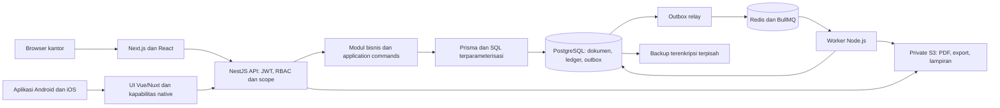

# Architecture evflow — web kantor, aplikasi mobile, satu backend modular

## Dampak keputusan 24 Oktober 2026

Mengikuti [desain arah fleksibel](../superpowers/specs/2026-10-24-erp-fleksibel-design.md). Mesin persetujuan umum dan Struktur Organisasi berada di modul Identity/Setting. Modul domain (Sales, Finance, HRIS, Warehouse) mendaftarkan jenis dokumen, kondisi yang didukung dan aksi lanjutan setelah keputusan; mesin tidak memuat aturan bisnis domain. Keputusan diteruskan ke domain melalui transaksi atau outbox yang idempotent. Nilai bawaan konfigurasi dibuat oleh proses penyiapan perusahaan yang idempotent, bukan konstanta kode.

## Submenu Akun dan migrasi master — 16 Oktober 2026

Akun tetap di modul Finance backend. transactionCommand, lock perusahaan lalu finance, optimistic version, audit dan isolasi perusahaan berlaku pada mutasi. UI Next.js memakai TanStack Query/Table, SelectionField dan Sonner. Posting/tax/bank/profile hanya menerima akun Detail aktif. Migrasi konfigurasi lokal memakai command atomik terjaga lingkungan dan admin, versi profile/pajak serta audit; tidak mengubah ledger. Seed finance uji diblokir sesudah migrasi.

### Penyempurnaan master pajak — 16 Oktober 2026

Penanda penggunaan master pajak diperiksa pada create/revise/submit SO dan create supplier invoice, selain filter opsi frontend. Riwayat snapshot lama tetap kompatibel. Tidak ada perubahan batas modul atau grant.

## Pembaruan pajak operasional — 16 Oktober 2026

Pajak operasional tetap dalam modular monolith Finance. Master, versi dan audit disimpan atomik lewat transactionCommand; posting penjualan/pembelian membawa akun dan tarif snapshot. Metadata faktur tidak memanggil posting. Izin server: tax_master.read/create/update, tax_output.read/update, tax_input.read/update. Opsi pajak minimum dapat dibaca pembuat/pengubah SO dan pembuat supplier invoice tanpa membuka daftar dokumen pajak. Grant lama tidak diperluas otomatis.


## 1. Stack yang dipilih

Nama aplikasi final adalah **evflow**. Keputusan D06 dikonfirmasi pengguna: Next.js + React untuk web kantor, Nuxt + Vue untuk aplikasi mobile sales/gudang yang dikemas agar dapat dipasang pada Android/iOS, dan satu backend NestJS dengan satu PostgreSQL sebagai sumber transaksi. PWA/browser hanya kanal tambahan. Backend memakai modular monolith. Skala awal 6–12 pengguna dan sekitar 700 SKU tidak memerlukan microservices. Satu transaksi database menjaga dokumen, stok, piutang dan jurnal tetap konsisten meskipun permintaan datang dari frontend yang berbeda.

| Lapisan | Teknologi | Peran |
|---|---|---|
| Web kantor | Next.js + React + TypeScript | Dashboard, administrasi, approval, finance, HRIS, laporan dan pengaturan |
| Aplikasi HP Android dan iOS — disepakati | Vue 3/Nuxt + TypeScript + Capacitor dengan build statis/SPA; minimum Android 10/iOS 15 | Menu kunjungan sales dan tugas gudang mengikuti izin; paket Android/iOS dari sumber UI bersama |
| Lokasi native mobile | Plugin/modul background location Android/iOS yang harus dibuktikan | Tracking aktivitas kerja sales saat UI tertutup; Capacitor sendiri belum menyediakan kemampuan tracking yang lengkap |
| Backend | Node.js + NestJS | Satu API dan aturan bisnis untuk kedua frontend |
| Styling UI | Tailwind CSS pada Next.js dan Nuxt | Token visual bersama, layout responsif dan komponen aksesibel |
| Data API frontend | TanStack Query: `@tanstack/react-query` / `@tanstack/vue-query` | Pengambilan data, cache memori, loading/error dan invalidasi setelah mutasi |
| Event realtime | WebSocket terotorisasi dengan cursor/replay; SSE read-only sebagai fallback web | Mendorong perubahan resource/projection sesuai company, user, scope dan field authorization |
| Tabel UI | TanStack Table: `@tanstack/react-table` / `@tanstack/vue-table` | Logika tabel headless; tampilan Tailwind, sort/filter/pagination dari server |
| Toast UI | `sonner` untuk React dan `vue-sonner` untuk Vue | Notifikasi singkat berhasil/gagal dan tindakan lanjut; hasil transaksi tetap mengikuti konfirmasi server |
| Data | PostgreSQL + Prisma ORM | Transaksi, numeric, constraint dan row lock; SQL khusus bila dibutuhkan |
| Queue/job | BullMQ + Redis, worker Node.js | PDF, ekspor/impor file, kalkulasi payroll draft dan notifikasi; ledger tetap di PostgreSQL |
| File | Private S3-compatible storage; MinIO untuk development lokal | Foto kunjungan, invoice dan slip gaji dengan izin berbeda; adapter aplikasi tetap memakai S3 API |
| Auth | JWT + RBAC + scope data | Autentikasi bersama, izin per tindakan, pembatasan pelanggan/gudang/data pribadi |
| Laporan | SQL/read models dengan rekonsiliasi ke ledger | Angka bisa ditelusuri; agregat boleh dibangun ulang |
| Deploy | Reverse proxy/TLS, Next.js, Nuxt, NestJS API, worker/relay, managed PostgreSQL, Redis, private storage dan backup | Pilot/production terpisah; prioritas region Jakarta, fallback Singapore terdokumentasi |

Versi Node.js LTS, framework dan package yang kompatibel dipilih serta dikunci pada bootstrap; dependency belum dipasang. PWA Nuxt dapat dibuka melalui browser dan dipasang ke home screen jika browser mendukung. Kamera/geolokasi memerlukan HTTPS dan izin pengguna. P1 membutuhkan koneksi untuk menyimpan transaksi; service worker tidak otomatis menyediakan sinkronisasi offline.

Next.js tetap memakai React, Nuxt memakai Vue; tidak ada pencampuran kedua framework dalam satu pohon komponen. Next.js dan Nuxt dapat memakai server rendering untuk kebutuhan tampilan, tetapi tidak memiliki mesin kredit, costing, approval atau posting sendiri. Frontend tidak mengakses PostgreSQL/Prisma secara langsung.

TanStack yang dipakai pada fase awal adalah Query dan Table; tidak ada paket resmi TanStack Toast. Routing tetap mengikuti Next.js/Nuxt. Toast memakai Sonner pada React dan Vue Sonner pada Vue, dengan isi/status yang sama menurut design tokens. TanStack Table menyediakan state dan perilaku tabel; styling, semantic markup, fokus keyboard dan kontrol akses UI diimplementasikan pada komponen masing-masing framework. Virtualisasi dievaluasi hanya bila pengukuran tabel memerlukannya. Versi Tailwind, adapter TanStack dan paket toast dikunci setelah pengecekan kompatibilitas kedua build.

## 2. Komponen



Core posting merupakan transaksi sinkron di NestJS. Dokumen, stock ledger, jurnal, open item dan event outbox disimpan bersama; kegagalan membatalkan seluruh transaksi. Setelah commit, relay menerbitkan event ke BullMQ dan event stream realtime. Queue menjalankan PDF, export/import staging, kalkulasi ulang absensi massal, notifikasi dan perhitungan payroll draft; cut-off absensi serta posting payroll tetap perintah terotorisasi setelah validasi/review. Event stream tidak menggantikan API dan tidak mengirim data di luar izin penerima.

Pengiriman event bersifat at-least-once. Gunakan event ID sebagai job identity serta deduplikasi/idempotency di PostgreSQL; hilangnya job Redis atau retry tidak boleh menggandakan jurnal. Payload queue membawa ID dan versi sumber, bukan salinan lengkap gaji/token. Worker memeriksa scope dan versi input; kalkulasi draft menjadi stale bila input berubah. PDF historis memakai snapshot dokumen. Redis tidak menyimpan sumber otoritatif saldo, approval atau status posting.

### 2.1 Perluasan mobile sales untuk tracking latar belakang

Pengguna menetapkan aplikasi HP harus bisa diinstal pada **Android dan iOS**. Keputusan final memakai satu aplikasi Nuxt/Vue 3 + Capacitor dengan minimum Android 10 dan iOS 15; web kantor tetap Next.js/React. Build mobile memakai statis/SPA tanpa server Nuxt SSR di HP. PWA/browser menjadi akses tambahan; aplikasi terpasang memakai modul lokasi native untuk tracking latar belakang.

Distribusi pilot memakai build internal Android dan TestFlight iOS. Jalur store/privat production ditentukan saat release readiness. Build/signing iOS memerlukan macOS/Xcode serta akun/profil distribusi; Android memerlukan signing aplikasi. Rilis kedua platform memakai versioning dan kompatibilitas API. Belum ada aplikasi yang dibangun atau diterbitkan.

Klien terpasang memakai API/RBAC yang sama, sesi kerja/tracking eksplisit, izin OS, indikator tracking dan kebijakan stop di luar aktivitas kerja. Android/iOS memerlukan konfigurasi background berbeda; force-stop, perangkat mati atau izin dicabut dapat menghentikan titik lokasi. Tampilkan last seen dan gap, bukan lokasi live palsu. Uji layar terkunci/UI ditutup, baterai, izin, pergantian akun, koneksi putus/pulih dan perilaku OS sasaran.

Antrean lokal terenkripsi boleh dirancang khusus untuk telemetri lokasi dengan point ID dan timestamp capture/receive. Ketentuan ini tidak mengubah P1 mutasi transaksi bisnis online-only. Auth native/penyimpanan kredensial OS dan lifecycle sesi perlu desain spesifik klien; jangan memindahkan token ke penyimpanan browser tidak aman. Interval dan retensi membaca OPS-VIS aktif; nilai awal 5/15 menit, raw 90 hari dan ringkasan 1 tahun.

Scheduler periode pipeline memakai timezone perusahaan, cut-off durable, event outbox dan idempotency database; retry tidak menutup Win atau menggandakan tindakan. Worker pengingat tugas memeriksa versi/status terkini sebelum mengirim notifikasi aplikasi; close periode mempertahankan tugas maintain. Pelacakan lokasi menyimpan bukti pada domain tracking dengan batas akses, bukan sebagai lokasi paksa pada setiap transaksi.

## 3. Kepemilikan modul

- Identity/Setting memiliki users, scopes, approvals, nomor dan audit. Modul bisnis meminta keputusan izin; tidak menulis role sendiri.
- Sales memiliki customer interaction, pipeline bulanan/PO-SP terverifikasi, strategi maintain, quote/harga khusus, kunjungan/follow-up, pengajuan sampel/trial, SO/target. Warehouse memiliki reservasi, quality dan pergerakan sampel/penjualan/return aktual. Sampel/trial tidak otomatis menghasilkan penjualan/AR; Finance menentukan posting biaya/kepemilikan/pajak yang sesuai. Identity/Setting melayani approval atasan/harga/sampel; persetujuan SO hanya berjalan bila aturannya aktif (24 Oktober 2026).
- SO normal dijalankan melalui pipeline otomatis pada submit/evaluate: validasi data/ketentuan pembayaran → past due/limit untuk tempo → stok → alokasi/release. Pelanggan baru default COD tiga bulan; Finance dapat memilih prepay. Pada COD invoice menunggu POD, sedangkan prepay mensyaratkan dana terverifikasi sebelum dispatch. Finance memiliki penerimaan dan pengikatan dana ke tahap agar tidak digunakan dua kali. Query stok informatif berizin tersedia saat input tanpa membuat reservasi. Approval engine digunakan untuk dokumen `sales_order_unlock`, bukan setiap SO.
- SO menyimpan seluruh permintaan; fulfillment_batches menghubungkan alokasi tersedia per tahap dengan proforma/picking serta packing aktual. Backorder/penutupan sisa/pembatalan tidak menulis ulang ordered quantity. Sales dan Warehouse berkoordinasi dalam transaksi PostgreSQL yang sama untuk membekukan/melepas jumlah, komitmen dan dokumen; close/cancel serta dispatch memakai lock konsisten. Pekerjaan pengembalian picking dapat berlangsung beberapa langkah dengan state pending yang durable, lalu finalisasi atomik setelah bukti gudang lengkap.
- Finance memiliki valuation policy, GL, open items, settlement, budget, tax, close. Posting profile menghubungkan event operasional dengan jurnal.
- HR memiliki hiring, candidate/private documents, employee/private compensation, kalender/shift, raw fingerprint staging, hasil kehadiran, cuti/lembur dan payroll inputs; Finance menerima payroll posting terotorisasi tanpa memberikan akses semua staf ke rincian gaji. Payroll membaca snapshot cut-off, bukan data absensi live.
- Master memiliki identitas produk/UOM/pihak/akun; transaksi menyimpan snapshot yang diperlukan.

Alur panggilan: controller → request validation → authorization → application service → domain invariants → repository/database → transactional outbox. Hindari logika saldo di komponen UI atau trigger yang diam-diam menciptakan dokumen bisnis. Trigger dipakai sebagai pengaman invariant/immutability, bukan mesin approval tersembunyi.

Operational Policy Service membaca definisi dan versi aktif dari PostgreSQL untuk parameter pada dokumen 40. Nilai tidak ditanam pada frontend atau tersebar sebagai environment variable bisnis. Perubahan melalui UI menginvalidasi cache policy, sedangkan transaksi penting menyimpan snapshot/kode versi yang relevan. Domain invariant tetap berada di kode/constraint dan tidak memiliki toggle policy untuk menonaktifkannya.

Struktur monorepo usulan:

```text
apps/
  office/                Next.js + React
  field/                 Nuxt + Vue, PWA
  api/                   NestJS HTTP API
  worker/                BullMQ consumers dan outbox relay
packages/
  backend/               modul domain/application NestJS; hanya API/worker
  database/              Prisma schema/client, migration dan SQL; server-only
  contracts/             OpenAPI, DTO publik dan client types untuk dua frontend
  design-tokens/         token CSS/theme Tailwind: warna, tipografi, spacing dan status
  ui-react/              komponen React + Tailwind, wrapper TanStack Table
  ui-vue/                komponen Vue + Tailwind, wrapper TanStack Table
  config/                konfigurasi lint, TypeScript dan tooling
```

Modul backend: Identity, Sales, Warehouse, Procurement, Finance, HR, Master dan Administration. **Procurement berada dalam navigasi Warehouse & Logistik → Pengadaan**, mencakup kebutuhan persediaan, PR, konsolidasi, PO Supplier/Vendor dan monitoring PO. Domain Finance tetap memiliki tagihan, AP, pembayaran dan pencocokan sumber PO/penerimaan; Administration tidak memindahkan PR/PO kembali ke Finance. Pemisahan domain backend tidak mengharuskan modul navigasi baru atau pengguna terpisah. Kedua frontend berbagi kontrak API, token visual dan helper murni yang relevan; komponen UI, router dan state store mengikuti framework masing-masing. Prisma client dan modul backend dilarang masuk bundle browser. Gunakan satu workspace/package manager dan lockfile; pilihan tooling detail ditetapkan saat bootstrap.

### Pengambilan data dan cache UI

- TanStack Query mengelola server state. QueryClient pada SSR dibuat per request; instance browser terpisah untuk web kantor/PWA dan dibersihkan saat sesi berganti. Provider React dan plugin Vue tidak berbagi instance runtime. Data hydration dibatasi pada DTO yang memang boleh dilihat pengguna.
- Query key mencakup resource, company, user/cakupan izin, filter, sort dan cursor. Perubahan role atau logout membatalkan request aktif dan menghapus cache privat agar respons akun lama tidak tampil setelah pergantian akun. Server tetap memeriksa izin setiap request.
- Gunakan client API terpusat dari kontrak yang sama. Untuk resource yang dikelola Query, hindari duplikasi cache independen melalui server fetch/loader framework; jika SSR prefetch digunakan, hasilnya diteruskan ke hydration query yang sama.
- Cache privat P1 hanya dalam memori. Tidak dipersist ke localStorage, IndexedDB atau service-worker cache. Ketentuan `no-store` berlaku untuk HTTP/SSR/shared cache; cache memori UI yang terisolasi tetap dapat dipakai untuk rendering. Data lama ditandai saat gagal diperbarui, bukan dianggap saldo terkini.
- Mutasi finansial/stok tidak memakai optimistic success atau retry otomatis frontend. Backend memberi status final; respons terputus ditampilkan sebagai belum terkonfirmasi dan dicek ulang dengan identitas operasi yang sama. Invalidasi query terkait setelah sukses: misalnya invoice, AR, customer credit dan laporan.
- Web dan PWA berlangganan event stream realtime sesuai company, user, scope dan resource. Event hanya membawa resource ID, versi, jenis perubahan dan metadata aman; klien menginvalidasi query lalu mengambil DTO terbaru melalui API. Cursor/replay, heartbeat dan reconnect mencegah perubahan terlewat; bila replay gagal, klien melakukan full refetch dan menandai data sedang disinkronkan. Stok, kredit, hak akses dan closing selalu divalidasi ulang di backend sebelum aksi.
- Bootstrap autentikasi selesai setelah login/MFA dan `/auth/me` memberi membership, scope, izin efektif serta versi izin; baru kemudian query privat dan stream dibuka. Refresh token atau reconnect stream memeriksa sesi dan versi izin kembali. Sinyal `auth_context_changed` atau respons 401/403 akibat perubahan akses menutup stream lama, membatalkan request dan menghapus cache privat sebelum mengambil `/auth/me` lagi; navigasi disusun dari izin baru. Logout/force revoke menutup koneksi sesi terkait pada tab/perangkat lain. Backend menolak akses yang dicabut segera pada setiap request, subscribe dan replay; pengiriman sinyal hanya mempercepat pembaruan UI.
- Realtime berlaku setelah perubahan diterima dan committed oleh ERP. Data dari perangkat, bank, pajak atau pihak luar tetap mengikuti waktu kedatangan sumbernya; status impor/ekspor, kalkulasi payroll draft dan laporan berat dapat didorong realtime, tetapi hasil finalnya baru tersedia setelah job selesai. Titik lokasi sales mengikuti interval OPS-VIS dan selalu menampilkan last seen/gap, bukan posisi kontinu yang dibuat-buat.
- TanStack Table memakai manual server sorting/filtering/pagination untuk daftar transaksi. Cursor mengikuti kontrak API; total laporan dihitung server. Selection lintas halaman menggunakan ID stabil dan cakupan eksplisit. Kolom tersembunyi tidak boleh menjadi satu-satunya pembatas harga modal atau payroll; field terlarang tidak dikirim API.

## 4. Konsistensi finansial

Perintah posting memulai database transaction, mengunci period/customer/source rows/stock sesuai urutan baku, memvalidasi izin dan versi, mengevaluasi kondisi terkini, menyimpan dokumen/ledger/jurnal/open items/audit/outbox, lalu commit. Deadlock/serialization failure mendapat retry terbatas dengan idempotency yang sama. Notifikasi dan event realtime baru dijalankan sesudah commit; event memiliki ID monotonik per stream, versi sumber, timestamp dan subject scope.

Prisma memakai transaction client yang sama untuk seluruh operasi posting. Level isolasi dipilih sesuai invariant; row locking dapat menggunakan SQL terparameterisasi di dalam transaksi. Decimal uang/qty dipetakan ke `Prisma.Decimal` dan PostgreSQL `numeric` dengan precision/scale eksplisit; jangan menghitung ledger menggunakan JavaScript `number`. Constraint/trigger/index PostgreSQL yang tidak tercakup schema Prisma ditulis dalam migration SQL dan diuji. Kegagalan kedua klien merebut stok atau limit yang sama diselesaikan di backend, bukan pemeriksaan UI.

Sumber otoritatif: ledger posted dan source snapshot. Stock balance serta dashboard bisnis/HRIS adalah projection dengan checkpoint, freshness dan kontrol rekonsiliasi. Projection dapat dibangun ulang dan tidak menyediakan endpoint untuk mengedit sumber. Satu ID event bisnis memiliki satu hasil posting per profil/revisi. Tidak ada endpoint untuk mengedit saldo langsung. Koreksi biaya, retur dan reversal tetap menambah bukti.

Unlock memisahkan permintaan, keputusan manusia dan grant sistem. Permintaan diarahkan ke approver yang ditetapkan policy; persetujuan membentuk pengecualian terbatas, lalu menjalankan ulang pipeline dengan grant yang masih sah. Keputusan/grant tersimpan atomik, dan evaluasi ulang yang perlu dicoba kembali memakai event durable/idempotent agar status approved tidak kehilangan tindak lanjut. Penerapan grant, konsumsi, reservasi stok dan release saling dikunci dalam transaksi; tidak ada pembukaan kunci global melalui flag yang dapat diedit pengguna. Perubahan input bisnis menguji ulang kecocokan grant, dan alasan baru tidak dianggap otomatis tercakup.

Penutupan period mengunci jalur posting. Backdate yang dapat mengubah urutan rata-rata bergerak ditolak pada P1; fase lanjut menyediakan recost dengan impact preview, versi dan jurnal adjustment di periode yang diizinkan. Cetak ulang dokumen menggunakan snapshot diterbitkan, bukan harga/tax master terbaru.

## 5. Keamanan dan privasi

Izin dicek pada server untuk read, write, approve, post, export dan scope data. Pembatasan payroll/biaya berlaku pula pada search, agregat, PDF dan URL attachment. Admin teknis tidak otomatis menjadi approver keuangan. Perubahan rekening supplier, akses istimewa dan reopen period memiliki audit dan kontrol khusus. Offboarding mencabut role, sesi aktif dan refresh token pada waktu efektif tanpa menghapus user atau audit historis; force revoke memerlukan izin dan alasan khusus.

Access token JWT berumur pendek diverifikasi signature, algorithm allowlist, issuer, audience dan expiry. Browser menyimpan token dalam cookie HttpOnly/Secure/SameSite, bukan localStorage. Refresh token dirotasi, hanya hash disimpan di PostgreSQL, dan replay ditangani dengan pencabutan sesi sesuai kebijakan. Logout mencabut sesi dan menghapus cookie untuk kedua frontend pada browser yang sama. Perubahan role, resign dan penonaktifan akun diperiksa di server; claims role lama tidak mempertahankan akses. Durasi token dan sesi dikonfigurasi sebelum deployment.

Gunakan pemeriksaan origin/CSRF untuk autentikasi berbasis cookie, password hash modern, rate limit, encrypted transport/storage backup dan secret store. MFA bagi admin/Finance/HR/pimpinan dan aksi sensitif merupakan peningkatan keamanan yang direncanakan, belum wajib pada tahap implementasi saat ini. Sesi/refresh rotation memiliki state server walaupun access token berupa JWT. Upload private melalui quarantine file, validasi MIME/size dan malware scanning. Log teknis tidak menyimpan NIK, nomor rekening penuh, gaji, password atau token. Lokasi sales dicatat hanya selama sesi kerja eksplisit dengan indikator aktif dan scope viewer terbatas.

Database memakai application role tanpa hak DDL; migration role terpisah. Production data tidak dimasukkan ke prompt AI atau fixture publik; pengembangan memakai data uji fiktif secukupnya. Retensi dan hak akses arsip ditentukan perusahaan. Restore backup tidak boleh membuka payroll ke semua pengguna.

## 6. Lingkungan dan operasi

Pisahkan development, pilot/staging dan production beserta database, storage, kredensial dan label layar. Development lokal memakai MinIO melalui Docker dengan bucket privat; kode mengaksesnya melalui S3 API. Pilot memakai data uji fiktif. Production memakai managed PostgreSQL, Redis dan private object storage; prioritas region Jakarta, fallback Singapore dengan keputusan terdokumentasi. MinIO production hanya dipilih bila backup, monitoring, patching dan replikasi operasionalnya dipenuhi. Deployment menjalankan migration teruji, health checks, version stamp dan rollback kompatibel. Backup database/files harus dapat direkonsiliasi pada satu titik pemulihan.

Routing usulan pada satu origin HTTPS: `/api/v1/*` menuju NestJS; `/lapangan/*` menuju Nuxt; path aplikasi kantor lainnya menuju Next.js. Konfigurasikan base path Nuxt, manifest start URL/scope dan service worker pada `/lapangan/`; asset kedua build harus dirutekan tanpa bentrok. Ini usulan path, bukan domain yang sudah tersedia. Reverse proxy memprioritaskan API/PWA sebelum catch-all web kantor. SSR yang memerlukan data pengguna meneruskan konteks autentikasi secara aman ke NestJS dan tidak menggunakan shared cache untuk respons pribadi.

Service worker hanya meng-cache shell/aset publik yang ditentukan. API, auth, slip gaji, dokumen finansial dan foto privat memakai network-only/no-store; jangan fallback ke cache untuk mutasi atau menyatakan penyimpanan berhasil tanpa respons server. Saat offline tampilkan status dan blok penyelesaian transaksi. Logout membersihkan state pribadi; update PWA memberi pemberitahuan dan tidak memuat ulang formulir yang belum disimpan secara paksa. Input offline dan resolusi konflik merupakan fase tersendiri jika kelak disetujui.

Frontend dan worker memakai versi kontrak yang kompatibel dengan API. Deployment memperhitungkan tab kantor/PWA versi lama; gunakan perubahan API additive dan strategi migration expand/contract. Proses scheduler/relay dapat digabung dengan worker pada pilot, dengan penguncian agar job terjadwal tidak dijalankan ganda. Redis dikelola untuk queue secara terpisah dari cache yang bisa dieviction; konfigurasi persistence, memory policy dan pemulihan job diuji. Runtime/backend/Redis tidak diekspos langsung ke internet.

Pantau error rate, latency, queue lag, disk, backup terakhir, failed jobs, posting failures dan rekonsiliasi. Pilot memakai RPO 24 jam/RTO 8 jam. Production memakai RPO ≤1 jam/RTO 4 jam, point-in-time recovery, backup harian terenkripsi dan restore test minimal triwulanan. Keberhasilan backup tidak dianggap keberhasilan restore sebelum drill lulus.

## 7. Pengembangan dengan bantuan AI

Pecah backlog menjadi irisan kecil berdasarkan ID requirement: schema → command → UI → uji invariant → review. AI membantu migration, form, laporan dan tes; aturan uang/stok diverifikasi dengan contoh hasil yang disepakati. Setiap perubahan memiliki diff, seed data uji fiktif, automated tests dan instruksi migrasi. CI menjalankan type/lint checks, unit/domain, database integration dan smoke E2E yang relevan.

Prioritas uji: jurnal seimbang dan satu kali; stock/credit concurrent; partial quantity; settlement; costing/rounding; closed period; scope payroll; import deduplication; restore. Snapshot UI saja tidak memverifikasi akuntansi. Hindari membangun semua layar placeholder lalu menyebut ERP selesai.

Tambahkan contract tests dari klien React dan Vue ke API yang sama, SSR cache isolation, refresh/logout lintas frontend, stale permissions, service worker scope, kondisi offline, update PWA, izin kamera/lokasi ditolak, serta retry worker setelah Redis restart. Pilih browser/perangkat uji dari perangkat staf sebelum pilot. Dua frontend menambah biaya UI dan deployment; implementasikan layar kantor dan tugas lapangan prioritas tanpa menggandakan seluruh menu ERP di PWA.

Untuk Tailwind/TanStack, verifikasi token dan komponen pada kedua build, pemisahan query cache antar akun/SSR request, invalidasi saldo setelah mutasi, reset cursor saat filter berubah, total server lintas halaman, pembatalan request saat logout, serta tidak adanya mutation replay ketika PWA kembali online. Uji tabel dengan keyboard dan layar HP; headless library tidak otomatis menyelesaikan aksesibilitas.

## 8. Integrasi masa depan

Sediakan adapter impor fingerprint dan statement bank pada fase yang disetujui. Generator file Coretax pajak keluaran aktif sebagai adapter ekspor lokal dengan XML UTF-8, urutan elemen deterministik, validasi mapping, hash, private object storage dan audit. Direct API submission tetap extension point sampai kontrak/kredensial tersedia. Integrasi yang kelak diaktifkan memakai signed request, replay protection dan idempotency; tidak mengubah kontrak ledger inti.


## Pembaruan backend O2C — 5 Oktober 2026

Prisma Client backend menggunakan engineType=binary; generate harus dijalankan sebelum build/deploy. API dan worker harus dirilis bersama; proses lama yang masih aktif tidak otomatis menggunakan kode baru. Worker memeriksa expiry reservasi dan antrean backorder; command memakai transaksi/idempotency serta lock domain. Keberhasilan build bukan bukti concurrency atau release gate.

Rujukan implementasi dan batas verifikasi: [laporan remediasi backend O2C](../development/o2c-backend-remediation-2026-10-05.md).

# Keputusan otorisasi terbaru — 16 Oktober 2026

Peran aktif `ADMIN_SYSTEM` pada membership perusahaan sesi memberi kewenangan penuh untuk pengaturan dan transaksi serta override penunjukan/persetujuan sendiri pada approval. Pemeriksaan role dilakukan server; UI hanya menyajikan kemampuan tersebut. Kode domain tetap menentukan pemilik aturan bisnis internal, bukan batas pengelompokan peran. Semua command tetap memeriksa autentikasi, perusahaan, status, versi, bukti dan invariant domain.

Layanan IAM menyalin katalog capability ke grant peran biasa baru dalam transaksi pembuatan peran, sehingga UI dan otorisasi server langsung sejalan. Peran lama diperluas hanya melalui command perubahan matriks per peran dengan snapshot konflik, audit diff dan pencabutan sesi anggota. Peran Admin Sistem tetap memakai pengecualian bawaan tanpa grant tersimpan.

Penghapusan pengguna dijalankan dalam transaksi backend dengan kunci perusahaan untuk melindungi Admin Sistem terakhir. Membership bersejarah diberi `deleted_at`, dinonaktifkan, dilepas dari peran dan sesinya dicabut; query autentikasi dan IAM mengecualikan arsip. Hapus permanen dibatasi pada akun tanpa sesi/aktivitas historis dan tanpa relasi identitas lain. Audit menyimpan identitas tindakan pada kedua jalur.

## Otorisasi submenu — 16 Oktober 2026

IAM-01/04: `PermissionGuard` mendukung metadata resource dinamis dengan allowlist server, pemeriksaan company/scope dan tanpa fallback induk. Perubahan ID resource atau query stage memilih pemeriksaan capability fitur yang benar, bukan membuktikan otorisasi dari asal menu klien. Query data terkait tetap memeriksa izin sumber. Migrasi grant tersimpan menjaga cakupan dan audit; matriks hanya menyimpan grant individual. Admin Sistem tetap menggunakan kewenangan bawaan.
