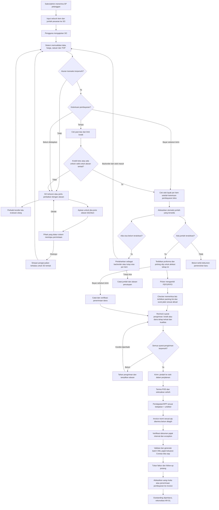
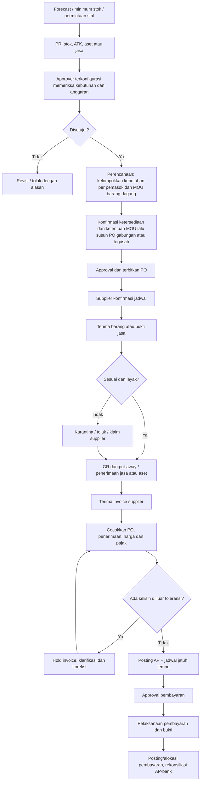
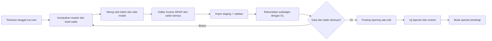

# User Flow — lintas peran dan pengecualian

## Detail SO dan uang muka — Bagian 2, 26 Oktober 2026

SO → Catat Uang Muka → Menunggu verifikasi → Finance pengguna berbeda memverifikasi atau menolak. Hanya verifikasi membuat penerimaan/jurnal dan menambah DP. Dispatch PREPAY mengikat dana SO yang dipakai ke satu batch sehingga batch lain tidak menghitung ulang. Detail menautkan dokumen asal; Buat Surat Jalan tetap melalui pengambilan dan pemeriksaan. Invoice dari Packing List menunggu POD tetap tampak di Transaksi bila izin invoice ada.

## Form SO — kontrak backend 25 Oktober 2026

Pilih pelanggan → alamat/termin bawaan → tentukan tanggal/sales/gudang → semua baris pesanan → simpan draft (No. SP/bukti hanya wajib bila Setting aktif) → submit memeriksa harga, termin, kredit dan stok → hanya gudang pilihan yang dialokasikan. Stock availability memberi informasi sisa dan locator lain tanpa perpindahan stok. Daftar menampilkan status turunan dari POD dan sisa ditutup; tanggal perkiraan jatuh tempo SO tidak mengganti tanggal resmi invoice. Implementasi layar baru, approval umum dan pengajuan pindah locator tetap bagian berikutnya.

## Keputusan 24 Oktober 2026 — konsolidasi

Mengikuti [desain konsolidasi](../superpowers/specs/2026-10-24-konsolidasi-pengaturan-design.md). Alur SO: pilih produk → harga otomatis (harga khusus pelanggan atau harga umum) → ubah harga/diskon dalam batas → pajak bawaan terisi → ajukan. Alur pembayaran: catat uang diterima → tambah baris potongan → potongan wajib bukti berstatus Menunggu bukti potong → unggah bukti → lunas. Harga khusus diajukan dan disetujui di Sales & Marketing pada halaman pengajuannya.

## Keputusan 24 Oktober 2026 — alur fleksibel

Mengikuti register README dan [desain arah fleksibel](../superpowers/specs/2026-10-24-erp-fleksibel-design.md). Alur SO: Draft dengan isian minimal → Ajukan → validasi data/harga → persetujuan SO bila aturan aktif cocok (stok belum direservasi; antrean alokasi dihitung sejak disetujui) → kredit sesuai mode Nonaktif/Peringatan/Blokir → alokasi stok → dokumen pemenuhan → invoice → pembayaran atau retur. Mode Peringatan menampilkan peringatan tanpa menahan; mode Blokir menahan SO dan pengguna mengajukan pengecualian melalui mesin persetujuan umum. Termin dipilih di SO.

Alur persetujuan untuk semua jenis dokumen: pengajuan → tahap berurutan (atasan langsung, atasan N tingkat, kepala departemen, orang atau peran tertentu) → Setujui, Tolak atau Minta Revisi dengan catatan → riwayat. Dokumen terkunci selama menunggu. Atasan tanpa akun dilewati ke atasan berakun berikutnya, lalu Admin Sistem. Menu yang belum berfungsi tidak tampil.

## Submenu Akun dan migrasi master — 16 Oktober 2026

Finance → Akuntansi → Akun → cari/filter (awal Aktif) → Detail atau Edit; Buat Akun membuka form tanpa saldo. Simpan memvalidasi kode, hierarki dan izin; edit akun terpakai perlu alasan dan hanya field aman/status sesuai referensi. Riwayat muncul pada detail. Impor 156 master sudah disetujui tanpa saldo awal. Konfigurasi operasional dialihkan ke akun impor, akun uji bersejarah tetap dapat ditemukan lewat filter Nonaktif. Impor/ekspor massal UI dan reklasifikasi khusus tetap di luar tahap ini.

### Penyempurnaan master pajak — 16 Oktober 2026

Buat/edit master: isi nama, jenis, penggunaan, perlakuan, akun dan tarif; pilihan jenis tidak menimpa perlakuan. Form menampilkan kelompok akun COA dan menerima pemisah desimal titik/koma. Setelah simpan, detail menunjukkan penggunaan dan rincian riwayat versi.

## Pembaruan pajak operasional — 16 Oktober 2026

Finance → Pajak → Daftar & Aturan Pajak → Buat/Edit → pilih jenis, tambah/potong, akun aktif, nilai persen dan pembulatan → Simpan → versi langsung berlaku tanpa antrean approval. Transaksi memilih master; submit menyimpan snapshot untuk perhitungan/posting. Faktur Keluaran/Masukan → pilih invoice sumber → isi nomor/tanggal dan lampiran resmi → Simpan metadata. Invoice belum posted tidak dapat menerima metadata. Perubahan tarif tidak menghitung ulang transaksi posted.

Alur izin Dashboard terbaru: Admin Sistem membuka Peran → Matriks Hak Akses, mencentang Lihat pada tiap tampilan Dashboard yang diinginkan untuk peran biasa, meninjau lalu menyimpan. Sesi anggota terdampak dicabut. Saat masuk kembali, navigasi memuat tampilan yang diizinkan; API menolak tampilan tanpa izin dan tetap menyaring data menurut izin/scope sumber. Menu yang belum berfungsi disembunyikan dari navigasi dan matriks (keputusan 24 Oktober 2026).

## Koreksi 7 Oktober 2026 — proforma manual

Submit SO → validasi/alokasi otomatis → pilih tahap pemenuhan pada detail SO →
Tinjau & Terbitkan Proforma → periksa qty/nilai dari server → Terbitkan Proforma →
buka/cetak dokumen yang sama. Hanya pemegang `proforma.issue` dapat menerbitkan.
Tanpa alokasi tidak ada proforma. Perubahan alokasi setelah pratinjau mewajibkan muat
ulang; perubahan setelah penerbitan menandai perlu revisi manual, bukan menerbitkan
otomatis. Prepay tetap menunggu dana terverifikasi saat dispatch. Urutan diagram
proforma di bawah adalah tindakan pengguna setelah alokasi, bukan efek submit.

**evflow** menggunakan Next.js + React untuk web kantor. Aplikasi mobile sales/gudang menggunakan Nuxt + Vue dan dikemas untuk Android/iOS; PWA/browser hanya akses tambahan. Keduanya memakai akun/izin dan API NestJS yang sama; perpindahan frontend tidak menyalin transaksi atau membuat database lain. Status terbaru dibaca kembali dari server sebelum tindakan penting.

## 0. Pengguna, peran dan penugasan tahap

### 0.3 Workflow submenu Setting

Pengelolaan Setting mengikuti batas modul pada [Setting, IAM dan Konfigurasi](15-setting.md). Admin atau pengguna berizin memilih submenu, sistem memeriksa izin efektif dan scope, lalu memuat versi aktif. Untuk Pengguna, Peran (termasuk Matriks Hak Akses pada detail peran), Kebijakan Pelanggan Baru, Kredit & Exposure, Pengaturan Persetujuan, Template, Penomoran, Daftar Referensi, Periode dan Impor/Ekspor, perubahan disimpan sebagai draft atau command sesuai jenisnya; server memvalidasi konflik dan dependensi sebelum aktif. Simulasi approval dan preview impor/nomor/template tidak mengubah transaksi atau konfigurasi aktif.

Pengguna melihat status **Draft**, **Valid**, **Aktif**, **Terjadwal**, **Tidak Aktif** atau **Terarsip** sesuai submenu. Aktivasi yang tidak memiliki assignee, scope, limit, fallback, owner, data wajib, seri nomor, template atau sumber referensi yang diperlukan ditolak dengan daftar blocker. Setiap perubahan menyimpan actor, waktu, versi, before/after terbatas dan alasan bila jenis perubahan mewajibkannya.

Untuk Periode & Closing, urutannya adalah **Buka → Closing → Review/Rekonsiliasi → Tutup**. Reopen hanya dapat dilakukan melalui izin khusus, alasan, reviewer dan audit. Untuk Impor/Ekspor, urutannya adalah **Staging → Validasi → Preview → Commit/Unduh → Arsip**, dengan idempotency dan error report per baris. Audit hanya read-only dan tidak menyediakan tindakan koreksi langsung.

Keputusan pengguna: satu orang boleh menjalankan beberapa peran jika diberikan hak akses. Sebutan sales, admin, finance, picker atau checker pada alur adalah fungsi pekerjaan. Sebutan tersebut tidak mengharuskan akun/orang berbeda dan tidak mengunci proses berdasarkan jabatan.

Alur pengaturan: admin yang berizin membuka **Setting → Peran** untuk membuat kelompok izin → mengatur **Matriks Hak Akses** per modul/tindakan/cakupan → membuka **Pengguna** untuk memasang satu atau beberapa peran → meninjau hak akses efektif → mengaktifkan pengguna. Perubahan hak akses tercatat dan berlaku pada web kantor maupun PWA.

Peran baru biasa dibuat dengan semua izin katalog saat itu sudah tersimpan. Admin dapat membuka matriks untuk membatasi peran tersebut. Peran lama mempertahankan izin yang sudah tersimpan; bila ingin penuh, admin membuka perannya, memilih **Pilih semua izin**, meninjau jumlah perubahan/anggota dan menyimpan. Peran lain tidak berubah dan sesi anggota peran yang diubah dicabut.

Admin Sistem dapat memilih **Hapus** pada baris Pengguna atau Peran dan meninjau dialog dampaknya. Server menolak akun sendiri/Admin Sistem terakhir. Untuk pengguna, server menghapus akun yang belum dipakai atau mengarsipkan akun dengan riwayat; daftar aktif diperbarui setelah berhasil. Sesi terdampak dicabut dan audit dicatat. Peran biasa yang dihapus dilepas dari seluruh anggotanya.

Profil Perusahaan: pengguna berizin membuka **Setting → Profil Perusahaan** → mengubah nama/alamat/kontak/logo sesuai kebutuhan → Simpan. Tidak ada tanggal berlaku, alasan perubahan atau approval. Nilai baru langsung dipakai pada layar dan dokumen baru; dokumen yang sudah diterbitkan tetap memakai snapshot identitas saat penerbitan.

Kebijakan Umum: pengguna berizin membuka **Setting → Kebijakan Umum** → memilih kelompok dan parameter → Edit → sistem menampilkan nilai awal/saat ini, unit dan validasi → Simpan → versi baru langsung aktif secara default. Form tidak meminta alasan, approval atau tanggal berlaku kecuali definition parameter mengaktifkannya. Transaksi baru membaca nilai aktif; transaksi issued/posted tetap memakai snapshot. Upaya mengubah invariant menampilkan bahwa aturan tersebut merupakan kontrol sistem dan tidak tersedia sebagai field.

Saat pengguna login, menu, tombol dan antrean tugas mengikuti hak efektif serta penugasan. Pengguna dapat membuat SO lalu melanjutkan penerbitan proforma atau tugas gudang dengan akun yang sama apabila masing-masing tindakannya diizinkan dan prasyarat dokumen terpenuhi. Tidak diperlukan pergantian akun untuk menjalankan peran tambahan. Pemberian akses tidak melewati urutan cek kredit, stok atau status dokumen.

Alur autentikasi Office: buka layar Login → masukkan email dan kata sandi → server memeriksa kredensial → bila ada lebih dari satu membership aktif, pilih perusahaan dari daftar yang diizinkan → kirim ulang kredensial yang sama beserta perusahaan pilihan → server memeriksa ulang kredensial dan membership → selesaikan MFA bila diaktifkan → server membuat sesi → klien menghapus kredensial dari memori dan meminta `/auth/me` → setelah izin/scope diterima, tampilkan navigasi dan buka stream realtime sesuai kemampuan platform. MFA belum wajib menurut keputusan 26 September 2026. Respons pemilihan perusahaan belum membuat sesi, cookie autentikasi atau audit sukses login. Akun/perusahaan/membership tidak sah menampilkan pesan generik.

Pada langkah perusahaan, pengguna memilih dari dropdown atau menekan **Kembali** untuk mengosongkan kredensial dan kembali ke form awal. Kredensial hanya berada dalam memori selama proses, tidak dipersist atau dimasukkan ke URL, serta dibersihkan setelah sukses, Kembali atau layar dilepas. Jika `/auth/me` gagal setelah login sukses, tampilkan kegagalan menyiapkan akses dengan **Coba Lagi** yang hanya mengulang bootstrap, bukan mengirim login kembali. Selama proses berlangsung, cegah pengajuan ganda dan tampilkan status memuat; batas percobaan, layanan tidak tersedia dan gangguan jaringan dijelaskan dalam Bahasa Indonesia. Bantuan masuk dapat dibuka untuk mengarahkan pengguna menghubungi admin; password recovery belum tersedia.

Refresh sesi tidak mengulang login manual bila token masih sah; koneksi stream yang dibuat ulang selalu memvalidasi sesi dan versi izin terbaru. Jika role, scope atau membership berubah saat pengguna aktif, klien menerima sinyal perubahan akses atau mendeteksinya dari respons API → tutup stream lama, batalkan request aktif, hapus cache privat → minta ulang `/auth/me` → susun ulang menu dan buka stream baru bila masih berizin. Logout pengguna mencabut sesi aktif dan membersihkan tampilan privat pada kedua frontend/tab browser; penonaktifan atau force revoke mencabut sesi terkait pada perangkat lain. Bila akses berakhir, kembali ke Login dengan pesan sesi berakhir; tindakan yang belum mendapat respons server tetap berstatus belum terkonfirmasi sampai diperiksa ulang setelah login berizin. Kontrol realtime lintas perangkat tetap merupakan requirement platform; renovasi login Office tidak menyatakan seluruh kontrol tersebut selesai.

| Tahap contoh | Hak yang diperlukan |
|---|---|
| Membuat SO | Buat SO pada cakupan pelanggan yang diizinkan |
| Mengajukan SO | Ajukan SO |
| Memvalidasi dan melepas SO normal | Dilakukan otomatis oleh sistem setelah pengguna berizin mengajukan SO dan syarat terpenuhi |
| Mengajukan unlock SO | Ajukan unlock, untuk alasan kunci yang diperbolehkan kebijakan |
| Memutuskan pengajuan unlock | Setujui/tolak unlock, sesuai penunjukan dan limit pemberi persetujuan pada Setting |
| Menerbitkan proforma | Terbitkan proforma |
| Mengambil / memeriksa barang | Konfirmasi picking / konfirmasi checking, masing-masing diatur |
| Posting invoice / penerimaan pembayaran | Posting invoice / posting penerimaan, masing-masing diatur |

Tugas approval unlock dikirim kepada pengguna/peran yang ditunjuk dan memenuhi izin, cakupan serta limit; tidak semua pengguna yang dapat melihat SO otomatis menjadi approver unlock. Jika tidak ada approver yang memenuhi syarat, permintaan tetap tertahan dengan alasan konfigurasi yang perlu diperbaiki. SO yang lolos aturan tidak perlu menunggu approver. Audit menunjukkan siapa melakukan tiap tahap, termasuk bila beberapa tahap dilakukan orang yang sama.

SO berjalan otomatis bila tidak ada aturan persetujuan aktif. Bila aturan persetujuan SO aktif dan kondisinya cocok (misalnya nilai, diskon atau pelanggan menunggak), SO menunggu persetujuan setelah validasi data dan sebelum pemeriksaan kredit serta alokasi. Pengecualian kredit pada mode Blokir diajukan melalui mesin persetujuan yang sama. Pemberi keputusan mengikuti aturan dan Struktur Organisasi; persetujuan dokumen sendiri hanya bila diizinkan eksplisit per jenis dokumen.

### 0.1 Pengaturan dan pelaksanaan persetujuan

Admin berizin memilih jenis pengajuan → mengisi kondisi/batas/dasar nilai → menentukan satu/beberapa tahap dan pengguna/peran/atasan → mengatur pengganti, persetujuan sendiri serta pengingat → simulasikan jalur → aktifkan versi aturan. Nama pemberi keputusan dan batas nominal dapat diisi nanti; draft konfigurasi belum lengkap tidak menjadi jalur approval aktif.

Pemohon menyimpan draft dokumen → ajukan versi bisnis → sistem menentukan policy/approver → keputusan tahap aktif → lanjut tahap berikutnya sampai Disetujui, atau Minta Revisi/Tolak beralasan. Pemohon melakukan revisi lalu mengajukan versi baru; keputusan lama tetap histori. Pengajuan tanpa pihak berwenang tertahan, tidak lolos karena tidak ada aturan. Delegasi diperiksa saat keputusan tanpa memperluas hak/limit; satu akun dengan beberapa peran tetap satu pelaksana.

Antrean Persetujuan Saya pada Dashboard menampilkan tugas lintas modul sesuai akses; dokumen tetap di modul asal. Approval bukan posting, penerbitan PO, transfer pembayaran atau pengeluaran stok. PO/PR tetap di Logistik; SO normal otomatis dan pengecualiannya melalui unlock. Rincian kebijakan/skenario serta form mengikuti bagian Pengaturan Persetujuan di Design.

### 0.2 Dashboard, tugas dan pelaporan

Pengguna membuka Dashboard → sistem menerapkan hak/scope → memilih periode/as-of dan filter → melihat ringkasan, freshness serta daftar tindakan → membuka drill-down ke transaksi/laporan sumber → menyelesaikan tindakan di modul pemilik → kembali ke Dashboard yang diperbarui. Angka Dashboard tidak dapat diedit dan tidak menjadi posting. Tugas approval, exception, follow-up dan blocker menunjuk resource/version asal; menyelesaikan kartu tanpa command modul asal tidak mengubah status transaksi.

Setelah perubahan sumber commit, outbox memicu pembaruan projection dan event realtime bagi pengguna berizin. Klien menerima event → invalidasi query terkait → GET ulang dengan izin/scope saat ini → tampilkan nilai, status dan `data_as_of` terbaru. Jika event tertunda atau koneksi terputus, tampilkan indikator sinkronisasi; saat reconnect replay dari cursor atau full refetch bila ada gap. Pekerjaan ekspor/impor/payroll draft tetap async; yang diperbarui realtime adalah status job hingga hasil finalnya tersedia. Perubahan izin/logout menutup stream dan menghapus cache privat.

Laporan: pilih jenis/periode/as-of/filter → sistem memvalidasi scope dan sumber posted → buat langsung atau jalankan export job → simpan versi/filter/hash → pengguna berizin melihat atau mengunduh file privat → audit akses tersimpan. Laporan final periode tertutup tidak ditimpa; koreksi menghasilkan versi baru.

## 1. Order-to-cash

Sumber domain alur penjualan adalah [Sales Order-to-Cash](10-sales-marketing.md); bagian ini menjelaskan urutan lintas peran dan exception.

Urutan yang dikonfirmasi: input seluruh item/jumlah pesanan → ajukan SO → validasi otomatis dan ketentuan pembayaran → cek past due/limit untuk tempo → cek stok per item → alokasikan dan lanjutkan jumlah yang tersedia. Pada bayar sebelum kirim, alokasi/proforma dapat dibuat sebelum pembayaran; pengiriman menunggu dana terverifikasi untuk tahap tersebut. Kekurangan pada satu item tidak menghalangi pemenuhan item lain yang lolos pemeriksaan. Validasi ulang mempertimbangkan pengecualian unlock yang disetujui dan masih valid untuk aturan terkait; aturan lain tetap diperiksa. Tidak ada tahap approval SO normal atau tombol release yang harus diklik approver. Pelaksana tindakan manusia ditentukan melalui hak akses dan penunjukan pemberi keputusan unlock. Proforma tidak mem-posting buku besar.

### 1.0 Pelanggan baru dan informasi stok saat input

Keputusan pengguna: cari pelanggan → jika belum ada, pengguna berhak memilih **Tambah Pelanggan** dari layar SO → periksa kemungkinan duplikasi → lengkapi nama, channel, kontak, alamat kirim/tagih, PIC sales dan data pajak sesuai kebutuhan → simpan → lanjutkan SO. Hak membuat pelanggan berbeda dari hak menetapkan fasilitas kredit.

Pendaftaran untuk kunjungan sebelum ada pesanan memakai **Prospek** pada alur bagian 6: satu institusi tercatat di Master Pelanggan dengan tahap hubungan Prospek dan form awal ringkas. Ketika sudah perlu dibuat SO, lengkapi data yang sama menjadi **Pelanggan terdaftar — belum bertransaksi**; jangan membuat duplikat. Pelanggan mulai dihitung sebagai **Pelanggan bertransaksi** saat invoice pertama diposting. Status master aktif hanya berarti data dapat digunakan, bukan bukti transaksi.

Form pelanggan lengkap mengikuti [17 atribut yang ditetapkan pengguna](07-design.md): identitas/alamat/channel/rayon, tiga fungsi PIC, legalitas/NPWP/penanggung jawab dan izin, termin/limit/saldo awal, serta NOO. Channel dan rayon dapat ditambah sesuai izin. Prospek yang dikonversi mempertahankan kontak dan riwayat kunjungan. Untuk pelanggan lama saat migrasi, tombol rincian piutang awal membuka prosedur opening per invoice; angka saldo pada form hanya ringkasan hasilnya. Riwayat invoice opening menandai pelanggan lama pernah bertransaksi, tidak menghasilkan penjualan baru pada tanggal impor.

Termin dipilih pada SO: **Tunai/COD saat barang diterima**, **Bayar sebelum pengiriman** atau **Tempo N hari**. Kebijakan COD awal untuk pelanggan baru bersifat opsional (default nonaktif). Pada COD, SO → pemeriksaan aturan/mode pembayaran → stok dan alokasi → Proforma/Surat Jalan → POD → Invoice posted dengan TOP 0 dan jatuh tempo tanggal POD → follow-up pembayaran. Pada bayar sebelum pengiriman, pengiriman menunggu dana terverifikasi; pembayaran sebelum invoice dicatat sebagai uang muka lalu dialokasikan ke invoice tanpa penerimaan kedua. Bukti transfer yang belum diverifikasi tidak memenuhi syarat kirim. Bila kebijakan COD awal dinyalakan, Tempo untuk pelanggan baru tersedia setelah periode yang diatur.

**Tempo** tidak memerlukan TOP/limit di master pelanggan. Termin bawaan pelanggan, bila diisi, hanya mengisi otomatis SO dan dapat diganti. Limit kredit opsional; pelanggan tanpa limit tidak diperiksa limitnya, sedangkan pelanggan dengan limit diperiksa sesuai mode kredit perusahaan. Limit belum ditetapkan berbeda dari limit nol. Perubahan ketentuan pada SO yang sedang berjalan dicatat sebagai revisi dan dievaluasi ulang; perubahan master tidak diam-diam mengganti histori transaksi.

Sales dengan izin melihat stok dapat melihat **tersedia untuk pesanan baru**, jumlah dipesan dan perkiraan kekurangan sejak memilih produk pada Draft, termasuk jika SO kemudian terkena credit hold. Informasi ini tidak mencadangkan barang. Setelah SO diajukan dan ketentuan transaksi lolos, sistem memeriksa ulang lalu melakukan alokasi atomik. Status “stok belum dievaluasi” pada SO berarti pemeriksaan/alokasi resmi SO belum dilakukan; informasi stok umum tetap dapat dibaca sesuai izin. Seluruh item/jumlah pelanggan tetap dicatat meskipun stok nol.

### 1.1 SO lengkap dan pemenuhan bertahap

SO menyimpan seluruh permintaan asli pelanggan, termasuk item tanpa stok dan kekurangan sebagian jumlah suatu item. Jumlah pesanan tidak diperkecil agar sama dengan stok. Stok tersedia berarti barang yang layak dijual pada lokasi/kepemilikan yang sesuai dan belum direservasi untuk pesanan lain; barang karantina, expired, recall atau bermasalah kualitas tidak termasuk.

Setelah aturan transaksi dan ketentuan pembayaran lolos (termasuk kredit untuk tempo), sistem membuat alokasi atomik. Setiap tahap pemenuhan memiliki referensi sendiri dan dapat berisi sebagian item/jumlah SO. Satu SO dapat menghasilkan beberapa tahap pemenuhan serta beberapa proforma, picking slip dan packing list. Semua dokumen tetap tertaut ke baris SO asal.

Pemeriksaan ketersediaan awal dilakukan **oleh sistem sebelum Picking Slip diterbitkan**, berdasarkan catatan stok, reservasi, batch/expiry, lokasi, kepemilikan dan kualitas. Picking Slip adalah dokumen/instruksi pengambilan hasil alokasi tersebut. Saat **proses picking**, petugas gudang mengonfirmasi barang fisik yang ditemukan dan diambil: produk, batch, kedaluwarsa, lokasi, jumlah serta kondisi yang terlihat. Checking memeriksa kembali hasil pengambilan sebelum packing. Penerbitan Picking Slip sendiri bukan bukti stok fisik sudah diverifikasi dan tidak menciptakan approval SO manual.

**Proses picking disetujui pengguna:** sistem menyarankan batch dan locator dari alokasi yang sah dengan FEFO untuk barang berkedaluwarsa, atau FIFO bila tidak memiliki expiry. Petugas berizin membuka Picking Slip, mengambil barang dari lokasi yang ditunjukkan, lalu mencatat jumlah aktual yang diambil beserta batch/locator aktual. Selisih tetap tercatat dan diteruskan untuk penyelesaian; konfirmasi picking tidak mengubah status menjadi terkirim. Setelah picking selesai, proses berlanjut ke checking dan packing. Perubahan batch/locator mengikuti izin serta pemeriksaan kelayakan/reservasi yang sudah ditetapkan.

Jika sistem mencatat 6 tetapi petugas hanya menemukan 5, hasil picking dicatat 5 dengan selisih 1. Gudang menelusuri selisih dan stok yang diragukan ditahan dari alokasi baru sampai diperiksa; saldo buku diperbaiki melalui proses adjustment berizin bila diperlukan. Sesudah penyesuaian alokasi yang terlacak, kekurangan pemenuhan menjadi backorder atau ditutup sesuai keputusan, dan Packing List hanya mengikuti jumlah aktual yang lolos checking. Petugas picking/checking ditentukan oleh hak akses; fungsi tersebut tidak otomatis mengharuskan orang yang berbeda.

| Dokumen | Dasar item dan jumlah |
|---|---|
| SO | Semua item dan jumlah yang dipesan pelanggan |
| Proforma Invoice | Jumlah stok layak yang telah dialokasikan untuk tahap pemenuhan terkait; item tanpa alokasi tidak dicetak |
| Picking Slip | Alokasi tahap terkait beserta batch/locator; jumlah yang sudah ditugaskan tidak dibuat ulang sebagai tugas baru |
| Packing List | Barang yang benar-benar sudah diambil dan lolos checking untuk tahap terkait; jumlah tidak melebihi picking aktual yang lolos |
| Surat Jalan | Jumlah aktual yang siap dikirim dari packing list |
| Invoice resmi | Sesuai alur yang disetujui: jumlah diterima berdasarkan POD yang belum ditagih |

Jika jumlah aktual picking/checking kurang dari alokasi, catat selisih, perbaiki alokasi dan revisi/void dokumen yang terdampak secara terlacak. Jangan mencetak kekurangan seolah-olah ada di kemasan. Proforma yang sudah diterbitkan disimpan riwayatnya dan diganti bila jumlah/nilai berubah; pembayaran yang sudah diterima direkonsiliasi sebagai uang muka atau refund sesuai proses finance.

Sisa yang belum tersedia ditampilkan per item/jumlah: **Backorder** berarti masih akan dipenuhi dan masuk antrean kebutuhan/pengadaan; **Tutup Sisa Pesanan** berarti jumlah itu tidak akan dipenuhi lagi, dengan alasan, pelaksana dan waktu. Sampai pengguna berizin menutup sisa, jumlah tersebut tetap terbuka sebagai backorder setelah evaluasi stok. Stok masuk memicu evaluasi ulang aturan/kredit sebelum alokasi tahap berikutnya. Hak menutup sisa diatur pada matriks akses, tanpa menambah approval rutin SO.

**Prioritas alokasi — dikonfirmasi pengguna:** stok diberikan kepada SO yang sudah lolos pemeriksaan; prioritas dapat diubah pengguna berwenang. Dasar antrean mengikuti urutan kelolosan SO, dengan waktu kelolosan pertama tersimpan agar evaluasi ulang tidak otomatis memindahkannya ke belakang. Backorder ikut antrean saat stok tersedia dan kelayakan SO diperiksa ulang. Antrean berlaku pada item yang berebut stok layak yang sama; kekurangan item lain tidak menghentikan pemenuhan parsial yang sah.

Alur layar: buka **Antrean Alokasi** → lihat SO yang memenuhi syarat, waktu kelolosan, item/jumlah dan stok tersedia → **Ubah Prioritas** sesuai izin → isi alasan → simpan urutan. Riwayat menyimpan urutan lama/baru, pengguna dan waktu. Perubahan prioritas tidak membuat SO yang masih tertahan menjadi lolos dan tidak mengambil stok terlarang.

Rancangan pengaman: perubahan urutan berlaku untuk alokasi berikutnya dari stok bebas; tidak diam-diam menarik reservasi SO lain. Jika perlu memindahkan stok yang sudah direservasi, gunakan tindakan realokasi berizin dengan sumber/tujuan/jumlah, alasan, pemeriksaan ulang serta pembaruan dokumen terkait secara atomik. Barang sudah picking/packing memerlukan penyelesaian gudang terkontrol, sedangkan barang sudah dikirim tidak dapat dialihkan melalui perubahan prioritas. Prioritas antar-SO berbeda dari FEFO/FIFO untuk memilih batch barang.

Contoh angka fiktif setelah kredit lolos:

| Item | Jumlah pada SO | Tersedia dan dialokasikan | Proforma / Picking Slip tahap 1 | Sisa |
|---|---:|---:|---:|---|
| A | 10 | 6 | 6 | 4 backorder atau ditutup |
| B | 5 | 0 | Tidak dicantumkan | 5 backorder atau ditutup |

Packing List tahap 1 memuat A sebanyak 6 hanya jika 6 benar-benar diambil dan lolos checking. SO tetap menyimpan A = 10 dan B = 5, berikut realisasi dan keputusan atas sisanya. Jika seluruh stok nol, belum ada dokumen pemenuhan yang diterbitkan.

### 1.2 Pembatalan atas konfirmasi pelanggan

Alur: buka SO → **Batalkan SO** → catat alasan serta konfirmasi pelanggan → tampilkan dampak pada alokasi/dokumen/uang muka → pengguna berizin mengeksekusi pembatalan → sistem mencatat riwayat dan memperbarui status. Catatan konfirmasi memuat pihak pelanggan, waktu, media (misalnya WhatsApp/email/telepon), dan isi atau referensi konfirmasi; lampiran bila tersedia. Konfirmasi pelanggan adalah bukti permintaan pembatalan, bukan approval rutin SO oleh internal.

Untuk SO yang belum dikirim, pembatalan menghentikan seluruh jumlah yang masih aktif, melepaskan reservasi dan komitmen kredit yang tidak dipakai, serta membatalkan dokumen pemenuhan yang belum dieksekusi. Bila barang sudah diambil/dikemas, tampilkan **Pembatalan dalam penyelesaian** sampai gudang mengembalikannya lewat proses terkontrol; stok tidak langsung ditambah dengan mengubah status SO. Jumlah yang sebelumnya ditutup tetap tercatat sebagai ditutup.

Jika sudah ada pengiriman atau invoice, tampilkan **Batalkan/Tutup Sisa Pesanan** untuk jumlah yang belum dikirim. Barang dalam perjalanan, barang diterima, tagihan dan pembayaran yang sudah terjadi diselesaikan lewat penghentian pengiriman/retur/credit note/refund sesuai kondisi. Riwayat transaksi tetap utuh; pembatalan bukan penghapus invoice atau piutang. SO yang pernah dipenuhi sebagian ditampilkan **Closed · Sebagian · Ditutup**, dengan alasan pembatalan pelanggan, setelah seluruh sisa dan pengiriman terkait terselesaikan.

### 1.3 Unlock dan pengecualian proses

Alur layar unlock: buka SO terkunci → lihat daftar alasan → pilih alasan yang dapat diajukan → isi alasan dan bukti → **Ajukan Unlock** → status **Menunggu keputusan unlock** → pihak terkonfigurasi menerima tugas → **Setujui** atau **Tolak** dengan catatan → sistem mencatat hasil dan, jika disetujui, mengevaluasi kembali SO menggunakan pengecualian tersebut. Persetujuan tidak mengubah piutang menjadi nol atau limit master secara permanen. Pengguna biasa tidak dapat langsung mengganti status kunci.

Jika semua penyebab kunci sudah terselesaikan melalui pembayaran/perbaikan sebelum keputusan unlock, sistem mengevaluasi SO normal dan menutup permintaan sebagai tidak lagi diperlukan. Jika data bisnis berubah sehingga permintaan tidak lagi cocok, permintaan/grant ditandai stale dan perlu pengajuan baru sesuai hasil pemeriksaan. Kekurangan stok tetap ditangani sebagai masalah pemenuhan; unlock kredit tidak menyediakan barang yang belum ada.

| Keadaan | Tindakan / hasil |
|---|---|
| SP tidak lengkap atau harga tidak cocok | Tampilkan validasi; perbaiki data. Unlock hanya untuk aturan bisnis yang mengizinkan pengecualian, bukan untuk menghilangkan data wajib |
| Kredit hold | Tampilkan invoice tertunggak/kelebihan limit; perbaiki kondisi atau ajukan unlock; tidak ada alokasi baru/dispatch sampai gate kredit terpenuhi; reservasi tahap sebelumnya tetap dapat ditelusuri |
| Pelanggan baru prepay | Alokasi dan Proforma dapat dibuat sebelum pembayaran; dispatch ditahan sampai dana tahap terkait terverifikasi dan seluruh syarat gudang terpenuhi |
| Tempo belum memiliki TOP/limit | Lengkapi melalui pengguna berwenang; belum ada fasilitas kredit otomatis atau limit tanpa batas |
| Unlock menunggu / ditolak | SO tetap terkunci sepanjang alasan belum terselesaikan; tampilkan pihak peninjau dan catatan keputusan |
| Unlock disetujui | Terapkan pengecualian sesuai SO/revisi/alasan/batasnya, kemudian periksa syarat lain dan stok; lanjut otomatis bila seluruh gate terpenuhi |
| Stok parsial | Semua item tetap di SO; proforma/picking hanya dari alokasi tersedia; packing list dari aktual lolos checking; sisa per item backorder atau ditutup |
| Stok seluruhnya belum tersedia | SO tetap terbuka/backorder setelah pemeriksaan stok; belum terbit dokumen pemenuhan kosong |
| Sisa tidak akan dipenuhi | Pengguna berizin menutup jumlah sisa dengan alasan; jumlah asli dan realisasi tetap terlihat |
| Pelanggan mengonfirmasi pembatalan | Catat konfirmasi; batalkan jumlah belum diproses atau selesaikan pengembalian picking; untuk transaksi sudah dikirim/ditagih gunakan penyelesaian terkait dan tutup sisa |
| Batch expired/recall/suhu bermasalah setelah reservasi | Blok dispatch, lepaskan/alihkan reservation berizin, buat pemeriksaan kualitas |
| Barang ditolak/hilang dalam pengiriman | POD memisahkan accepted/rejected/missing; sisanya tetap transit sampai retur/claim/write-off diselesaikan |
| Harga/TOP/qty SO berubah | Revisi bisnis bertambah; evaluasi dan grant unlock yang terdampak menjadi stale; jalankan ulang validasi |
| Customer retur setelah invoice | Return authorization → terima karantina → inspeksi → restock/destroy → credit note bila disetujui |
| Invoice salah setelah posting | Credit note/reversal dan invoice pengganti sesuai aturan, tidak edit posted invoice |
| Pembayaran parsial | Alokasikan ke invoice; sisanya tetap terlihat dalam aging |

### 1.4 Pengiriman, barang dalam perjalanan dan POD

Pengguna menyetujui alur Surat Jalan → penentuan tujuan/PIC/kurir → pemeriksaan syarat kirim → konfirmasi barang keluar → pemantauan perjalanan → pencatatan penerimaan dan selisih → invoice dari jumlah diterima yang belum ditagih. Pemantauan barang sedang dikirim menjadi kebutuhan utama. Persetujuan alur operasional ini tidak otomatis menetapkan seluruh kebijakan jurnal/akuntansi D03.

Surat Jalan bersumber dari barang yang telah dikemas; simpan alamat tujuan, PIC penerima, pengiriman internal atau ekspedisi, kurir/kontak, nomor resi bila ada, tanggal/jam keluar, jumlah kemasan dan estimasi tiba bila diketahui. Dispatch memeriksa dana terverifikasi untuk bayar sebelum kirim atau kelayakan kredit untuk tempo, serta kondisi gudang/kualitas. Saat barang keluar dikonfirmasi, jumlah stok gudang berpindah ke barang dalam perjalanan dan tidak tersedia untuk SO lain. Status Pemenuhan menjadi Sebagian atau Terkirim Semua sesuai jumlah aktual keluar; ini tidak berarti pelanggan sudah menerima.

Buka **Warehouse & Logistik → Monitoring Pengiriman** untuk melihat kiriman aktif per Surat Jalan/tahap SO. Tampilkan pelanggan/tujuan, kurir/resi, waktu kirim, estimasi tiba, pembaruan terakhir, jumlah dikirim/diterima/belum terselesaikan, petugas tindak lanjut dan status. Usulan status pengiriman: **Siap Dikirim → Dalam Perjalanan → Diterima Sebagian / Diterima**. Terlambat, kendala dan POD belum lengkap merupakan indikator terpisah; estimasi yang tidak tersedia tidak ditebak. Satu SO dapat memiliki beberapa Surat Jalan dengan status perjalanan berbeda.

Pada tahap awal, pengguna berwenang memperbarui perjalanan/kejadian secara manual melalui web/PWA berdasarkan informasi kurir dan bukti pelanggan. Setiap update menyimpan waktu kejadian, waktu pencatatan, sumber, pelaksana dan catatan. Waktu pembaruan terakhir harus terlihat; belum ada integrasi pelacakan ekspedisi/GPS otomatis. Catatan kurir “sudah sampai” belum menjadi konfirmasi penerimaan pelanggan bila bukti/jumlah belum diverifikasi.

POD mencatat penerima, tanggal/jam, bukti tanda tangan/foto/dokumen, serta kuantitas per item/batch yang diterima, ditolak, rusak atau kurang. Dukung penerimaan bertahap tanpa menghitung ulang POD terdahulu. Hanya jumlah diterima yang tervalidasi dapat ditagih dan dikeluarkan dari transit melalui proses yang sesuai. Selisih tetap dalam antrean tindak lanjut; retur baru menambah stok gudang melalui penerimaan dan pemeriksaan kualitas yang sah. Klaim/write-off mengikuti prosedur berizin. Status Diterima tidak ditetapkan hanya karena seluruh barang sudah dikirim; jika sisanya ditolak/dikembalikan, tutup penyelesaian dengan hasil pengecualian yang tetap terlihat.

SO dapat menampilkan **Open · Terkirim Semua** sementara satu atau beberapa Surat Jalan masih **Dalam Perjalanan**. SO tidak otomatis Selesai saat dispatch. Invoice resmi terhubung ke POD dan jumlah diterima yang belum ditagih; saldo piutang/pembayaran tetap dimensi terpisah.

### 1.5 Retur pelanggan — alur disetujui, rincian kebijakan dilengkapi

Alur yang disetujui: **Pengajuan Retur → Tinjau kelayakan → Penerimaan Retur → Pemeriksaan Kualitas → Penyelesaian Barang dan Tagihan/Penggantian → Selesai**. Pengajuan mencatat pelanggan, referensi SO/Surat Jalan/POD/invoice sesuai tahap, produk, batch/serial bila berlaku, expiry, jumlah, alasan, bukti dan permintaan pelanggan. Jenis persetujuan, pemberi keputusan serta batas waktu retur masih perlu ditetapkan; tidak otomatis memakai aturan unlock SO.

Keputusan pengguna: daftar pilihan alasan dikelola melalui **Setting → Alasan Retur**. Pengguna berwenang dapat menambah, mengubah, mengurutkan dan menonaktifkan pilihan; alasan yang sudah dipakai tidak dihapus dari histori. Rancangan isian pengaturan: kode unik, nama alasan, status aktif dan opsi catatan wajib. Nota Retur memilih alasan per baris barang agar satu dokumen dapat memuat produk dengan penyebab berbeda, serta catatan bila diperlukan. Daftar contoh untuk ditinjau: barang rusak, salah barang, jumlah berlebih, tidak sesuai spesifikasi, masalah batch/kedaluwarsa, dan lainnya; contoh bukan penetapan semua alasan otomatis layak diterima. Pilihan Lainnya meminta catatan. Snapshot alasan pada transaksi menjaga histori ketika nama master berubah.

Pilihan penyelesaian **Potong Tagihan** menerbitkan Nota Kredit sesuai retur yang disetujui dan mem-posting/alokasikannya ke invoice. Invoice asal menjadi usulan tujuan awal; nilai alokasi dibatasi outstanding. Invoice yang sudah lunas atau kelebihan nilai kredit menyisakan saldo kredit pelanggan untuk tagihan lain/refund sesuai izin. Pemilihan alasan retur tidak otomatis menyetujui retur, menentukan kelayakan stok, atau memotong piutang; dampak finance terjadi melalui proses posting terkontrol dan tidak dihitung dua kali.

Barang yang ditolak saat pengantaran dicatat pada POD sebagai rejected dan tetap tertaut pengiriman. Penerimaan kembalinya tidak boleh sekaligus dihitung sebagai retur atas barang yang sudah diterima pelanggan sehingga menggandakan pergerakan. Untuk retur setelah penerimaan pelanggan, validasi jumlah/nilai terhadap sumber dan retur/koreksi terdahulu.

Penerimaan fisik mencatat jumlah aktual, kondisi, batch dan selisih. **Keputusan pengguna: saat penerimaan retur dikonfirmasi/diposting, sistem otomatis memasukkan jumlah aktual ke locator karantina**, dengan status kualitas Karantina dan belum menjadi stok tersedia. Pengajuan retur saja belum menambah stok. Locator tujuan berasal dari konfigurasi gudang dan harus sesuai kebutuhan penyimpanan produk, termasuk suhu khusus. Jika locator karantina yang sesuai belum dikonfigurasi, konfirmasi ditahan dengan petunjuk melengkapi lokasi; tidak dialihkan otomatis ke stok jual. Dokumen/pergerakan stok tertaut retur dan retry tidak menggandakan penerimaan.

Pemeriksaan menentukan layak dilepas ke stok jual, tetap ditahan, diklaim/retur ke supplier, atau dimusnahkan melalui proses berizin. Pelepasan ke stok jual mencatat hasil inspeksi, pihak berwenang dan perpindahan locator; tidak dilakukan hanya dengan mengganti alasan retur atau menyelesaikan credit note. Produk bersuhu khusus diperiksa sesuai bukti kondisi penyimpanan/pengangkutan yang relevan. Keputusan kualitas dan penyelesaian komersial dicatat terpisah; barang tidak layak jual tetap dapat memperoleh penyelesaian tagihan sesuai keputusan retur.

Untuk invoice posted, retur komersial yang disetujui menghasilkan credit note sesuai nilai sumber dan alokasi ke piutang. Invoice sudah lunas menghasilkan saldo kredit pelanggan yang dapat dipakai pada transaksi berikutnya atau direfund melalui pembayaran keluar berizin. Credit note bukan bukti refund sudah dibayar. Untuk invoice belum posted, gunakan koreksi dokumen terbit yang terlacak, bukan kredit atas AR yang belum ada. Barang pengganti memakai dokumen/pengiriman tertaut dengan pemeriksaan stok/kualitas dan perlakuan tagihan eksplisit; tidak otomatis membuka kembali SO lama atau menagih dua kali.

Status pengajuan, penerimaan, kualitas dan penyelesaian finance/penggantian ditampilkan terpisah. Retur selesai setelah kewajiban pada jalur yang dipilih tuntas. Isi final daftar alasan, batas waktu, biaya kirim, bukti wajib dan aturan persetujuan merupakan keputusan lanjutan pengguna; kemampuan mengatur daftar alasan melalui Setting sudah dikonfirmasi.

## 2. Procure-to-pay

Sumber domain operasional pengadaan dan gudang adalah [Warehouse & Logistik](11-warehouse-logistik.md). Finance tetap memiliki tagihan, AP dan pembayaran.

Master supplier memakai atribut yang ditetapkan pengguna dalam [form Supplier](07-design.md). **TOP ditetapkan pada setiap PO**, bukan sebagai nilai tetap di master supplier; pengguna memeriksa kesesuaiannya dengan MOU dan sistem menyimpan snapshot untuk tagihan supplier. Dasar jatuh tempo AP masih perlu ditetapkan secara eksplisit, tidak otomatis mengikuti aturan piutang pelanggan.

**Keputusan pengadaan barang dagang:** seluruh menu pengadaan, termasuk PR dan PO, berada pada **Warehouse & Logistik → Pengadaan**. Sales mencatat SO/backorder; Logistik mengevaluasi kebutuhan persediaan, stok layak/minimum, forecast serta kebutuhan yang sudah tercakup PR/PO/kiriman berjalan, lalu menyusun PR yang diperlukan. Setelah persetujuan, kebutuhan masuk **Perencanaan Pembelian** untuk digabung/dibagi per pemasok, jumlah, urgensi dan ongkir, kemudian dibuat PO. PR tidak otomatis menjadi PO. Pengguna pelaksana/approver mengikuti hak akses; Finance menangani tagihan/utang/pembayaran.

Pengguna bekerja berdasarkan **MOU dengan pabrik, importir, sole agent atau pemilik izin edar**. Sistem memetakan produk ke pemasok dan MOU yang berlaku; tidak menyediakan tahap wajib membandingkan penawaran atau memilih supplier termurah. Purchasing mengonfirmasi ketersediaan, harga serta termin sesuai MOU, kemudian menentukan waktu/jumlah pemesanan dan penggabungan untuk mengelola ongkir. Ketentuan MOU yang perlu direkam sebagai rancangan: cakupan produk, masa berlaku, harga/diskon, termin, minimum pesanan, ongkir/pihak penanggung dan fasilitas bebas ongkir jika memang ada. Ketentuan belum diketahui ditampilkan belum tersedia, bukan dianggap gratis/nol.

Satu PR dapat dibagi ke beberapa PO sesuai pemasok produk. Beberapa PR dapat digabung ke satu PO untuk pemasok yang sama apabila mata uang, termin, tujuan dan ketentuan pemesanannya kompatibel. Satu PO hanya untuk satu pemasok; setiap baris/jumlah PO tetap dapat ditelusuri ke beberapa baris PR dan SO/backorder asal. Jumlah sudah dipesan, masih perlu dipesan dan ditunda ditampilkan untuk mencegah pemesanan ganda. Penggabungan mempertimbangkan tanggal kebutuhan pelanggan; penundaan memiliki alasan serta tanggal tindak lanjut, bukan menunggu tanpa batas.

Perencanaan memperlihatkan total pembelian, estimasi ongkir, minimum pemesanan dan kekurangan menuju syarat bebas ongkir bila ada. Sistem tidak otomatis menambah pembelian demi bebas ongkir; kebutuhan tambahan harus beralasan dan mengikuti persetujuan PR. Jika produk belum memiliki pemetaan MOU atau perjanjian tidak berlaku, tampilkan perlu klarifikasi pengguna berwenang; tidak otomatis mencari pemasok pengganti di luar MOU. Ketentuan ini untuk barang dagang; vendor jasa/aset/nonpersediaan dibahas terpisah.

Cabang karantina tidak otomatis menjadi barang layak: langkah GR dapat merekam barang milik perusahaan sebagai stok karantina atau mencatat penolakan/return, tergantung keputusan inspeksi dan kepemilikan. PO jasa memakai service acceptance; PO aset memakai bukti penerimaan aset. Permintaan ATK mengambil stok ATK jika tersedia atau menghasilkan pembelian; semua staf tidak harus mengetahui COA untuk mengajukan permintaan.

### 2.1 Pemenuhan PO sebagian dan monitoring pengiriman supplier

Pengguna menyetujui PO dapat diterima sebagian dan meminta pemantauan pengiriman supplier. Jumlah awal PO tetap tersimpan. Sisa per item dapat tetap terbuka untuk pengiriman susulan dengan konfirmasi/estimasi supplier, atau ditutup beralasan oleh pengguna berwenang. Sisa terbuka tetap mencakup kebutuhan PR sehingga tidak dibuat PO ganda. Penutupan sisa yang belum dipenuhi melepaskan cakupan kebutuhan PR untuk direncanakan kembali, kecuali kebutuhan asal dibatalkan; tidak otomatis menutup backorder pelanggan. Bagian yang masih dalam perjalanan/bersengketa diselesaikan dahulu agar penutupan tidak memesan ulang barang yang sebenarnya sedang dikirim.

Status PO yang disepakati: **Draft, Open, Selesai, Closed, Cancelled**. Status penerimaan: **Belum Diterima, Sebagian, Diterima Semua**. Selesai mensyaratkan seluruh permintaan PO dipenuhi dan selisih penerimaan terselesaikan; Closed menutup sisa yang tidak dipenuhi. Status pengiriman, pemeriksaan kualitas, tagihan dan pembayaran supplier ditampilkan terpisah.

Menu **Monitoring Pengiriman** memiliki tab **Dari Supplier** dan **Ke Pelanggan**. Tab Dari Supplier memuat nomor PO, supplier, referensi pengiriman/surat jalan supplier, kurir/ekspedisi, resi bila ada, tanggal kirim, estimasi tiba, gudang tujuan, item/jumlah kiriman, pembaruan terakhir, PIC tindak lanjut dan kendala. Satu PO dapat memiliki beberapa pengiriman; satu pengiriman boleh merujuk beberapa PO dari supplier yang sama dengan pemetaan item/jumlah yang jelas.

Usulan status per pengiriman: **Menunggu Dikirim → Dalam Perjalanan → Tiba di Gudang → Penerimaan Selesai**. Status Tiba di Gudang belum menambah stok tersedia atau membuktikan kualitas layak. Gudang mengonfirmasi penerimaan aktual, batch/expiry, jumlah, kondisi serta locator melalui GR; barang layak kemudian dapat dialokasikan ke SO sesuai prioritas, sementara selisih/karantina tetap ditindaklanjuti. Penanda terlambat dihitung dari estimasi yang tercatat; estimasi belum tersedia tidak ditebak. Kiriman sudah tiba yang masih diperiksa tetap terlihat pada antrean penerimaan.

Rincian PO membedakan jumlah belum dikirim, masih dalam perjalanan, tiba belum diverifikasi, diterima layak, karantina/ditolak dan sisa ditutup. Tahap-tahap ini ditelusuri dari pengiriman/GR tanpa menghitung satu jumlah dua kali. Contoh: PO 100 unit, pengiriman pertama 60 unit sedang di perjalanan → belum diterima 100, terdiri dari 60 dalam perjalanan dan 40 belum dikirim. Penerimaan pertama tidak membuat seluruh PO selesai; kiriman susulan tetap tertaut PO yang sama.

Tahap awal memakai pembaruan manual purchasing/gudang berdasarkan konfirmasi supplier/ekspedisi dan bukti penerimaan, dengan waktu kejadian, waktu pencatatan, sumber, pelaksana dan riwayat. Tidak mengklaim pelacakan GPS/resi otomatis. Monitoring kiriman masuk bukan pengakuan otomatis stok/aset perusahaan: kepemilikan dan pencatatan akuntansi mengikuti kontrak/kebijakan penerimaan. GR tertaut pengiriman dan baris PO; konfirmasi berulang tidak menggandakan stok. PO–GR–invoice supplier tetap dicocokkan sebelum penyelesaian hutang.

### 2.2 Penerimaan dan penyimpanan barang supplier — disetujui pengguna

Mengikuti SOP Sheet5 C8:C24 dan persetujuan pengguna: **Persiapan inbound → Tiba → Pemeriksaan Dokumen → Pemeriksaan Fisik → Pencatatan Hasil → Penempatan ke Locator → Pembaruan Stok → Arsip**. Purchasing memberi informasi kedatangan; logistik menyiapkan area, PO dan form penerimaan. Pemeriksaan dokumen mencakup PO, surat jalan, invoice/resi yang menyertai, kesesuaian supplier, barang, jumlah dan tujuan serta pencatatan tanda tangan resi. Tanda tangan resi atau status tiba tidak otomatis menyatakan kualitas barang layak atau membuat stok tersedia.

Pemeriksaan fisik mencakup pembongkaran sesuai K3, jumlah, satuan, batch, expiry dan kondisi kemasan; kondisi simpan/suhu khusus mengikuti produk. Hasil penerimaan mencatat jumlah aktual per batch dan locator. Dalam satu penerimaan, sebagian barang dapat diterima layak dan sebagian ditempatkan di karantina dengan identifikasi/alasan ketidaksesuaian. Barang yang lolos pemeriksaan dan disetujui ditempatkan pada locator penyimpanan sesuai persyaratan, dengan FEFO untuk produk ber-expiry atau FIFO bila tidak memiliki expiry.

Kekurangan jumlah merupakan selisih yang ditindaklanjuti dan tidak menciptakan stok karantina fiktif. Barang rusak, mendekati expiry atau tidak sesuai dokumen dipisahkan untuk pemeriksaan/keputusan; ambang sisa masa berlaku belum ditentukan dalam SOP dan perlu dikonfigurasi berdasarkan kebijakan produk. Semua barang retur pelanggan tetap otomatis masuk locator karantina sesuai keputusan terdahulu; penerimaan supplier tidak otomatis mengarantina seluruh barang.

Setelah hasil penerimaan dan penempatan dikonfirmasi, sistem mem-posting stok aktual beserta batch, expiry, locator dan status kualitas; hanya jumlah yang layak dan tersedia boleh dialokasikan. Posting idempotent dan tertaut GR/PO/pengiriman. Barang karantina tetap tidak allocatable sampai pemeriksaan/pelepasan berizin; status penerimaan fisik dipisah dari penyelesaian selisih/kualitas. Dokumen diarsipkan secara digital dan dapat dicetak sesuai kebutuhan; SOP manual menyebut arsip dua rangkap. Verifikasi tagihan supplier tetap mencocokkan PO, penerimaan dan invoice setelahnya.

### 2.3 Tagihan Supplier — disetujui pengguna

Invoice pembelian berasal dari supplier. Menu **Finance → Tagihan Supplier** mencatat dokumen tersebut, bukan menerbitkan invoice penjualan kepada supplier. PO referensinya berada di Warehouse & Logistik → Pengadaan. Aksi tersedia sesuai hak akses: **Catat Invoice**, **Posting**, **Bayar Tagihan**. Tagihan Vendor mengikuti pemisahan yang sama.

Alur: pilih supplier → pilih PO dan penerimaan terkait → isi nomor invoice supplier, tanggal, rincian nilai/pajak serta lampiran → cocokkan PO–penerimaan–invoice → selesaikan selisih atau tahan untuk klarifikasi → posting. Nomor invoice supplier disimpan terpisah dari nomor pencatatan internal otomatis ERP. Validasi duplikat supplier + nomor invoice dan jumlah yang sudah ditagih mencegah tagihan ganda. TOP/jatuh tempo mengikuti ketentuan pada PO yang relevan; dasar waktunya belum otomatis mengikuti POD pelanggan.

PO mencatat komitmen pembelian. Penerimaan yang kepemilikannya telah menjadi milik perusahaan mencatat persediaan dan kewajiban barang diterima belum ditagih (GRNI) sesuai kebijakan akuntansi. Invoice yang diverifikasi lalu posted memindahkan kewajiban terkait ke utang usaha/AP tanpa menghitung dua kali; approval pembayaran merupakan tahap terpisah. Pembayaran posted mengurangi outstanding sesuai alokasi, sedangkan pembayaran sebelum penerimaan dicatat sebagai uang muka supplier sesuai ketentuan transaksi. Rincian jurnal mengikuti kebijakan finance dan kepemilikan dalam MOU/PO.

Penerimaan yang belum memiliki invoice tetap terlihat dalam daftar **Barang Diterima Belum Ditagih**. Kartu utang menautkan invoice supplier, nomor internal, PO, GR, pembayaran dan koreksi. Pencatatan draft atau klik Bayar Tagihan belum mengurangi utang; pembayaran harus diproses sesuai izin/persetujuan dan diposting. Dana yang sudah dibayar/dicatat sebelumnya dialokasikan, bukan dibuatkan pembayaran baru.

### 2.4 Ongkos kirim penjualan dan pembelian — disetujui pengguna

SO/PO mencatat penanggung ongkir, pihak pembayar, ketentuan serta estimasi/nilai yang disepakati. Ongkir dapat ditanggung perusahaan, ditagihkan ke pelanggan, ditanggung supplier/termasuk harga, atau dibayar langsung kepada ekspedisi sesuai konteks. Nilai belum diketahui bukan otomatis nol. Basis penagihan sekali per pesanan atau per pengiriman disimpan eksplisit; pengiriman parsial tidak otomatis menagih ongkir berulang.

**Proforma:** field Ongkos Kirim mengambil nilai yang ditagihkan kepada pelanggan dari SO/tahap pengiriman dan dapat disesuaikan pengguna berwenang sebelum diterbitkan. **Invoice Penjualan:** meneruskan nilai disepakati yang belum ditagih; Proforma tidak menambah tagihan/AR sehingga penerusan ke invoice tidak menggandakan ongkir. **Tagihan Supplier:** field Ongkos Kirim diisi sesuai invoice supplier dan dicocokkan dengan PO. Pilihan **Termasuk harga** tidak menambahkan biaya yang sama ke total sekali lagi.

Biaya ekspedisi aktual penjualan dicatat terpisah di detail pengiriman; selisih dengan ongkir yang ditagihkan pelanggan terlihat. Pelanggan membayar langsung ekspedisi berarti informasi pengiriman, bukan otomatis piutang atau biaya perusahaan. Jika ongkir pembelian ditagih ekspedisi secara terpisah, catat tagihan/pembayaran ekspedisi yang tertaut kiriman, bukan menambahnya lagi pada tagihan supplier barang. Satu ongkir kiriman gabungan beberapa PO dicatat satu kali dan alokasinya dapat ditelusuri.

Prinsip yang disepakati: ongkir pembelian barang dagang yang memenuhi kebijakan kapitalisasi masuk biaya perolehan persediaan; ongkir ke pelanggan menjadi biaya distribusi/penjualan dan dapat diperhitungkan pada laporan margin setelah pengiriman. Dasar alokasi biaya masuk (berat/volume/jumlah/nilai) masih perlu ditetapkan; aturan pajak mengikuti transaksi yang berlaku. Estimasi ongkir bukan bukti utang/pembayaran. Seluruh biaya aktual memiliki sumber serta pihak penagih/penerima; posting, pembayaran, alokasi landed cost dan penerusan antar dokumen tidak boleh menghitungnya dua kali. Perubahan setelah posting memakai koreksi berizin, bukan edit langsung. Revisi ongkir sebelum dispatch memperbarui total dan pemeriksaan kredit/dana yang terkait.

### 2.5 Supplier, Vendor dan permintaan kebutuhan internal — disetujui pengguna

**Penanggung jawab saat ini: HR mengelola barang operasional**, sesuai informasi pengguna. Antrean permintaan barang operasional diarahkan ke pengguna yang ditugaskan sebagai pengelola tersebut. Rancangan tugasnya: memeriksa kebutuhan/ketersediaan, mengelola data dan stok sesuai izin, mencatat penyerahan barang kepada staf dan menyiapkan/meneruskan PR ketika perlu pembelian. Penugasan memakai peran/hak akses, bukan mengunci jabatan HR dalam kode; penanggung jawab dapat berubah dan satu pengguna tetap dapat memegang beberapa peran.

Pengelolaan barang tidak otomatis menjadi hak menyetujui PR, menerbitkan PO, mem-posting tagihan atau melakukan pembayaran. Pelaksana pembelian, approver dan limit nominal tetap perlu ditentukan dalam konfigurasi. Tidak menyimpulkan bahwa seluruh pengadaan jasa/aset atau gudang barang dagang otomatis menjadi tugas HR hanya dari penugasan barang operasional ini.

**Supplier dan Vendor dipisahkan dalam master dan menu.** Supplier menangani pengadaan barang dagang dengan ketentuan MOU yang telah disepakati. Vendor menangani pengadaan aset, barang operasional/nonpersediaan dan jasa. Pilihan pihak pada PO/tagihan mengikuti tujuan pengadaan; ketentuan MOU barang dagang tidak otomatis diwajibkan untuk Vendor. Pemisahan ini menggantikan usulan sebelumnya untuk menggabungkan supplier/vendor sebagai satu master berlabel kategori. Bila badan usaha yang sama digunakan pada kedua konteks, pencatatan tidak otomatis menggabungkan PO, tagihan atau saldo; rincian identitas dan kontrol duplikasi lintas konteks ditetapkan saat pembahasan master Vendor.

Alur kebutuhan internal: **Permintaan staf → Pemeriksaan kebutuhan dan ketersediaan → PR bila perlu dibeli → Persetujuan → PO Vendor → Penerimaan → Tagihan Vendor → Pembayaran**. Jika barang operasional sudah ada, penuhi melalui pengeluaran stok; jika aset sudah tersedia dan dapat ditugaskan, gunakan penyerahan aset. Pemenuhan dari ketersediaan sendiri tidak membuat PR/PO baru. Pelaksana dan pemberi persetujuan mengikuti hak akses serta aturan yang dikonfigurasi, bukan jabatan tetap.

Jenis kebutuhan dan penyelesaiannya: aset masuk register aset, lokasi dan penanggung jawab serta kebijakan kapitalisasi/penyusutan; barang operasional yang disimpan memakai stok operasional dan pengeluaran; barang langsung digunakan dicatat biaya sesuai penggunaan; jasa memakai bukti pekerjaan/service acceptance. Contoh laptop/rak bukan penetapan semua pembelian tersebut wajib dikapitalisasi tanpa kebijakan nilai/manfaat. Tagihan Vendor dicocokkan dengan PO serta bukti penerimaan yang relevan, kemudian diposting/dibayar sesuai kontrol finance. Seluruh 18 atribut Vendor pada Design telah disetujui, termasuk TOP pada PO/kontrak dan saldo awal dari rincian tagihan terverifikasi. Form permintaan dan limit persetujuan merupakan pembahasan berikutnya.

### 2.6 Master Item Operasional dan permintaan item baru — disetujui pengguna

Pengguna menyetujui **Master Item Operasional** sebagai menu pengelolaan yang terpisah dari produk barang dagang. Barang operasional yang disimpan wajib berkode master untuk pencatatan stok/pengeluaran. Jenis/model aset memiliki master; setiap unit yang diterima memiliki nomor aset tersendiri. Barang langsung digunakan dan jasa berulang memakai master; kebutuhan sekali pakai atau pekerjaan khusus boleh diajukan sebagai deskripsi/spesifikasi atau ruang lingkup.

Dalam permintaan internal, pemohon memilih item yang sudah ada atau **Ajukan Item Baru** dengan nama, spesifikasi, jumlah dan satuan. Petugas berwenang memeriksa duplikasi, menautkan ke master yang sudah ada atau membuat master yang diperlukan dan menetapkan klasifikasi. Permintaan tetap tertaut setelah peninjauan; jangan membuat kebutuhan pembelian kedua ketika item diberi kode. Pengajuan item bukan otomatis persetujuan pembelian/penerbitan master, dan tidak menambah stok. Master wajib lengkap sebelum penerimaan/pengeluaran stok atau pencatatan aset yang memerlukannya; item langsung pakai/jasa deskriptif tetap memiliki identitas baris dan bukti penerimaan yang dapat ditelusuri.

Contoh: master Laptop tipe X dapat digunakan pada beberapa permintaan dan pembelian; penerimaan tiga unit membentuk tiga identitas aset yang berbeda sesuai kebijakan aset. Spesifikasi kebutuhan tidak memaksa kapitalisasi tanpa penilaian finance. Hak membuat/mengubah master dipisahkan dari hak semua staf untuk mengajukan kebutuhan; rincian atribut master dan limit persetujuan ditetapkan pada pembahasan berikutnya.

### 2.7 Selisih kualitas, retur ke supplier dan klaim

Barang supplier yang kurang, rusak, salah, kedaluwarsa terlalu dekat atau tidak sesuai dokumen dicatat sebagai finding pada GR/inspeksi → jumlah layak dipisahkan dari karantina/ditolak → purchasing mengajukan klarifikasi atau retur supplier → pengguna berwenang memilih penggantian, credit note supplier, penerimaan dengan pengecualian atau penolakan → barang yang dikirim kembali keluar melalui movement tertaut retur → tagihan/AP disesuaikan melalui debit/credit note yang diposting. Status fisik, klaim, tagihan dan pembayaran tetap terpisah. Mengubah hasil inspeksi tidak langsung menghapus stok atau utang.

Barang yang belum pernah diterima sebagai milik perusahaan tidak dibuat sebagai retur stok fiktif. Bila kepemilikan sudah diakui, pengeluaran retur memakai batch, locator, qty dan biaya sumber yang sama serta tidak dapat melebihi jumlah yang masih dimiliki. Penggantian supplier diproses sebagai kiriman/penerimaan baru dengan referensi klaim agar tidak menggandakan PO atau stok.

### 2.8 Stock opname, recall, pemusnahan dan konsinyasi

Stock opname: tentukan scope dan cut-off → bekukan/atur pergerakan pada scope → ambil snapshot sistem → hitung fisik pertama → recount bila policy memerlukan → review selisih → approval adjustment → posting movement/jurnal → buka kembali scope. Nilai saldo tidak diedit langsung; pergerakan yang terjadi setelah snapshot dipisahkan agar tidak menjadi selisih palsu.

Recall: buka kasus berdasarkan produk/batch/alasan/severity → blok alokasi/dispatch → telusuri stok, transit, konsinyasi dan pelanggan terdampak → tugaskan komunikasi/pengembalian → terima barang ke karantina → rekonsiliasi jumlah → putuskan release/retur supplier/pemusnahan → tutup kasus dengan bukti. Menutup recall tidak otomatis membuat batch tersedia; release kualitas merupakan keputusan tersendiri.

Pemusnahan: pilih stok tidak layak yang masih dimiliki → validasi batch/qty/nilai dan larangan alokasi → ajukan approval → laksanakan metode/witness/bukti → posting pengeluaran stok dan write-off → arsip dokumen. Draft atau approval saja tidak mengurangi stok.

Konsinyasi: buat perjanjian dan ownership rule → kirim/terima barang dengan movement konsinyasi → catat penggunaan/penjualan/return per batch → settlement sesuai periode dan bukti → invoice/AP/AR bila kewajiban muncul → rekonsiliasi stok fisik, ownership, cost layer dan settlement. Barang milik pihak lain tidak masuk valuasi persediaan milik perusahaan.

## 3. Status bisnis per dokumen

| Objek | Transisi utama | Larangan penting |
|---|---|---|
| Status Pesanan | Draft → Open setelah submit → Selesai / Closed / Cancelled | Selesai jika seluruh permintaan dipenuhi dan pengiriman selesai; Closed bila ada sisa ditutup/dibatalkan dan tidak ada pekerjaan pemenuhan terbuka; Cancelled seluruh SO tanpa realisasi kirim, dengan konfirmasi pelanggan |
| SO validation / release | pending → held jika gate gagal; eligible setelah aturan/kredit lolos; pelepasan hanya sejumlah alokasi yang sah | Status open atau unlock tidak otomatis membuktikan stok tersedia; jangan release saat gate lain gagal |
| SO credit | Tempo: unchecked → passed/held/passed_by_unlock → expired/stale → rechecked; bayar sebelum kirim: not_applicable, syarat dana diperiksa terpisah | not_applicable bukan izin mengirim tanpa dana; jangan memakai hasil/grant lama atau di luar lingkup |
| Permintaan unlock | submitted → approved/rejected/cancelled/expired/stale/superseded | Menganggap pengajuan atau approval unlock sebagai bukti stok tersedia |
| SO allocation | none → partial/full → consumed/released | Mengalokasikan batch tidak layak |
| Status Pemenuhan | Belum Dikirim → Sebagian → Terkirim Semua | Terkirim tidak otomatis diterima; jumlah yang ditutup/dibatalkan tidak dihitung sebagai terkirim |
| Sisa | Backorder: belum tersedia setelah evaluasi; Proses Pemenuhan: teralokasi dan sedang disiapkan; Ditutup: sisa dihentikan dengan alasan/riwayat | Status ditampilkan per item/jumlah dan dapat bersamaan pada satu SO; penutupan tidak menghapus jumlah asli |
| SO billing / payment | Belum ditagih → ditagih sebagian/penuh; belum dibayar → dibayar sebagian/lunas | SO completed/closed/cancelled tidak membuat tagihan dianggap lunas |
| GR/stock movement | draft → inspected → approved → posted; reversal | Mengedit saldo langsung |
| Invoice | draft → approved bila perlu → posted → reversed/credited | Menyamakan approved dengan paid |
| Pembayaran | draft → approved → executed → posted → reversed | Mengurangi hutang/piutang dari rencana pembayaran saja |
| PR | draft → submitted → approved/rejected/revision → covered/closed/cancelled | Approval tidak otomatis membuat PO; alokasi PO tidak boleh melebihi kebutuhan terbuka |
| PO | Draft → Open → Selesai / Closed / Cancelled; penerimaan dan invoice terpisah | Menandai selesai hanya karena PO dikirim ke supplier atau dibayar |
| Pengiriman supplier | waiting → in_transit → arrived → receiving_completed/exception | Status tiba tidak menambah stok atau menyatakan kualitas layak |
| Retur/quality | requested → reviewed → received/returned → inspected → disposition → completed | Credit note tidak menggantikan movement fisik dan sebaliknya |
| Stock count | draft → frozen/snapshot → counting → review → approved → posted → closed | Mengedit saldo agar sama dengan hitungan tanpa adjustment posted |
| Recall/destruction | open → contained → disposition → closed; destruction draft → approved → executed → posted | Release batch atau pengurangan stok hanya dari event berizin |
| Tax document/Coretax batch | prepared → validated → generated → downloaded → uploaded → accepted/partially accepted/rejected/superseded | Menganggap generate/download sebagai approval otoritas |
| Budget | draft → review → approved → active → revised/transferred → closed | Budget check atau approval transaksi tidak mengubah anggaran aktif diam-diam |
| Asset | draft/received → capitalization review → in_service → transfer/maintenance/idle → disposed/lost/destroyed | Status fisik tidak langsung mengubah nilai/jurnal; disposal posted diperlukan |
| Recruitment/onboarding | request → approved → opening → candidate pipeline → offer → employee conversion → onboarding → completed/exception | Hired/offer accepted tidak otomatis membuat karyawan atau role ERP |
| Attendance/payroll cutoff | attendance open → review → cutoff → reopened with permission; payroll draft → calculated → reviewed → approved → posted → paid/reconciled | Mengubah raw scan atau payroll posted untuk koreksi; pembayaran tanpa review/approval |
| Period | open → closing → closed → reopened dengan izin | Posting saat closed; close dengan blocker |

Label yang dikonfirmasi pengguna: **Status Pesanan: Draft, Open, Selesai, Closed, Cancelled**; **Status Pemenuhan: Belum Dikirim, Sebagian, Terkirim Semua**; **Sisa: Backorder, Proses Pemenuhan, Ditutup**. Definisi operasional/transisi di atas menjadi rancangan penerapannya. Sistem menampilkan beberapa dimensi sekaligus, misalnya **Open · Sebagian · Backorder 4 pcs**, dengan kredit dan pembayaran terpisah. Satu baris dapat memiliki jumlah dalam Proses Pemenuhan sekaligus Backorder.

Sebelum cek stok diizinkan, kolom Sisa belum diberi status dan diberi keterangan pemeriksaan belum dilakukan; jangan menganggap barang tidak tersedia. Jika tidak ada sisa, tampilkan tanda “—”. Pembatalan yang masih memerlukan pengembalian picking ditampilkan sebagai tugas/indikator **Pembatalan dalam penyelesaian** pada pesanan Open, bukan status pesanan keenam; Cancelled berlaku setelah proses tuntas. Pada SO 10 unit dengan 6 terkirim dan 4 ditutup, tampilkan **Closed · Sebagian · Ditutup**, bukan Terkirim Semua. Penutupan pemenuhan tidak melunasi piutang. Backorder belum dialokasikan tidak memakai limit; komitmen dimulai saat alokasi dan mengikuti keputusan D05.

## 4. Finance: rutinitas harian sampai closing

Pajak transaksi: dokumen sumber memilih profil/rule efektif → backend menghitung DPP/tarif/nilai → tax transaction menyimpan snapshot → faktur/bukti diverifikasi → pilih dokumen siap ekspor → validasi identitas/mapping/nilai → preview → generate dan download XML Coretax → unggah manual → catat bukti/hasil → withholding direkonsiliasi terhadap pembayaran → masa pajak direview dan dicocokkan ke GL. PPh Badan: ambil laba sebelum pajak dari laporan posted → susun koreksi fiskal positif/negatif beserta bukti → terapkan kompensasi kerugian sesuai rule → hitung estimasi pajak kini → alokasikan kredit PPh/angsuran tervalidasi → review posisi kurang/lebih bayar → approve dan post provision/true-up → finalisasi worksheet tahunan. Direct API submission Coretax belum aktif. Detail mengikuti [Pajak dan Kepatuhan Pajak](12-finance-administration.md) dan [dokumen 38](12-finance-administration.md).

### Invoice, jatuh tempo dan Terima Pembayaran

Keputusan pengguna: **jatuh tempo = tanggal aktual barang diterima pada POD + termin pembayaran**. Tanggal input POD, tanggal cetak invoice dan tanggal tukar faktur tidak menggantikan tanggal penerimaan aktual. Jika POD belum dikonfirmasi, tanggal jatuh tempo belum ditetapkan dan tidak ditebak. Koreksi tanggal penerimaan/termin harus berizin, beralasan dan terlacak; bayar sebelum kirim tetap memerlukan dana sebelum dispatch. Gelombang A menetapkan bahwa satu invoice hanya menggabungkan POD dengan pelanggan, mata uang, tax profile, TOP dan tanggal POD yang sama. POD berbeda tanggal menghasilkan invoice terpisah sehingga due date tidak memakai tanggal terakhir secara massal.

Pada **Detail Invoice → Terima Pembayaran**, pengguna berizin membuka form dengan pelanggan, invoice dan saldo tersisa terisi otomatis. Masukkan tanggal penerimaan dana, kas/bank, uang masuk, referensi dan bukti. Bila pelanggan/transaction rule menunjukkan WAPU, sistem mengusulkan dua baris terpisah pada tabel pajak: **PPN Dipungut WAPU** dan **PPh Dipotong**. Setiap baris menyimpan jenis, DPP, tarif, nominal, nomor/tanggal/masa bukti, file dan status verifikasi; jenis lain dapat ditambah sesuai rule. Sistem menampilkan rekonsiliasi `uang masuk + komponen pajak tervalidasi + komponen sah lain = nilai AR yang diselesaikan`. Komponen pajak tidak menjadi diskon atau retur penjualan. Setelah verifikasi sesuai hak, simpan/posting penerimaan dan alokasi. Pembayaran parsial menyisakan outstanding; nominal lebih tidak otomatis dihapus atau menjadi pendapatan, tetapi ditangani eksplisit sebagai uang muka/sisa belum teralokasi sesuai kebijakan. Status Lunas hanya berasal dari transaksi yang terverifikasi dan diposting, bukan dari membuka tombol atau mengunggah bukti. Riwayat pembayaran, kartu piutang dan saldo invoice diperbarui satu transaksi/idempotent. Dana yang sudah dicatat dipilih melalui alokasi penerimaan yang ada agar tidak dicatat dua kali.

**Kesepakatan sementara pengguna untuk invoice asli saat pengantaran:** tersedia pilihan penerbitan **Setelah POD** (alur normal) atau **Dibawa saat pengiriman**. Pada pilihan kedua, invoice komersial bernomor resmi dapat disiapkan dari jumlah aktual Packing List/Surat Jalan sebelum berangkat, dengan status penerbitan **Diterbitkan — Menunggu POD**. Dokumen asli mencantumkan termin “N hari setelah barang diterima”; tanggal jatuh tempo aktual belum dicetak sebagai tanggal pasti. Nomor/tanggal terbit asli, data dan versi cetak disimpan, tidak diubah mundur saat POD masuk. Cara ini disepakati untuk sementara dan dapat dievaluasi setelah uji alur.

Rancangan opsi tersebut memisahkan penerbitan dokumen dari posting akuntansi: pengakuan/posting tetap mengikuti kebijakan POD yang dipilih dan dikonfirmasi finance; cetak sebelum kirim tidak otomatis menjadi pendapatan atau invoice posted. Setelah POD diverifikasi, tautkan jumlah diterima, hitung jatuh tempo dan lanjutkan posting invoice yang sama tanpa nomor baru atau tagihan kedua. Dengan demikian hitungan pelanggan bertransaksi tetap mengikuti invoice pertama posted. Jika ada penolakan/selisih, lakukan koreksi dokumen terlacak sesuai statusnya sebelum penyelesaian; credit note bila invoice sudah posted, bukan edit diam-diam invoice asli yang dibawa pelanggan. Pembayaran yang masuk sebelum invoice posted dicatat sebagai uang muka bertaut referensi lalu dialokasikan ketika invoice posted.

### Kartu piutang per pelanggan

Buka **Finance → Piutang → pilih pelanggan → Kartu Piutang**, atau buka tab Piutang dari detail pelanggan sesuai hak akses. Pilih periode/tanggal acuan. Tampilkan saldo awal sebelum periode, mutasi bertanggal beserta nomor/referensi dokumen, penambahan, pengurangan dan saldo berjalan; akhiri dengan saldo akhir. Saldo berasal dari transaksi posted dan koreksi yang berlaku pada tanggal laporan, bukan angka yang diedit manual.

Di bawah kartu, tampilkan invoice terbuka: nilai awal, pembayaran/credit note teralokasi, sisa, jatuh tempo dan hari keterlambatan. Setiap baris dapat dibuka ke invoice, pembayaran, SO/POD dan bukti. Riwayat penagihan memuat tanggal tukar faktur, PIC pelanggan, petugas, hasil follow-up, janji bayar dan tindak lanjut berikutnya; janji bayar tidak mengurangi saldo.

Kartu menampilkan mutasi yang mengubah AR satu kali. Proforma dan SO tidak membentuk piutang. Uang muka/penerimaan belum teralokasi serta unbilled ditampilkan terpisah dan tidak otomatis mengurangi invoice tertentu. Pembayaran, credit note, alokasi uang muka dan reversal mengikuti dampak posting sebenarnya; jangan menghitung posting dan alokasi sebagai dua pengurangan AR. Jumlah invoice terbuka dan kredit AR direkonsiliasi dengan saldo kartu/akun kontrol pada tanggal yang sama. Saldo awal bersumber dari saldo historis atau opening yang sudah disetujui; belum ada data awal tidak ditampilkan seolah-olah pasti nol.

Cetak/ekspor mengikuti hak akses. Sales dapat melihat pelanggan dalam cakupannya jika diberi izin piutang; daftar prospek tanpa transaksi tidak menghasilkan saldo atau invoice fiktif.

### Kas, bank dan rekonsiliasi

Penerimaan/pembayaran: buat atau pilih transaksi sumber → isi rekening, pihak, tanggal nilai, nominal, komponen/alokasi dan bukti → ajukan/verifikasi/approval sesuai jenis → eksekusi transfer bila pengeluaran → posting → alokasikan ke open item/advance → rekonsiliasi dengan mutasi bank. Approval, eksekusi bank, posting dan settlement merupakan status berbeda. Reversal membuat transaksi lawan serta membuka kembali alokasi; transaksi posted tidak diedit.

Rekonsiliasi bank: pilih rekening dan periode → impor statement ke staging → validasi format, saldo, duplikasi dan reference → commit baris valid → jalankan usulan matching → pengguna review pasangan satu-ke-satu, satu-ke-banyak atau pecah → buat draft transaksi/penyesuaian untuk baris yang sah → review exception → cocokkan saldo awal/akhir dan saldo buku → sign-off. Baris belum dikenal masuk dana belum teridentifikasi; tidak dipaksakan menjadi pembayaran pelanggan. Transfer antar-rekening sendiri dicocokkan pada dua sisi tanpa menggandakan arus kas.

### Biaya, reimbursement dan uang muka karyawan

Permintaan kebutuhan internal mengikuti bagian 2.5. Reimbursement: karyawan membuat klaim dan baris biaya → lampirkan bukti serta tautkan perjalanan/advance bila ada → sistem memeriksa duplikasi, kategori, limit, pajak, bukti dan budget → atasan/HR/Finance meninjau sesuai policy → minta revisi, tolak atau approve → posting beban/utang karyawan → jadwalkan dan posting pembayaran → rekonsiliasi. Klaim approved belum berarti dibayar; pembayaran tidak membuat beban kedua.

Uang muka karyawan: ajukan tujuan/estimasi/tanggal settlement → approval → pembayaran membentuk advance → karyawan menyerahkan bukti dan rincian aktual → sistem mengalokasikan biaya, pengembalian atau tambahan reimbursement → review exception → post settlement → tutup ketika saldo nol atau ada penyelesaian resmi. Advance outstanding dapat menahan advance baru sesuai policy; write-off tidak dilakukan dari tombol tutup biasa.

### Perjalanan dinas

Karyawan membuat pengajuan tujuan, pelanggan/kegiatan, tanggal, rute dan estimasi biaya → atasan dan Finance menyetujui sesuai limit → cash advance dibayar paling lambat sesuai policy → status perjalanan membentuk informasi Dinas Luar pada attendance → setelah kembali, karyawan mengajukan settlement maksimal sesuai tenggat → bukti dan plafon diperiksa → sisa dikembalikan atau kekurangan menjadi reimbursement → pembayaran/return diposting → perjalanan selesai setelah advance, klaim dan exception tuntas. Perubahan tujuan, tanggal, penerima atau nominal material setelah approval memerlukan evaluasi ulang.

### Rutinitas dan closing

Setiap hari finance membuka antrean: invoice belum diterbitkan, pembayaran belum dialokasikan, tagihan supplier belum cocok, dan piutang jatuh tempo. Dari suatu saldo, klik invoice → pengiriman → SO/SP → jurnal → bukti. Tampilan wajib memperlihatkan tanggal acuan agar laporan historis tidak bercampur dengan saldo saat ini.

Closing bulanan dipandu sebagai berikut:

1. Tetapkan periode dan penanggung jawab. Identifikasi dokumen operasional sebelum cut-off yang belum selesai.
2. Cocokkan kas/bank dengan statement dan hitung kas. Tindak lanjuti mutasi belum cocok, biaya bank dan penerimaan belum teridentifikasi.
3. Cocokkan AR/AP per pihak dengan akun kontrol. Tinjau aging, credit notes, withholding dan uang muka. Rekonsiliasi unbilled serta GRNI secara terpisah.
4. Cocokkan stok fisik, stock ledger, costing, barang transit dan konsinyasi dengan GL. Selesaikan adjustment berizin dan landed cost.
5. Posting akrual, prepaid, penyusutan, payroll, pajak dan biaya lainnya sesuai modul aktif. Tidak berlaku harus diberi alasan dan review.
6. Tinjau neraca saldo, neraca, laba rugi, margin dan arus kas. Selidiki akun suspense/negatif tak wajar; jurnal seimbang saja belum cukup.
7. Reviewer memeriksa bukti/selisih. Sistem memvalidasi ulang dan mengunci periode hanya jika semua blocker selesai.
8. Simpan versi laporan/close run. Koreksi berikutnya memakai periode terbuka atau reopen terotorisasi dengan audit dan review ulang.

Closing tahunan menambahkan review saldo laba, jurnal penutup akun nominal, carry-forward saldo permanen dan rekonsiliasi awal tahun. Fitur tersebut fase lanjut dan memerlukan COA/kebijakan yang disetujui.

Reopen periode: pengguna berizin mengajukan periode, alasan, transaksi/akun terdampak, bukti dan dampak laporan → approver menilai → sistem membuka window terbatas atau menolak → koreksi dilakukan dengan reversal/adjustment → rekonsiliasi dan close run baru dijalankan → laporan versi lama tetap tersimpan. Reopen tidak menghapus sign-off atau laporan historis.

## 5. HPP dan penetapan harga

Finance menyiapkan nilai awal/biaya pembelian → GR masuk dengan biaya sementara yang bersumber → invoice dan landed cost diverifikasi → valuasi diperbarui melalui event terkontrol → harga rekomendasi dihitung dari basis biaya dan target margin → sales/pimpinan meninjau daya saing serta batas diskon → pricelist divalidasi dari konflik → versi baru disetujui dan dipublikasikan bertanggal efektif. Rincian mengikuti [Harga Jual dan Margin](10-sales-marketing.md).

Jika biaya belum ada, layar menampilkan “Biaya belum tersedia”, melarang penerbitan rekomendasi otomatis, dan mengarahkan finance melengkapi biaya. Sistem tidak mengubah harga kontrak pelanggan secara otomatis saat HPP berubah. Kalkulator membandingkan margin setelah diskon dan harga sebelum pajak.

Chart of Accounts dan aturan jurnal: Finance membuat/mengubah akun Draft → validasi kode, induk, klasifikasi dan pemakaian → aktifkan/nonaktifkan sesuai constraint. Untuk jurnal otomatis, buat posting profile/version → tentukan event, kondisi, sumber nominal, akun dan dimensi → simulasi dengan transaksi contoh → validasi konflik/mapping → aktifkan bertanggal efektif. Perubahan hanya berlaku pada event baru; jurnal posted dan laporan historis tidak dihitung ulang. Jurnal manual: buat draft seimbang → lampirkan dasar/dimensi → review/approval sesuai policy → post pada periode terbuka → reversal/adjustment bila salah.

## 6. Kunjungan dan target sales

Sales dapat mendaftarkan **institusi/prospek dan kontak yang akan ditemui sebelum ada PO**, kemudian menyusun rencana kunjungan harian. Konteks “user” dalam kunjungan adalah kontak di institusi, misalnya dokter, kepala laboratorium, farmasi atau bagian pengadaan; kontak bukan akun pengguna ERP. Satu institusi dapat memiliki beberapa kontak/unit dan banyak kunjungan tanpa menggandakan data institusi.

Alur: cari institusi/prospek → tambah bila belum ada → pilih kontak/unit, tanggal/jam, tujuan dan sales penanggung jawab → simpan rencana → lakukan kunjungan melalui HP → catat hasil, kebutuhan produk dan tindak lanjut/penawaran. PO, SO, limit kredit dan data pajak lengkap tidak menjadi syarat membuat rencana kunjungan. Kunjungan yang dibatalkan atau tidak berhasil bertemu tetap dicatat sesuai hasilnya.

| Tahap hubungan | Makna |
|---|---|
| Prospek | Sudah tercatat di Master Pelanggan untuk pendekatan, kunjungan atau penawaran; kelengkapan transaksi belum diwajibkan |
| Pelanggan terdaftar — belum bertransaksi | Data transaksi sudah dilengkapi untuk pemrosesan pesanan, tetapi belum ada invoice posted |
| Pelanggan bertransaksi | Invoice pertama telah diposting; ini pemicu yang dipilih pengguna |

Konversi prospek memakai data institusi yang sama dengan pemeriksaan duplikasi; kontak, kunjungan, penawaran dan pemilik tetap tertaut. Membuat PO/SO, alokasi, Proforma atau kunjungan tidak menaikkan hitungan pelanggan bertransaksi. Status aktif/nonaktif master dan status prospek/opportunity tidak menjadi dasar otomatis angka pelanggan bertransaksi. Dashboard memisahkan prospek, pelanggan belum bertransaksi, pertama kali bertransaksi dan bertransaksi dalam periode. Metrik pelanggan aktif berarti memiliki invoice posted dalam 12 bulan terakhir; ini tidak mengubah status master.

Sales menjalankan langkah lapangan pada aplikasi mobile Nuxt/Vue; supervisor menyusun target dan meninjau hasil melalui web kantor Next.js. Gudang membuka antrean tugas aplikasi mobile → pilih pick list/penerimaan yang ditugaskan → konfirmasi produk, batch, qty dan locator → kirim hasil ke API → lanjut checking/serah terima sesuai izin. Administrasi dokumen dan review tetap tersedia di web kantor. Bila jaringan putus, layar menampilkan belum tersimpan; pengguna baru dianggap menyelesaikan tugas setelah server mengonfirmasi. Izin kamera/lokasi yang ditolak ditangani eksplisit dengan alternatif input/bukti yang diizinkan kebijakan.

Target ditetapkan pengguna berwenang bagi pengguna mana pun yang ditunjuk, tidak terikat jabatan. A/T Penjualan memakai invoice diposting dengan nilai net sesudah diskon/retur diposting, tanpa pajak/ongkir; A/T Tagihan memakai pembayaran terverifikasi, diposting dan dialokasikan ke invoice. Nota kredit bukan pembayaran. Angka utama A/T adalah aktual ÷ target × 100%; agregasi periode mengikuti metrik. Atribusi dan pembagian pencapaian mempertahankan histori serta mencegah hitungan ganda. Ikuti TGT-01–12 pada Requirements; periode pengurang retur lintas bulan masih perlu ditetapkan.

Target penjualan juga mendukung total penjualan, nilai per kategori/pelanggan, SKU, qty dan NOO; pengguna memilih metrik, satuan serta cakupannya. Akumulasi bulanan berlaku untuk metrik yang dapat dijumlahkan. SKU/pelanggan unik dihitung ulang pada periode gabungan; hasil antar-KPI yang tumpang tindih tidak dijumlahkan sebagai penjualan tambahan. NOO mengikuti invoice pertama diposting. Target Kunjungan telah disetujui: hitung sesi yang berhasil bertemu sekali per visit_id meskipun menemui beberapa PIC; tidak bertemu/batal belum menjadi realisasi berhasil. Acuan terbaru TGT-09/10.

Skema target telah disetujui lengkap pada TGT-11. Pengguna berwenang memilih jenis → skema → cakupan → penerima → periode → nilai/satuan dan memantau sumber aktual. Atribusi default 100% owner invoice/SO; split wajib total 100%. KPI gabungan nonaktif pada pilot; bila diaktifkan, bobot wajib tepat 100% dan setiap metrik menyimpan formula/satuan/arah.

### Estimasi penjualan dan penagihan

Penjualan: pilih periode/tanggal acuan dan penanggung jawab → ambil usulan dari kebutuhan/pipeline/penawaran/pesanan atau input manual → tentukan produk, qty, harga net dan tanggal perkiraan invoice diposting → periksa tautan sumber agar tidak ganda → simpan versi → perbarui estimasi tambahan saat perkembangan berubah → bandingkan prediksi dengan aktual invoice/koreksi diposting. Win PO/SP tetap terpisah dari realisasi penjualan.

Penagihan: pilih invoice terbuka sesuai cakupan → tinjau jatuh tempo, tunggakan dan janji bayar → isi estimasi tanggal/nominal penerimaan, termasuk cicilan → validasi terhadap piutang yang dapat ditagih → simpan versi → lakukan follow-up → saat pembayaran diposting/dialokasikan, hubungkan ke realisasi dan kurangi bagian rencana tersisa. Nota kredit hanya menyesuaikan piutang/rencana yang masih mungkin, tidak menjadi penerimaan uang.

Ringkasan periode: aktual sampai tanggal acuan + tambahan yang belum terealisasi = estimasi akhir periode. Tampilkan target, estimasi, aktual, E/T dan A/T dengan dasar yang sama serta versi prediksi. Perubahan tidak menimpa rencana lama atau otomatis mengubah target; seluruh perhitungan mengikuti EST-01–05.

### 6.1 Manajemen prospek, kontak dan kebutuhan beberapa produk

Cari institusi di Master Pelanggan → bila belum ada, buat data ringkas dengan tahap hubungan Prospek → pilih/tambah kontak dari database Kontak → tetapkan penanggung jawab, sumber dan status pendekatan → tambahkan satu atau beberapa kebutuhan produk → jadwalkan kunjungan/follow-up → catat hasil dan tindakan berikutnya → buat peluang/penawaran sesuai kebutuhan → lengkapi data pelanggan pada institusi yang sama → buat SO sesuai pesanan. Penawaran/kunjungan tidak wajib dilalui untuk pesanan langsung.

Form Kontak memakai 11 atribut pengguna pada Design, termasuk nama lengkap/panggilan terpisah, hubungan Master Pelanggan, jabatan/unit terpisah, beberapa fungsi PIC dan tanggal lahir opsional. Kontak bukan akun ERP; riwayat tetap tertaut saat institusi beralih tahap hubungan.

Status pendekatan awal **Baru, Dalam Pendekatan, Potensial, Ditunda, Tidak Dilanjutkan** dapat diatur di Setting; Ditunda/Tidak Dilanjutkan memerlukan alasan. Status ini berbeda dari hubungan pelanggan dan status aktif. Satu institusi dapat memiliki beberapa peluang, masing-masing dengan beberapa kebutuhan produk.

Setiap baris kebutuhan memuat produk, estimasi jumlah, satuan, perkiraan waktu kebutuhan dan catatan. Produk diambil dari master; kategori/uraian dapat dipakai bila produk spesifik belum diketahui. Baris dapat diteruskan ke penawaran dan SO dengan tautan sumber; sebelum SO, pastikan produk/jumlah/satuan valid. Pencatatan prospek, peluang atau kebutuhan tidak membuat reservasi, PR maupun realisasi penjualan. Riwayat aktivitas menyatukan kunjungan, komunikasi yang dicatat, kebutuhan, penawaran dan tindak lanjut.

### 6.2 Waktu kunjungan dan pencatatan kontak — disepakati

Sales datang ke pelanggan/lokasi → check-in satu kali untuk sesi kunjungan tersebut → catat kontak yang ditemui serta hasil pembahasan/tindak lanjut masing-masing → check-out saat sesi selesai. Waktu mulai dan selesai berlaku per kunjungan, bukan per kontak.

Contoh: kunjungan RS A pukul 09.00–10.30 menemui PIC Pembelian, Kepala Laboratorium dan PIC Keuangan. Catat satu kunjungan berdurasi 90 menit dengan tiga kontak dan hasil/tindak lanjut yang dapat berbeda. Jika sales kembali ke RS A pada sore hari, catat kunjungan baru dengan waktu tersendiri. Rekap kunjungan/durasi tidak menggandakan angka karena beberapa kontak ditemui.

Keputusan terbaru: rencana harus disetujui atasan, foto wajib dan pelacakan lokasi berlaku sepanjang aktivitas kerja termasuk saat aplikasi tertutup. Pengajuan di luar rencana/perubahan juga memerlukan persetujuan. Ikuti [CRM operasional](10-sales-marketing.md) untuk revisi beralasan, pelaksanaan/bukti, pengingat dan batas teknis lokasi; rancangan ini menggantikan opsi foto sukarela/approval belum ditentukan.

### 6.3 Pipeline, penawaran, follow-up dan sampel

Peluang dibuka pada awal periode bulanan → perbarui stage/confidence per produk → PO/SP pelanggan diterima dan diverifikasi → Win dengan alasan serta strategi maintain → sisa belum Win ditutup Lost beralasan tenggat akhir bulan. Master pelanggan/kontak tetap sama. Stage sumber: Lead 10%, Qualified 25%, Penawaran 40%, Negosiasi 60%, PO Expected 80%, Closed Won 100%, Closed Lost 0%. Alasan Lost komersial dibedakan dari tenggat. Penutupan tidak otomatis membatalkan SO/invoice atau menghapus tugas maintain.

Penawaran: draft beberapa produk → pengajuan harga/diskon per produk/pelanggan jika diperlukan → keputusan terikat versi/syarat → penerbitan → tanggapan pelanggan per versi/item/qty → revisi atau penerusan item sesuai pesanan ke SO. Penawaran dapat diterima sebagian; qty sumber/terkonversi/sisa tetap tertelusur. SO tetap lolos aturan harga/kredit/stok; persetujuan SO hanya bila aturannya aktif.

Sampel: pengajuan → keputusan → issue aktual dari gudang → serah terima → trial per produk/kriteria → hasil dan follow-up → pengembalian/penyelesaian bila relevan. Barang kembali dari pelanggan masuk karantina. Pengajuan bukan pengurangan stok; trial sukses bukan Win/penjualan otomatis. Hasil trial, action plan, penawaran dan strategi maintain membuat tugas/pengingat berizin.

Aktual nilai penjualan mengikuti net: nilai barang − diskon − pengurang retur/koreksi diposting, tanpa pajak/ongkir. Dasar aktual invoice diposting tetap terpisah dari keberhasilan pipeline pada PO/SP. Retur mengurangi aktual pada periode credit note/retur finansial diposting; laporan menyediakan dimensi periode invoice asal tanpa menulis ulang histori.

## 7. HRIS, payroll dan resign

Master karyawan, organisasi dan kontrak mengikuti [dokumen 34](13-hris.md); alur proses khusus mengikuti dokumen 26–29.

Master/kontrak karyawan: HR membuat identitas minimum → duplicate check → tetapkan employment type, organisasi, atasan dan lokasi efektif → buat kontrak Draft → review/approval → Active pada tanggal berlaku → pengingat sebelum berakhir → perpanjang melalui contract version/addendum, supersede, expire atau terminate beralasan. Perubahan jabatan, penempatan dan kompensasi memakai versi bertanggal efektif; tidak menimpa histori dan tidak otomatis mengubah role aplikasi.

Rekrutmen: permintaan tenaga + headcount/rentang biaya + budget check → review HR/approval → lowongan → kandidat dan lamaran → screening/tes/interview → final review → offer versioned → diterima → verifikasi dokumen → konversi idempoten menjadi karyawan → kontrak → onboarding. Kandidat Hired belum menjadi karyawan sebelum konversi.

Onboarding: buat case dari template jabatan/jenis hubungan kerja → verifikasi dokumen/kontrak → tetapkan penempatan dan atasan → siapkan kalender/shift/fingerprint → setup payroll/rekening/pajak/BPJS → minta dan serahkan aset/perlengkapan → buat akun dan role melalui IAM → orientasi/pelatihan → review blocker → aktifkan pada tanggal mulai. Jabatan tidak otomatis memberikan hak akses.

Waktu & Kehadiran: tetapkan kalender/shift efektif → impor fingerprint ke staging → validasi file, mapping, timestamp dan duplikasi → commit event valid → hitung absensi harian → gabungkan cuti/izin, perjalanan dinas dan koreksi → review exception → verifikasi realisasi lembur → rekap bulanan → validasi blocker → cut-off dan snapshot payroll. Raw scan tidak diubah oleh koreksi; baris belum termapping tidak dianggap hadir.

Cuti/Izin: karyawan memilih jenis/tanggal → sistem menghitung hari kerja dan saldo ledger → ajukan → approval → kalender/absensi diperbarui. Pembatalan membuat mutasi balik. Lembur: pengajuan rencana → approval → realisasi → verifikasi terhadap kehadiran → durasi layak masuk cut-off. Scan pulang terlambat saja tidak otomatis menjadi lembur.

Payroll: tetapkan kalender dan cut-off → kunci data karyawan/kompensasi → ambil snapshot waktu/kehadiran → kunci input variabel (lembur, komisi, reimbursement, adjustment) → hitung draft → review exception dan perbandingan periode lalu/manual → approval → posting beban serta kewajiban → terbitkan slip pribadi → buat batch pembayaran → posting pembayaran → rekonsiliasi. THR, BPJS, PPh 21 dan komisi memakai rule version; aplikasi tidak menebak aturan yang belum ditentukan. Run posted dikoreksi melalui adjustment, bukan diedit. Detail input waktu mengikuti dokumen 26 dan detail payroll pada dokumen 27.

Resign/offboarding: pengajuan jenis dan tanggal efektif → approval HR/atasan → rencana handover → inventarisasi aset, barang dan akses → pengembalian/inspeksi atau exception → kunci snapshot absensi/cuti/lembur/komisi/advance/reimbursement → hitung final pay → review/approval → posting dan pembayaran → cabut role/sesi pada waktu efektif → tutup assignment/kontrak → exit interview opsional → arsip. Pemblokiran final pay karena aset perlu kebijakan/legal review yang relevan, tidak menjadi default otomatis.

Dashboard/laporan HRIS: pengguna memilih periode/as-of dan filter → API menerapkan scope/field authorization → projection mengembalikan definisi, data_as_of, freshness dan ringkasan → pengguna membuka drill-down ke transaksi sumber → tindakan diselesaikan pada modul asal. Ekspor besar berjalan sebagai job privat dan mencatat filter, versi definisi, pengguna serta audit download.

## 8. Onboarding data nyata

Master pelanggan, produk dan pegawai dapat dipersiapkan sebelum semua saldo selesai. Nilai modal yang belum diketahui tetap ditandai belum tersedia; tidak dibuat nol untuk lolos impor. Lingkungan pilot dan production dipisah. Historical invoice opening menyimpan original_date dan due_date agar aging hari pertama benar.

## 9. Master Data dan konfigurasi

Pembuatan master: pengguna berizin membuka jenis master → cari dan jalankan duplicate check → isi atribut minimum sesuai tahap/kategori → simpan Draft → validasi legalitas, referensi, effective date dan kelengkapan → review bila master sensitif → aktifkan. Perubahan material membuat versi/effective date; master yang sudah dipakai dinonaktifkan atau superseded, bukan dihapus. Aktivasi master tidak membuat transaksi, stok, saldo atau jurnal.

Impor master: unggah template → staging → validasi per baris dan kandidat duplikat → preview create/update/skip/error beserta total kontrol → perbaiki atau commit memakai file hash/version yang sama → simpan hasil dan audit. Retry tidak menggandakan record. Data sensitif seperti rekening, kredit, tax profile dan harga mengikuti hak khusus serta verifikasi.

Konfigurasi: admin membuat Draft policy/template/penomoran/reason list → validasi schema, overlap, jalur approval dan dampak → simulasi/preview → publish/activate bertanggal efektif → transaksi baru mengambil versi aktif → histori tetap memakai snapshot lama. Counter nomor yang sudah dipakai tidak direset bebas; template cetak published tidak mengubah file historis. Perubahan pengguna/peran mengikuti bagian 0 dan dapat mencabut sesi bila risikonya memerlukan.

Arsip administrasi: pengguna membuat atau menautkan dokumen → klasifikasikan kategori, pemilik, tanggal, pihak dan retensi → unggah file privat → verifikasi/finalisasi → akses/unduh sesuai scope → perbarui melalui versi/addendum → arsipkan atau musnahkan setelah retensi dan approval. Mengganti file tidak menimpa dokumen final atau bukti transaksi lama.

## 10. Anggaran dan Budget vs Actual

Finance/pemilik anggaran membuat Draft per periode, akun dan dimensi → mengajukan review → approver menyetujui → Finance mengaktifkan versi → PR/PO/perjalanan/reimbursement/aset/biaya menjalankan budget check → transaksi yang disetujui membentuk komitmen → transaksi posted memindahkan komitmen menjadi realisasi tanpa hitung ganda → pengguna memantau sisa dan forecast → transfer/revisi memakai approval → closing meninjau komitmen terbuka dan varians.

Hasil budget check: Lolos, Peringatan, Ditahan atau Tidak Berlaku. Exception menyimpan alasan, approver, nilai dan masa berlaku. Budget check tidak menggantikan approval transaksi. Pembatalan/revisi dokumen melepaskan atau menyesuaikan komitmen secara atomik. Rincian mengikuti [Anggaran dan Budget vs Actual](12-finance-administration.md).

## 11. Aset Tetap dan Penyusutan

Permintaan aset → budget check → PR/PO Vendor → penerimaan per unit → tagihan Vendor → Finance menilai kapitalisasi → Aset Dalam Penyelesaian atau Register Aset → konfirmasi siap digunakan/in service → jadwal dan posting penyusutan → assignment ke lokasi/karyawan → mutasi, maintenance dan opname → impairment atau pelepasan.

Tab Aset pada karyawan mengambil assignment yang sama. Resign membuat tugas pengembalian, tetapi tidak menghapus aset atau menahan final pay secara otomatis. Jurnal, penyusutan dan nilai buku dikelola Finance; HR mengelola administrasi assignment sesuai izin. Detail mengikuti [Aset Tetap dan Penyusutan](12-finance-administration.md).

## 12. Kebijakan kredit dan exposure

Untuk pelanggan Tempo, sistem menghitung AR terbuka + unbilled dari POD + barang dalam perjalanan + stok yang sudah dialokasikan − uang muka terverifikasi yang ditautkan. SO Draft/submit tanpa alokasi hanya menampilkan simulasi. Backorder belum dialokasikan tidak memakai limit; ketika stok tersedia, evaluasi kredit dilakukan ulang di bawah lock sebelum alokasi.

Perpindahan alokasi ke transit, unbilled dan AR memindahkan komponen tanpa menghitung dua kali. Pembayaran/credit note yang sudah posted dan dialokasikan mengurangi exposure. Freeze H+30 menahan alokasi/dispatch yang memerlukan kredit; unlock tetap terbatas pada SO/revisi/alasan/nilai/masa berlaku. Rincian mengikuti [Kebijakan Kredit dan Exposure](10-sales-marketing.md).

## 13. Status audit workflow

Audit 25 September 2026 membandingkan alur ini dengan Requirements, dokumen domain 09–29 dan 32–38, Database, API dan Design. Alur lintas modul yang sebelumnya belum eksplisit—retur supplier/quality claim, stock opname, recall, pemusnahan, konsinyasi, kas/bank dan rekonsiliasi, biaya/reimbursement/advance, perjalanan dinas, reopen periode, CoA/posting profile/jurnal manual, lifecycle kontrak, Master Data serta konfigurasi—telah ditambahkan.

Dokumen ini sekarang mencakup happy path, exception utama, handoff pemilik modul, titik approval, posting, reversal dan larangan status untuk seluruh domain utama. Detail field, formula dan constraint tetap dimiliki dokumen domain/Requirements/Database; User Flow tidak boleh menjadi sumber baru yang mengganti aturan tersebut.

Alur blueprint sudah final. Operasional resmi tetap memakai gerbang penggunaan: daftar data wajib per kondisi, kebijakan mutu, aturan payroll/pajak, identitas/XSD/katalog Coretax, penanggung jawab persetujuan, data awal, pencadangan/pemulihan dan uji penerimaan harus lengkap. Implementer wajib menahan fungsi terdampak dan menampilkan pemilik konfigurasi/bukti yang kurang; tidak menebak nilai.

## Implementasi web tahap pertama: persiapan peluang

Pada tahap 29 September 2026, pengguna membuat/memilih institusi pada Prospek, menambahkan kontak institusi, menyimpan kebutuhan produk, lalu memilih kebutuhan dan kontak untuk peluang draft per periode. Institusi baru dan prospek disimpan atomik. Penambahan kebutuhan memeriksa versi prospek; setiap mutasi memeriksa izin/scope, idempotency dan audit di server. Draft dapat dibaca kembali, tetapi belum mengaktifkan stage/confidence, forecast, Win/Lost atau pesanan. Kekurangan konfigurasi nomor dokumen memblokir penyimpanan dan perlu ditangani administrator. Detail bukti dan batas tahap ada pada [catatan pembangunan CRM](../mockup/crm-build.md).

## Pembaruan backend O2C — 5 Oktober 2026

Exception picking dapat direvisi dengan bukti dan versi, mengembalikan kekurangan ke backorder. Release stok yang sudah dipick membutuhkan konfirmasi kembali ke sumber; invoice yang sudah diterbitkan memblokir release otomatis. Expiry PREPAY hanya melepas batch belum dipick/tidak terikat invoice. Invoice dapat diterbitkan sebelum POD tanpa AR/GL/due date, kemudian difinalisasi memakai identitas sama. Refund/koreksi pajak/reversal/closing melalui request → decision → post dengan pemeriksaan ulang sumber. Layar untuk command baru belum termasuk tahap ini.

Rujukan implementasi dan batas verifikasi: [laporan remediasi backend O2C](../development/o2c-backend-remediation-2026-10-05.md).

## Pengelolaan akses — keputusan 7 Oktober 2026

IAM-01/04/11: pengguna dapat memiliki beberapa peran; izin efektif adalah gabungan izin peran aktif sesuai scope. Pengelolaan akun dan peran hanya untuk pemegang peran aktif Admin Sistem (`ADMIN_SYSTEM`) dalam perusahaan sesi, dengan permission aksi yang sesuai. Nama jabatan atau nama tampilan peran bukan bukti administrator. Pengguna → pilih akun → tetapkan beberapa peran; Peran → Atur Hak Akses → ubah checkbox matriks peran → simpan. Menu Pengguna/Peran/Matriks disembunyikan bagi nonadministrator; deep link dan seluruh endpoint `/users`, `/roles`, `/permissions` beserta mutasinya ditolak 403 walaupun permission IAM terlanjur diberikan. Pengaturan bisnis lain tetap mengikuti permission domain. Tidak ada bypass izin transaksi untuk Admin Sistem. Perubahan akses diaudit dan sesi terdampak dicabut. Tidak ada perubahan model database atau migration; implementasi dan batas validasi dicatat pada [catatan pengelolaan akses](../development/iam-admin-only-2026-10-07.md).
# Keputusan IAM terbaru — 16 Oktober 2026

Admin Sistem membuat/mengubah/menghapus peran, memilih izin fitur dan tindakan tanpa pembagian domain pada layar, lalu memasang beberapa peran ke pengguna. Admin Sistem memiliki kewenangan penuh di perusahaan sesi walau grant perannya kosong, termasuk transaksi dan keputusan approval sendiri/tanpa penunjukan. Penghapusan peran mencabut penugasan dan sesi anggota, serta diaudit. Keputusan ini menggantikan ketentuan IAM lama tentang permission tambahan dan larangan bypass Admin Sistem; pemeriksaan validitas transaksi tetap dilakukan server.

## Mengatur izin submenu — 16 Oktober 2026

Admin Sistem → Peran → pilih peran → Matriks Hak Akses. Buka kelompok menu, pilih tindakan pada submenu, atau pilih semua anak melalui checkbox kelompok. Status sebagian menunjukkan sebagian grant anak dipilih. Tinjau perubahan → simpan → backend memeriksa snapshot grant, mengaudit diff dan mengelola sesi terdampak. Induk pengelompokan tidak menyimpan grant. Prospek, Kontak, Pelanggan CRM, Master Pelanggan dan tahapan barang keluar dapat diatur terpisah.

Navigasi CRM 16 Oktober 2026: pengguna membuka CRM > Peluang untuk daftar/pencarian peluang; akses sumber Prospek dan Master Pelanggan mengikuti izin terpisah. URL Pelanggan CRM lama menuju Master Data > Pelanggan. Proses create/win/lost yang sudah tersedia tetap melalui Prospek. Lihat catatan navigasi pada Design dan kontrak daftar pada API.

## O2C Release 1 (29 Oktober 2026)

Pada Release 1, pengguna membuat Surat Jalan langsung dari SO, dapat mengirim parsial kumulatif, mengisi waktu/penerima/bukti serah, menerbitkan Surat Jalan sebagai event stok/pendapatan/HPP, lalu membuat Invoice dari Surat Jalan terbit.

## O2C Release 1 (29 October 2026)

Issued Surat Jalan is the handover, stock, revenue and HPP event. One SO supports cumulative Surat Jalan quantities up to ordered quantity; Invoice is created only from an issued Surat Jalan. Termin/TOP is selected on SO and snapshotted. Surat Jalan uses existing outbound permission grants; no delivery_note grants are introduced.

